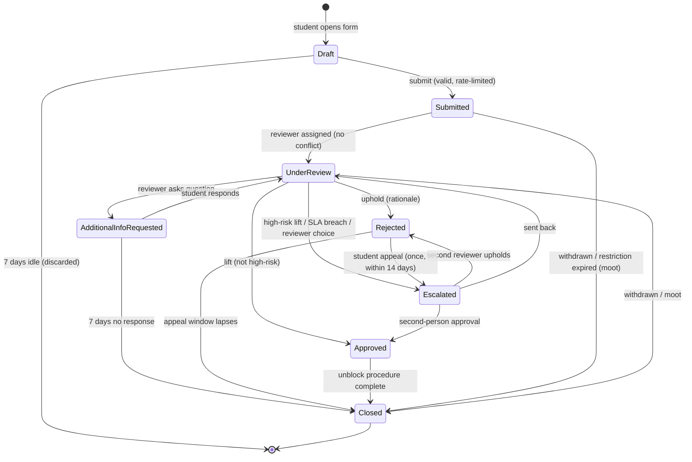

# Account Unblock Workflow — Tech Drona LMS

| | |
|---|---|
| Owner | Security & Account Monitoring Specialist |
| Contract | `docs/blueprint-brief.md` v0.2; `docs/contract-reconciliation.md` |
| Depends on | `docs/account-security-and-risk-engine.md` (levels L1–L4, HC rules, T-protect, enforcement points) |
| Status | Every item in this document is **Planned** |
| Change requests for other owners | `docs/consistency-pass-requests.md` |

## Changelog

### v0.3 — 2026-11-03 (Security Specialist, review pass)

- **Pending second-person approvals** are stored in `approval_requests` (`action_type = security.case.decision`); `case_decisions` is written only when a decision is final (§5.1; AMB-13).
- **Rejection vs auto-expiry** clarified: a rejection refuses an early lift only; an L3 still auto-expires at `ends_at` after re-verification (§4.3; AMB-16).
- **False-positive compensation** rule fixed: which entitlements are extended and by how much (§6 step 8; AMB-14, pending PO-10).
- **CAPTCHA removed** from the unblock form (WCAG 2.2 SC 3.3.8); rate limits only (§3, §8; AMB-19).
- L2 copy no longer offers email OTP; new copy for the single-session replay response and for bulk false-positive lifts (§1.6a, §1.6b).
- Engine-applied L3s can be lifted in bulk after a rule malfunction (§6.2; deployment I-02). `users.account_status` reference replaced by `users.restriction_level` (§6).
- Report references renumbered to the verbatim Section H list (H1–H12).

### v0.2 — 2026-11-03

Reconciliation follow-ups F-UNB-1, F-UNB-2 applied.

Principle: the remedy comes before the penalty, every decision carries a reason, and a human reviews every restriction that a student contests. Two research findings shape the design. Spotify, Disney+ and Netflix each pair enforcement with a legitimate path back (RPA §3 [Verified]/[Reported]). LeetCode publishes a penalty ladder but explicitly omits an appeal step, so Tech Drona adds one (RPA §5 [Rec]). DPDP s.13 and Rule 14 require a grievance mechanism with a response cap of 90 days ([Verified]); we target days, not months.

---

## 1. Student-facing messages (exact copy)

Copy rules: plain English (Hindi and Telugu translations planned), no accusation, every message states what happened, why, what still works, and what to do next. Every message also carries the case reference. `{…}` marks a template variable. Explanation strings come from the rule's `explanation_key`, never from raw signal data.

### 1.1 L1 notice: banner and email

> **New activity on your account**
> We noticed your account being used on {n} devices recently, including {device_label_1} and {device_label_2}. If these are all yours, you don't need to do anything. If you don't recognise one, sign it out and change your password.
> [Review my devices]  [This wasn't me]

### 1.2 L2 verify: interstitial on an unverified device

> **Confirm it's you**
> To keep your account and your test results yours, we need to confirm this device belongs to you. We'll send a 6-digit code by SMS to your registered phone ending ••{last2}.
> Until then, videos and tests are paused on this device. Other devices that don't need confirming keep working.
> [Send code]  [Use authenticator app or passkey instead]
> *Why am I seeing this?* {explanation, e.g. "Your account was active on two devices in different locations at the same time on {date}."}

### 1.3 L3 temporary restriction: full-screen state

> **Learning access paused until {ends_at_local}**
> Case reference: **{case_ref}**
> Our account-protection system paused video lessons, tests and practice on your account for {duration}. Here's why:
> • {explanation_1}
> • {explanation_2}
> Our Terms allow one person per account, with up to {max_sessions} signed-in devices and {max_streams} video at a time ([Device policy]).
> **What still works:** your dashboard and progress, your devices page, billing, support and your privacy requests. Nothing has been deleted. Your subscription, progress and certificates are safe.
> **What happens next:** when the pause ends, you'll confirm your identity with a code and review your devices, and then access returns automatically.
> **Think this is a mistake?** Ask for a review now. A person, not a computer, will look at it, usually within 24 hours.
> [Request a review]  [Review my devices]  [Read the device policy]

### 1.4 L4 suspension

> **Your account is suspended pending review**
> Case reference: **{case_ref}**
> After reviewing activity on your account, our security team has suspended access while the case is open. Reason: {reviewer_summary_for_student}.
> You can still sign in to see this page, ask for a review, contact support, manage billing (including cancelling renewals), and make privacy requests. Your data and purchases have not been deleted.
> **To ask for a review**, tell us what happened. We'll reply within {sla_first_response_hours} hours and decide within {sla_decision_days} days.
> [Request a review]  [Contact support]

### 1.5 T-protect: protective lock (account takeover)

> **We've secured your account**
> We noticed sign-in activity that may not have been you, so we've signed out all devices to protect your account. Reference: **{case_ref_or_event_ref}**
> To continue, verify with a code sent to {masked contact} and choose a new password.
> [Secure my account]
> If you can't access your registered phone or email, [get help recovering your account].

### 1.6 Signed-out device (revoked by security)

> **You were signed out on this device**
> This happened because {reason_text}. If this wasn't you, [secure your account].

### 1.6a Session replay notice (TO-04 / TO-08 / TO-10, sent to the owner)

> **We signed out a session that looked unusual**
> On {date_time_local}, a sign-in from {device_label} was used from a different browser, so we signed it out. Your other devices are still signed in. Next time you sign in or change important settings, we'll ask you to confirm it's you.
> [This was me]  [This wasn't me — secure my account]

"This wasn't me" triggers HC-T3 (risk engine §5.6): all sessions are signed out and the §1.5 flow starts.

### 1.6b Bulk false-positive lift

> **We made a mistake — your access is back**
> Case reference: **{case_ref}**
> An error in our account-protection system paused your learning access on {date}. We've removed the pause, and we've added {extension_days} days to your access to make up for it. You don't need to do anything else. Sign in again to continue.
> [Sign in]

### 1.7 Error payload for API clients (problem+json)

```json
{"type": "https://techdrona.in/problems/account-restricted", "title": "Account access paused",
 "status": 403, "code": "account_restricted", "detail": "Learning access is paused until 2026-11-04T10:15:00+05:30.",
 "case_ref": "SEC-2611-7KQ4MZ", "level": 3, "request_id": "..."}
```

Minors never see L1–L3 sharing copy, because the engine does not score them. They see only the cap dialogs and the T-protect message.

---

## 2. Case reference format

| Object | Format | Example | Notes |
|---|---|---|---|
| Security case | `SEC-YYMM-XXXXXX` | `SEC-2611-7KQ4MZ` | 6 characters of Crockford Base32 (excludes I, L, O, U) from a CSPRNG, giving 30 bits. Unique-checked. Not sequential, so it cannot be enumerated |
| Unblock request | `APL-YYMM-XXXXXX` | `APL-2611-3HX9RB` | Always linked to one `SEC-` case |
| Takeover event | `ACC-YYMM-XXXXXX` | | Only when no case is opened |

A reference is **not an authenticator**. Looking a case up always requires the authenticated owner, or staff with scope. Support verifies a caller with OTP to the registered contact, never with the reference alone.

---

## 3. Unblock request form

**Entry points:** the [Request a review] button on L3 or L4 screens, the status-only portal, and the support widget (which deep-links to the form). The form is available only to the authenticated account holder in `restricted` or `status_only` scope. A **guardian-assisted** variant exists for minors, but it applies only to deterministic or takeover issues.

| Field | Type | Required | Validation |
|---|---|---|---|
| Case | Prefilled `case_ref` (read-only) | ✓ | Must be the user's own open case. One open request per case (🔒) |
| What happened? | Multi-select: "All devices are mine", "A family member used my account", "I shared my login with a friend", "My account may have been hacked", "I was travelling / using VPN", "Other" | ✓ | ≥1 option |
| Your explanation | Textarea | ✓ | 30–2,000 characters. Plain text only. Stripped of HTML and CR/LF-normalised. Rejected if it matches password- or OTP-like patterns (e.g. a 6-digit code next to the word "OTP" or "code", or "password:") with the inline hint "Please don't include passwords or codes" |
| Devices you recognise | Checklist of the account's devices (label, last used, approximate state) | ✓ | ≥1 must be selected or "None of these" |
| Devices you don't recognise | Derived from the unselected rows | — | Revoked automatically on submit (no confirmation needed; the user can re-add them later) |
| Supporting document | File upload | Optional | Max 2 files, each ≤5 MB, PDF/PNG/JPG only. AV scanned. EXIF stripped. Stored in private S3 with SSE-KMS. **Never ask for Aadhaar or PAN.** The hint text says: "Do not upload ID documents unless we ask; if asked, mask all but last 4 digits" |
| Preferred contact | Radio: in-app / email / SMS | ✓ | Only verified channels can be chosen |
| Declaration | Checkbox: "The information I've given is true. I understand one account is for one person." | ✓ | |
| ~~Password / OTP / card~~ | **Not collected.** The form never asks for passwords, OTPs, recovery codes or payment details | — | A server-side DLP check on the textarea masks any match before storage |

**Rate limits:**
- 1 open request per case;
- 3 submissions per 30 days per user;
- 5 form loads per minute;
- an Idempotency-Key is required on submit.

There is **no CAPTCHA** on the unblock form (AMB-19): the form is reachable only from an authenticated restricted or status-only session, and the limits above bound abuse. This keeps the flow compliant with WCAG 2.2 SC 3.3.8 (accessible authentication).

Submitting triggers:
1. revoke the unrecognised devices;
2. an immediate automatic acknowledgement with the `APL-` reference;
3. the state changes to `Submitted`, then to `Under review` when a reviewer is assigned.

---

## 4. State machine

### 4.1 States

| State | Machine code (`unblock_requests.state`) | Meaning | Who sees it |
|---|---|---|---|
| Draft | `draft` | The form was started but not submitted (autosaved for 7 days) | Student |
| Submitted | `submitted` | Received and acknowledged; waiting for assignment | Student, reviewers |
| Under review | `under_review` | Assigned to a `security_reviewer` | Both |
| Additional info requested | `info_requested` | The reviewer asked for specific information; the SLA clock pauses | Both |
| Escalated | `escalated` | Waiting for a senior or second reviewer: a second-person approval, a conflict of interest, a takeover with changed contact details, or a student's second-level appeal | Both (student sees "With senior reviewer") |
| Approved | `approved` | Decision to lift or reduce; the unblock procedure (§6) runs | Both |
| Rejected | `rejected` | Decision to uphold the restriction, with a reason | Both |
| Closed | `closed` | Terminal: after the procedure completes, after a rejection's appeal window lapses, on withdrawal, on no response, or when the restriction expired naturally | Both |

`closure_reason` values (set when `state = closed`): `completed` (unblock procedure finished), `rejected_final` (rejection stands: appeal window lapsed or appeal decided), `withdrawn` (student withdrew), `no_response` (no reply to an information request within 7 days), `moot` (restriction expired naturally). The eight states follow brief v0.2 §1; `escalated` is pending product-owner confirmation (PO-01).

### 4.2 Transitions

| From → To | Actor | Trigger / guard | Notifications |
|---|---|---|---|
| — → Draft | Student | Opens the form | — |
| Draft → Submitted | Student | Valid form; rate limits pass | Student: in-app + chosen channel "We've received your request {APL}". Queue counter |
| Draft → (deleted) | System | 7 days idle | — |
| Submitted → Under review | Reviewer (claim) or auto-assign (round-robin, skipping conflicts) | The reviewer did not apply the restriction, is not the user, and has no org or personal conflict | Student: "A reviewer is looking at your case" |
| Under review → Additional info requested | Reviewer | Must pick a templated question and may add free text | Student: in-app + channel. Reminders at 72 h and 6 days |
| Additional info requested → Under review | Student | Responds (same validation as the form) | Reviewer |
| Additional info requested → Closed | System | No response in 7 days (`closure_reason = no_response`). The student can open a new request (counts toward the 3/30 d limit) | Student |
| Under review → Approved | Reviewer | Not high-risk (§5) | Student: decision + next steps |
| Under review → Escalated | Reviewer or System | High-risk lift (§5), SLA breach of the decision deadline, a takeover with changed contacts, or reviewer choice | Senior pool. Student: "Your case is with a senior reviewer" |
| Escalated → Approved | Second reviewer (`security_reviewer` ≠ first) or `super_admin` | Second-person approval recorded (`case_decisions.approved_by`) | Student |
| Escalated → Rejected | Second reviewer | | Student |
| Escalated → Under review | Second reviewer | Sent back with a note | First reviewer |
| Under review → Rejected | Reviewer | Rationale required (student-visible summary ≥50 characters) | Student: reasons + how to appeal (14 days) + the DPDP grievance route |
| Rejected → Escalated | Student | **One** second-level appeal within 14 days; a different reviewer is required | Senior pool |
| Rejected → Closed | System | 14 days without an appeal, or the appeal is decided (`rejected_final`); or the L3 restriction auto-expired and the student re-verified before then (`moot`) | Student |
| Approved → Closed | System | Unblock procedure finished (§6) | Student: "Access restored" |
| Submitted / Under review / Additional info requested → Closed | Student (withdraw) or System | Withdrawal; **restriction expired naturally** (L3 `ends_at` passed and the student re-verified). Outcome `moot`. The reviewer may still record a false-positive finding for the metrics | Student |

### 4.3 SLAs (business-hours independent; 7-day coverage target)

| Metric | L3 | L4 | Escalated | Takeover recovery cases |
|---|---|---|---|---|
| Automatic acknowledgement | Immediate | Immediate | — | Immediate |
| First human response | 24 h | 48 h | 24 h after escalation | 12 h |
| Decision | 72 h | 120 h (5 days) | 72 h after escalation | 48 h |
| Breach handling | Auto-escalate at 100% of the decision SLA; alert the security lead at 80% | same | Page the on-call security lead | same |
| Hard ceiling | 30 days for every case (well inside the DPDP Rule 14 cap of 90 days [Verified]; the E-Commerce Rules allow 1 month for grievances [Reported]) | | | |

The SLA clock pauses only in `Additional info requested`.

**Rejection and auto-expiry (AMB-16).** A rejection refuses an *early* lift. It does not cancel the L3's fixed `ends_at`: when it passes, the auto-lift (§6, steps 3–7) still applies after re-verification, and the rejected request closes as `moot` (a pending appeal is withdrawn automatically). A rejection does count as a confirmed decision for the repeat modifier (SH-M1). L4 has no `ends_at`, so a rejection keeps L4 in force until a later decision.

### 4.4 Mermaid: state diagram



---

## 5. Second-person approval rules

A lift requires a **second, distinct approver** (`security_reviewer` or `super_admin`, not the decider, not the person who applied the restriction, and not in a conflict) when **any** of these holds. This is enforced by `case_decisions` CHECK `approved_by <> decided_by` and by a service rule.

1. The restriction is **L4** and the case is flagged `is_high_risk`. That flag is set when any of these is true:
   - the reseller pattern was present (SH-09 + SH-11 + SH-06);
   - a confirmed takeover exists where the contact details changed within the 7 days before the restriction;
   - it is a repeat incident (≥2 confirmed L3+ within 180 days);
   - the affected account holds any staff role;
   - the account is linked in the device graph to ≥3 other restricted accounts.
2. The decider **overrides** a `recommend_L4` with a full lift (`lift_false_positive`) while the score is ≥90.
3. The decision grants a **user exception** that loosens a 🔒 or cap setting beyond 2× its default, or lasts more than 90 days.
4. The decision restores an account whose verified contact must be **changed** as part of recovery.
5. The reviewer has had prior contact with the student (support ticket handled, same org, declared relationship). In that case the reviewer must recuse, and a second approver is mandatory even for L3.

Applying L4 itself needs one security_reviewer plus a documented rationale. Applying L4 to a staff account needs two.

### 5.1 How a pending decision is stored (AMB-13)

`case_decisions` is append-only and holds **final** decisions only. A decision that needs a second approver is first stored as a proposal:

1. The first reviewer submits the decision (`SEC-09`). The server computes `requires_second_approval` (rules 1–5 above). If false, a `case_decisions` row is inserted immediately (`approved_by` null).
2. If true, **no `case_decisions` row is written.** Instead an `approval_requests` row is inserted: `action_type = security.case.decision`, `target_type = security_case`, `target_id = case_id`, `payload` = the full decision (outcome, resulting level, rationale, student summary, conditions, extension days, unblock request id), `payload_hash`, `requested_by` = first reviewer, `required_approver_role = security_reviewer`, `status = pending`, `expires_at = created_at + 72 h`. At most one pending `security.case.decision` per case (partial unique index). The unblock request and the case move to `escalated`. The API answers `202` with `approval_request_id`.
3. The second reviewer (≠ requester, ≠ the person who applied the restriction, no conflict) then:
   - **approves** → status `approved` then `executed`; in the same transaction the `case_decisions` row is inserted with `decided_by` = requester, `approved_by` = approver, `approved_at`, `approval_request_id`; the restriction moves to `lift_pending` (or the rejection is applied);
   - **sends back** → status `rejected` with `decision_note`; the unblock request returns to `under_review` with the note; no decision row exists;
   - lets it lapse → after 72 h status `expired`; the case stays `escalated`, an SLA-breach alert fires, and the first reviewer must re-propose.
4. The requester may withdraw a pending proposal (`cancelled`), e.g. after new evidence. The payload can never be edited: a changed decision is a new proposal (the hash is re-verified on execution).

This keeps the CHECKs on `case_decisions` (`approved_by <> decided_by`; `requires_second_approval` ⇒ `approved_by` present) true for every stored row. Schema and API changes: CPR-SCH-05, CPR-API-04.

**Separation of duties.**
- `support_agent` can clear L1 and L2 (send OTP, help with devices) and grant the +1 device replacement. It **cannot** lift L3 or L4 or edit a decision.
- No one can act on a case about their own account, or about a user with whom they share a registered device.

---

## 6. Unblock procedure (after Approved, or when an L3 auto-expires)

```text
1. Decision recorded (case_decisions) → restriction marked "lift_pending" (still enforced).
2. Student sees "Your review was approved — finish these steps to get back in".
3. Re-verification (fresh, cannot reuse earlier codes):
   a. OTP to a verified contact that existed BEFORE the restriction (contacts changed in the
      7 days before restriction are not trusted → manual verification via escalated reviewer).
   b. If enrolled: MFA (passkey/TOTP). If family = takeover or outcome requires: password reset
      (NIST: forced change only on evidence of compromise) with breached-password check.
4. Device review: student re-confirms each trusted device; unconfirmed devices → removed (do not
   consume replacement quota). Lab devices untouched.
5. Revoke ALL sessions (sessions_valid_after = now) including the restricted-scope session used for
   the appeal; remember-device tokens invalidated.
6. Restriction ended: account_restrictions.ended_at/ended_by/end_reason/decision_id; Redis
   restr:{uid} invalidated; users.restriction_level recomputed from remaining active restrictions.
7. Fresh session only after full authentication (new token, new auth_time, aal per method).
8. Entitlement restoration: entitlements were gated, not revoked → access returns immediately.
   If outcome = lift_false_positive and unblock.false_positive_extension = true (PO-10):
   restricted_days = ceil((restriction end − starts_at) in days), counting L3 and any L4 period
   of the same case, from the original start even when an `uphold` was later overturned.
   Every entitlement that was active and time-bound during the restriction gets
   ends_at += restricted_days (subscriptions and time-bound course/test grants).
   Days that cannot be credited are recorded in case_decisions.conditions.uncredited_days and
   handled by support (AMB-14). Entitlement event reason "security_false_positive_credit", audited. Interrupted attempts: trainer notified to consider an
   override (per-user extra time / reopen) — the security module never edits scores.
9. Score handling:
   - lift_false_positive: signals that drove the decision get `suppressed_by_decision_id`; score recomputed
     excluding them; the rule's FP counter increments (dashboard H8).
   - lift_with_warning / lift_conditions: score decays normally; repeat window starts (SH-M1).
   - Optional user exception from conditions (time-bound).
10. Notifications: student (access restored + what to watch for),
    case → Closed.
```

**Auto-expiry of L3** follows steps 3–7 without a case decision. The restriction ends with `end_reason = expired_reverified` and the case closes, unless a reviewer had already converted it to L4. Any open unblock request closes as `moot`.

### 6.2 Bulk false-positive lift

When a rule malfunction restricts many students, reviewers use the bulk lift (risk engine §5.8) instead of case-by-case decisions: selector, dry run, Dual approval; one `case_decisions` row per case (`lift_false_positive`, `approval_request_id` = the bulk request); the restriction ends **without** the re-verification of step 3 (the error was ours, and sessions were already revoked when L3 was applied); steps 8–10 apply; the student gets copy §1.6b. Only engine-applied L3s that are not high-risk can be bulk-lifted.

### 6.1 Mermaid: sequence diagram

```mermaid
sequenceDiagram
    autonumber
    actor S as Student
    participant W as Next.js BFF
    participant API as FastAPI (security module)
    participant R as security_reviewer
    participant R2 as Second approver
    participant N as notifications
    participant E as entitlements
    S->>W: Opens restricted screen, clicks "Request a review"
    W->>API: POST /api/v1/security/unblock-requests (Idempotency-Key, restricted session)
    API->>API: validate, DLP scrub, rate-limit, revoke unrecognised devices
    API->>N: ack APL-ref (in-app + email/SMS)
    API-->>W: 201 {reference, state: Submitted}
    R->>API: claim case (step-up MFA, reason_code=case_review)
    API->>API: state Under review; audit_log
    R->>API: view timeline/evidence (PII reveal audited)
    alt needs more info
        R->>API: request info
        API->>N: notify student
        S->>W: responds
        W->>API: POST .../responses
    end
    alt high-risk lift
        R->>API: decision lift (requires_second_approval)
        API->>API: approval_requests (pending, 72 h); state Escalated; no case_decisions row yet
        R2->>API: approve approval request (≠ R)
        API->>API: insert case_decisions (decided_by=R, approved_by=R2)
    else normal
        R->>API: decision lift
    end
    API->>API: state Approved; restriction lift_pending
    API->>N: "Finish these steps"
    S->>W: re-verify (OTP to pre-existing contact, MFA / password reset)
    W->>API: POST /auth/reverify
    API->>API: device review, revoke all sessions, end restriction
    API->>E: (if false positive) extension credit
    S->>W: full login
    W->>API: POST /auth/login → new session
    API->>N: "Access restored"; case Closed
```

---

## 7. Admin review console

**Who:** `security_reviewer` (platform scope). `super_admin` has read access and can act as second approver. Session tier: 15 min idle / 8 h absolute, mandatory MFA (brief §1), and step-up within 5 min before any decision.

| Panel | Content |
|---|---|
| Queue (dashboard H1/H6) | Filters by level, SLA state, high-risk, repeat, org. Claim/assign. Conflict check on claim |
| Case header | Case ref, level, family, status, SLA timers, restriction (since, ends_at, deferred), recommended level, high-risk flags with the reasons |
| Explanation | The ruleset version, the HC rule (if the restriction came from one) with its qualifying days, the score breakdown by category, and each contributing signal (rule, version, points, decayed points, evidence summary) rendered in plain language, plus the same student-facing explanation |
| Timeline (H12) and concurrency Gantt (H3) | Embedded. IPs shown as /24 or /48; separation class (S0–S3) per overlap; "Reveal full IP" needs a reason and is audited |
| Device–account graph (H2) | 1–2 hops. Linked accounts appear by internal ID until opened (separate audit) |
| Student submission | Form answers, attachments (viewed in a sandboxed viewer, download disabled by default), device recognitions |
| History | Prior cases and decisions, exceptions, OTP outcomes |
| Notes | Internal or student-visible (`case_notes.visibility`). Templates for info requests |
| Decision form | Outcome (enum), rationale (internal), student summary (required, ≥50 characters, previewed exactly as the student sees it), conditions (exception key, value, expiry), extension credit toggle, "requires second approval" (auto-computed, cannot be unticked; when set, submitting creates a pending proposal, §5.1) |
| Pending approvals | Proposals awaiting a second reviewer (`approval_requests`, `security.case.decision`) with expiry countdown; approve or send back |
| Guard rails | Decision disabled until the reviewer has opened the explanation and timeline panels (checked server-side). No bulk decisions. No delete |

---

## 8. Bypass prevention

| Bypass attempt | Control |
|---|---|
| Creating a new account to evade restriction | Verified phone and email are unique per active account; a restricted account's contacts cannot register a new account until the case closes. A device used by a restricted account that logs into a new account within 7 days creates an SH-11-style review signal (adults only) |
| Clearing cookies or using a new browser to escape a restriction | The restriction is bound to `user_id`, never to device, session or IP |
| Changing email or phone while restricted to take over the appeal | Contact changes are **blocked** in `restricted` and `status_only` scope. Recovery uses contacts that pre-date the restriction |
| Social-engineering support | Support cannot lift L3 or L4 and cannot see signal evidence. Callers are verified only by OTP. Scripts prohibit reading out case details |
| Reviewer collusion or insider lift | Conflict checks, second-person approval (§5), immutable `case_decisions`, hash-chained `audit_log`, a monthly sample QA of 10% of lifts by the security lead, and an alert when one reviewer has a lift rate >2σ above the team |
| Replaying or forging the decision API call | The decision endpoint requires the `security.case.decide` permission, step-up MFA within 5 min, CSRF, an Idempotency-Key, and that the case is in a valid state (optimistic version check) |
| Using the restricted session to reach content | `require_active_principal` scope gate (deny by default) plus entitlement gating; a CI test enumerates routes |
| Flooding unblock requests | 1 open per case; 3 per 30 days; 5 form loads per minute; authenticated restricted session required. No CAPTCHA (WCAG 2.2 SC 3.3.8) |
| Abusing appeal to probe detection logic | Student-facing explanations name the behaviour, not the thresholds or weights. Rule parameters are not exposed |
| Lifting a student via policy changes | Policy changes only apply to future evaluations and cannot loosen 🔒 keys |
| Waiting out L3 while sharing continues | Auto-lift requires owner re-verification. Repeat incidents within 180 days escalate (×1.25, 72 h, L4 recommend) |

---

## 9. Audit

Every event below writes an `audit_log` row: append-only, hash-chained, actor, `reason_code`, request_id, before/after for state changes.
- request created, viewed, state-changed;
- note added;
- attachment viewed or downloaded;
- PII revealed;
- decision proposed, approved, sent back, expired or withdrawn (`approval_requests`);
- bulk lift requested, approved and executed (with the selector and count);
- restriction applied, deferred, lifted or expired;
- exception granted;
- sessions revoked;
- devices removed;
- extension credited;
- SLA breach;
- export.

| Retention | |
|---|---|
| `unblock_requests`, `security_cases`, `case_notes`, `case_decisions` | 1 year after case closure (3 years if disputed or legal hold). See the privacy doc |
| Attachments | Deleted 90 days after case closure unless on legal hold |
| `audit_log` | See the privacy doc D17 (3 years for security-administration actions; 8 years where the action is financial) |

---

## 10. Contract change proposals (from this document)

Reconciled in `contract-reconciliation.md` §2.3.

| # | Proposal | Reconciliation outcome |
|---|---|---|
| CCP-U1 | Add `Escalated` to the canonical unblock states (the source requirement's verbatim list has seven states and does not include it) and the student-visible label "With senior reviewer" | → Accepted in brief v0.2 §1 (8 states); product-owner confirmation pending (PO-01) |
| CCP-U2 | `case_decisions` needs `approved_by` and `approved_at` with a DB CHECK `approved_by <> decided_by` (Architect) | → Accepted (schema §5) |
| CCP-U3 | A restricted-scope session (`scope=restricted|status_only`) is a new session attribute. `auth_sessions.scope` is needed | → Accepted in brief v0.2 §1, §5 (schema §4) |
| CCP-U4 | Pending second-approval decisions live in `approval_requests` (`security.case.decision`); add `case_decisions.approval_request_id`; SEC-10/11 address the approval request, not a decision id | Proposed (CPR-SCH-05, CPR-API-04) |
| CCP-U5 | False-positive compensation rule (§6 step 8) replaces "extend the subscription" | Proposed; PO-10 confirmation (CPR-PRD-04) |
