# Tech Drona LMS — Entity-Relationship Diagrams

> **Superseded (2026-11-14):** the LMS runs on Firebase (Vite React SPA + Cloud Functions + Firestore, project `billing-f4fe3`) — see `docs/firebase-migration-plan.md` and `docs/firebase/`. These PostgreSQL ERDs describe the legacy VM database, not the Firestore data model.

> **Single-company note (2026-11-06).** Tech Drona now runs as a single company ([ADR-0015](architecture-decisions/ADR-0015-single-company.md)); the college/B2B features described in this document (college portal and coordinators, institution contracts and seats, invitations and roster import, per-organization settings, trusted networks and lab devices, the "For colleges" page) are removed. Roles are Admin (`super_admin`), Trainer, Evaluator, Content manager and Student; finance, support, security and mentor duties belong to Admin. Batches are Tech Drona cohorts managed by Admin at `/admin/batches`; businesses use the corporate enquiry form at `/enquiries`. Where this document conflicts, ADR-0015 and [`single-company/REMOVAL-PLAN.md`](single-company/REMOVAL-PLAN.md) §8 win.

| Field | Value |
|---|---|
| Owner | System Architect |
| Status | **Partially implemented (v0.5)** — 123 tables migrated (113 contract tables + 10 implementation tables); 9 entities carry `_status "Planned - not yet migrated"` |
| Source of truth | `docs/database-schema.md` (columns, constraints, RLS, retention). Diagrams show keys and the most relevant columns only. |
| Revision | v0.2 (2026-11-03): aligned with Brief v0.2 and the reconciled schema (121 tables); see `docs/contract-reconciliation.md`. v0.3 (2026-11-03): wave-2 consistency pass (contract-reconciliation §7): `auth_sessions.status` adds `pending_session_choice`; `refunds.approval_request_id`; `users.is_synthetic`; `products.product_kind` uses the PRD vocabulary. v0.4 (2026-11-03): security review pass (CPR-ERD-01..04, `contract-reconciliation.md` §9): `session_network_observations` (122 tables); `approval_requests → case_decisions`; HMAC `key_version`; remember token; `idle_hold_until`; `is_minor_at_time` on evaluations; rule status-change columns; enum notes (`remember_device`, `replaced_same_device`, `engine_hc_L3`, `reattach_same_device`) v0.5 (2026-11-03, **Stage 10 schema sync**): diagrams aligned with the Alembic migrations — soft references (no FK yet) drawn dashed, implementation tables added (`coding_test_case_blobs`, `seat_waitlist`, `reconciliation_runs`, `security_user_state`, `security_notices`, `security_counters`, `security_report_exports`, `security_bulk_lifts`, `analytics_job_state`, `analytics_consumed_events`), key added columns shown, Planned entities marked; see §11 and `database-schema.md` §17. |

Legend: `PK` primary key, `FK` foreign key, `UK` unique. All tables are canonical in Brief v0.2 §4 (proposal origins are tagged in `database-schema.md`). Dashed relationships (`..`) are **soft references** (uuid without FK, used for partitioned tables) or polymorphic links.

---

## 0. Cross-domain overview

```mermaid
erDiagram
  users ||--o{ auth_sessions : "signs in via"
  users ||--o{ user_devices : "registers"
  devices ||--o{ user_devices : "trusted per user"
  users ||--o{ account_restrictions : "may have"
  users ||--o{ security_cases : "subject of"
  users ||--o{ org_memberships : "member of"
  organizations ||--o{ org_memberships : "has"
  organizations ||--o{ batches : "runs"
  batches ||--o{ batch_members : "contains"
  users ||--o{ role_grants : "holds"
  roles ||--o{ role_grants : "granted as"
  courses ||--o{ course_versions : "versioned as"
  users ||--o{ enrolments : "enrols"
  courses ||--o{ enrolments : "has"
  entitlements ||..o{ enrolments : "authorises (soft ref)"
  users ||--o{ entitlements : "owns"
  products ||--o{ entitlements : "grants"
  orders ||--o{ order_items : "contains"
  order_items ||--o| entitlements : "fulfils"
  subscriptions ||--o| entitlements : "renews"
  institution_contracts ||--o{ entitlements : "seats"
  topics ||--o{ questions : "classifies"
  questions ||--o{ question_versions : "versioned as"
  tests ||--o{ test_sections : "has"
  users ||--o{ test_attempts : "takes"
  tests ||--o{ test_attempts : "attempted as"
  question_versions ||--o{ attempt_responses : "answered in"
  coding_problems ||--o{ code_submissions : "receives"
  users ||--o{ code_submissions : "submits"
  users ||--o{ analytics_events : "emits"
  users ||--o{ notifications : "receives"
  users ||--o{ support_tickets : "raises"
  users ||--o{ unblock_requests : "submits"
  security_cases ||--o{ unblock_requests : "appealed via"
  users ||--o{ topic_mastery : "mastery"
  users ||--o{ privacy_requests : "exercises rights"
  organizations ||--o{ org_invitations : "invites"
  organizations ||--o{ org_trusted_networks : "registers"
  entitlements ||--o{ entitlement_events : "history"
  users ||--o{ mentor_bookings : "books"
  approval_requests ||..o{ policy_settings : "approves"
```

---

## 1. Identity and sessions

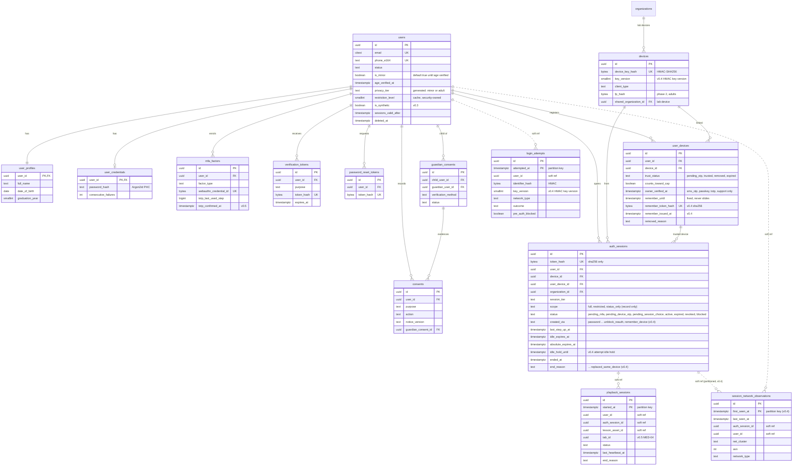

---

## 2. Security

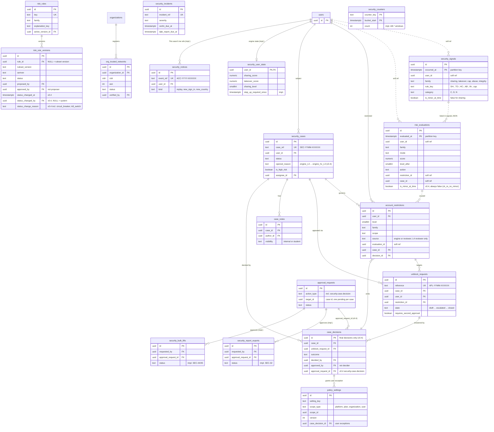

---

## 3. Organizations and RBAC

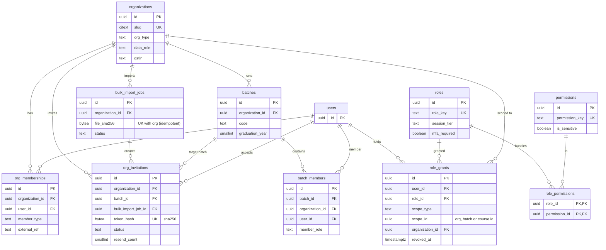

---

## 4. Catalog and learning

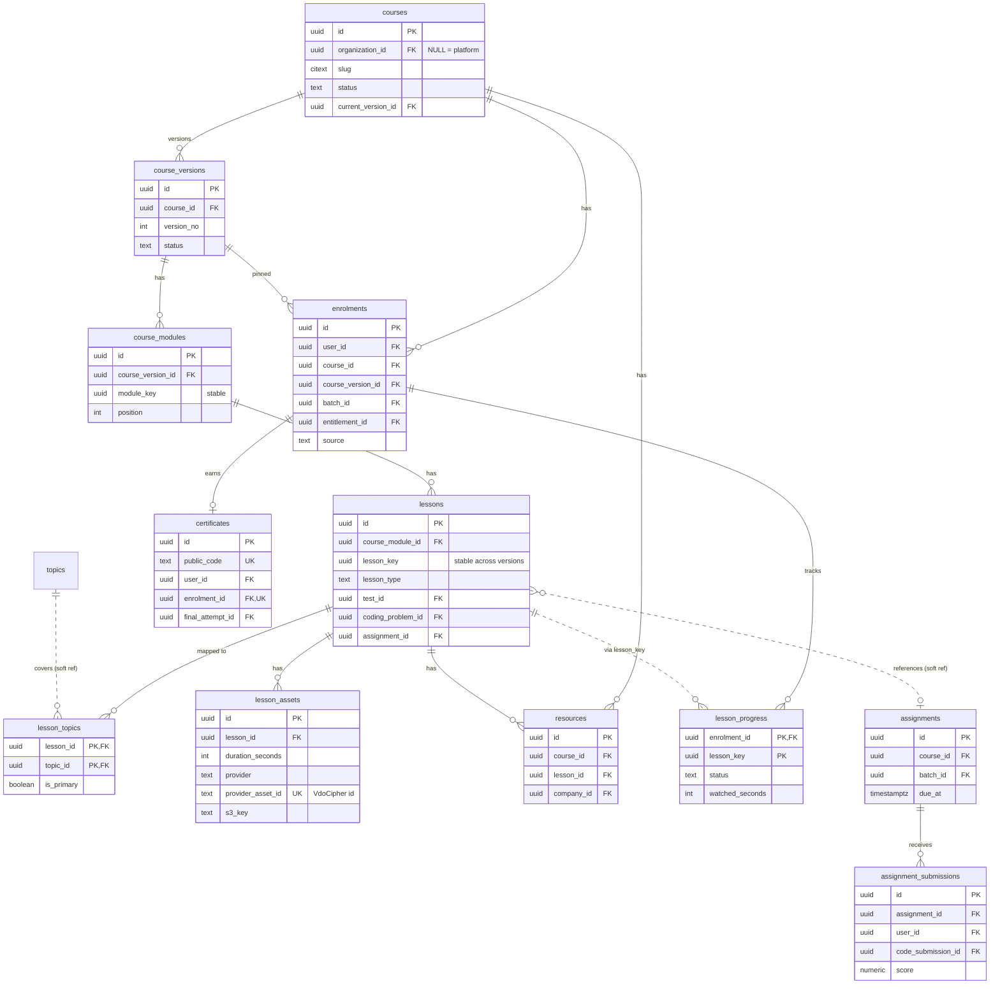

---

## 5. Placement (taxonomy, question bank, practice)

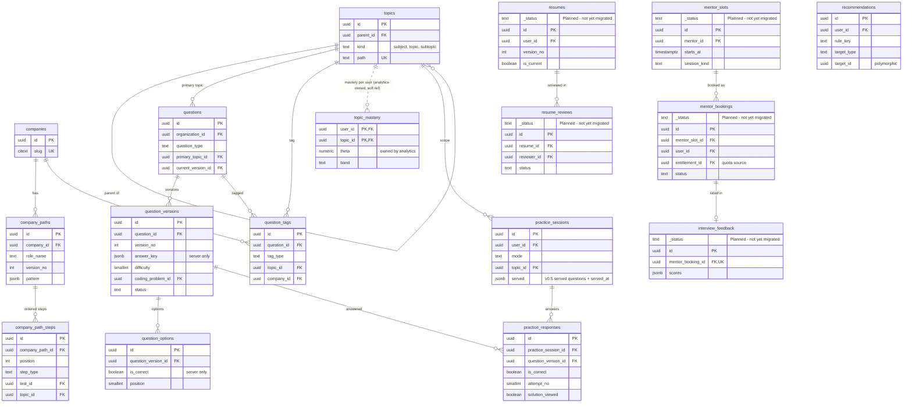

---

## 6. Assessments

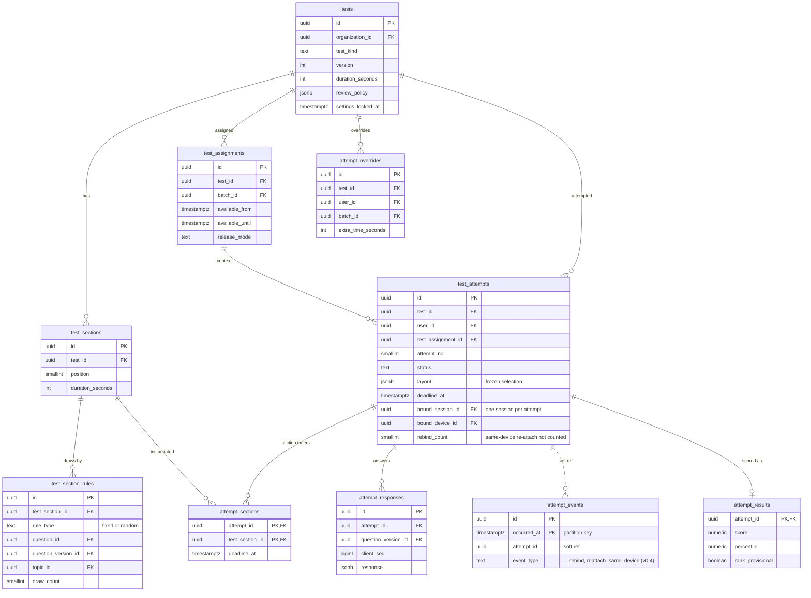

---

## 7. Coding

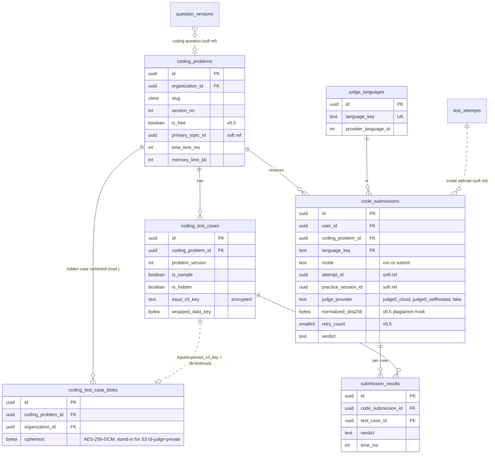

---

## 8. Commerce and entitlements

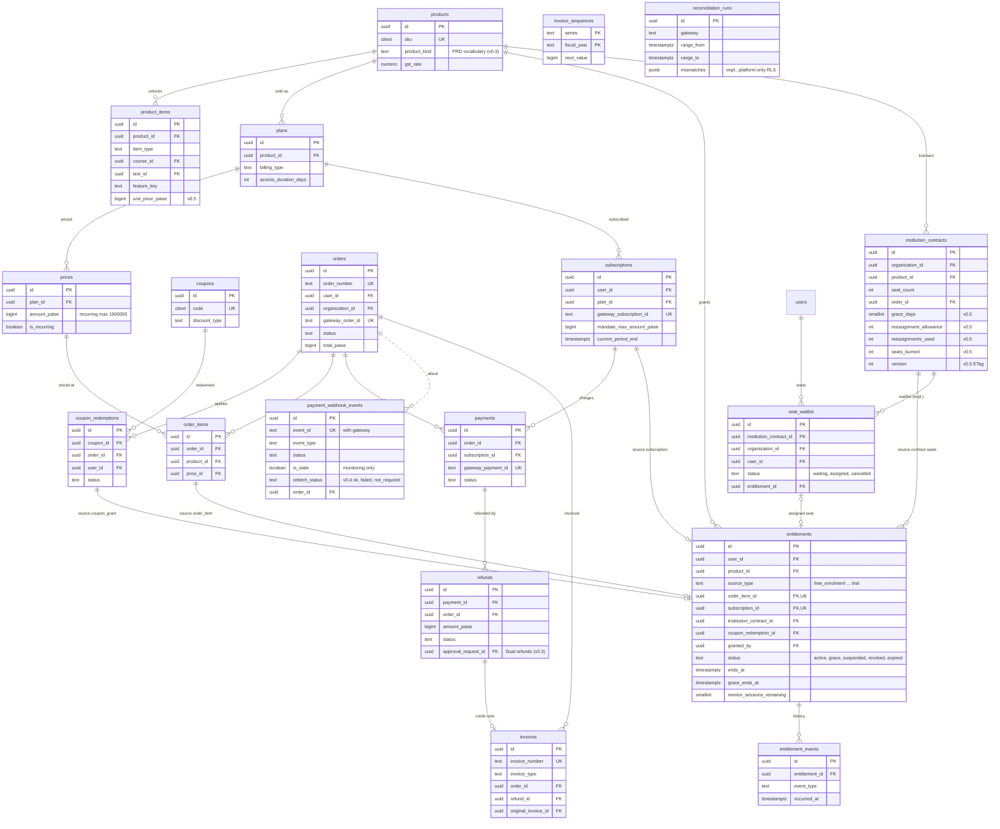

---

## 9. Analytics

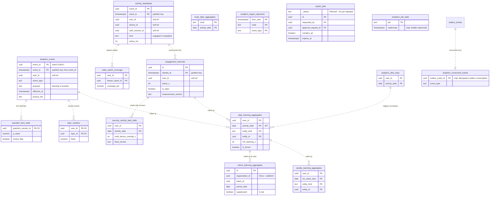

---

## 10. Platform, approvals and privacy

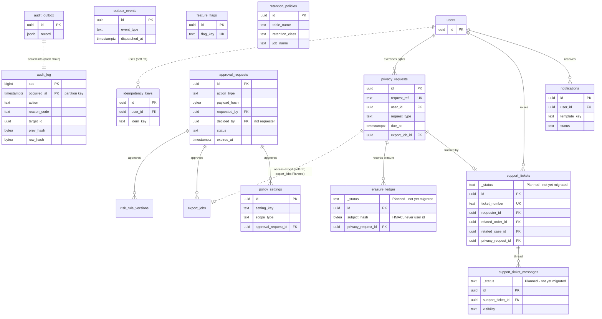

---

## 11. Implementation status and changelog (v0.5, Stage 10 schema sync — 2026-11-03)

The Alembic migrations in `apps/api/migrations/versions/` are the source of truth; `database-schema.md` §17 is the full as-migrated reference (revision inventory, deviation register, soft references, RLS, partitioning).

| Item | As migrated |
|---|---|
| Migrated tables | 123 = 113 of the 122 contract tables + 10 implementation tables |
| Planned — not yet migrated | `mentor_slots`, `mentor_bookings`, `interview_feedback`, `resumes`, `resume_reviews`, `support_tickets`, `support_ticket_messages`, `export_jobs`, `erasure_ledger` (marked `_status "Planned - not yet migrated"` in the diagrams) |
| Implementation tables | §2 `security_user_state`, `security_notices`, `security_counters`, `security_report_exports`, `security_bulk_lifts`; §7 `coding_test_case_blobs`; §8 `seat_waitlist`, `reconciliation_runs`; §9 `analytics_job_state`, `analytics_consumed_events` |
| Soft references drawn dashed in v0.5 | `entitlements → enrolments`, `topics → lesson_topics`, `lessons → assignments`, `topics → topic_mastery`, `test_attempts → code_submissions`, `question_versions → coding_problems`, `privacy_requests → export_jobs`, `users → idempotency_keys`. Also soft but not drawn: `lessons.test_id` / `coding_problem_id`, `resources.company_id`, `courses.primary_topic_id`, `certificates.final_attempt_id`, `assignment_submissions.code_submission_id`, `test_assignments.course_id`, `product_items.course_id` / `test_id` / `company_path_id` / `topic_id`, `entitlements.course_id`, `question_item_stats.question_version_id` |
| FKs added by a later revision | `consents.organization_id` (identity_0002), `company_path_steps.test_id` (placement_0002); drawn solid |
| Partitioned tables | DEFAULT partition only; `pg_partman` monthly partitions Planned |

**Changelog**

- v0.5 (2026-11-03, Stage 10 schema sync): header status changed from Planned to Partially implemented; Planned entities marked; soft references redrawn dashed; implementation tables added to §2, §7, §8 and §9; key added columns shown (`mfa_factors.totp_confirmed_at`, `playback_sessions.tab_id`, `practice_sessions.served`, `coding_problems.is_free`, `code_submissions.judge_provider` incl. `fake`, `normalized_sha256`, `retry_count`, `institution_contracts` grace/reassignment/version, `product_items.unit_price_paise`).
