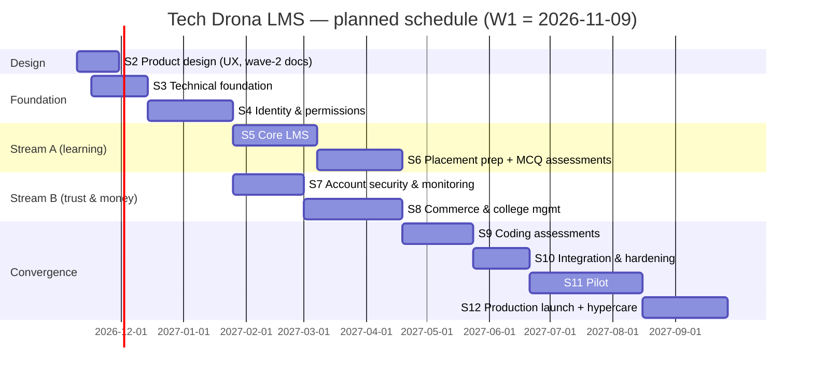

# Tech Drona LMS — Implementation Roadmap

> **Single-company note (2026-11-06).** Tech Drona now runs as a single company ([ADR-0015](architecture-decisions/ADR-0015-single-company.md)); the college/B2B features described in this document (college portal and coordinators, institution contracts and seats, invitations and roster import, per-organization settings, trusted networks and lab devices, the "For colleges" page) are removed. Roles are Admin (`super_admin`), Trainer, Evaluator, Content manager and Student; finance, support, security and mentor duties belong to Admin. Batches are Tech Drona cohorts managed by Admin at `/admin/batches`; businesses use the corporate enquiry form at `/enquiries`. Milestones that deliver college onboarding, contracts, seats or the coordinator portal are cancelled. Where this document conflicts, ADR-0015 and [`single-company/REMOVAL-PLAN.md`](single-company/REMOVAL-PLAN.md) §8 win.

| Field | Value |
|---|---|
| Owner | Integration Lead / Technical Project Manager |
| Date | 2026-11-03 |
| Status | **Planned** (blueprint stage; no application code exists yet) |
| Contract basis | `docs/blueprint-brief.md` **v0.3**, `docs/contract-reconciliation.md` (§7 wave-2 decisions), `docs/integration-pass-requests.md`, `docs/consistency-pass-requests.md`, `docs/source-requirements-excerpt.md` |
| Inputs | `docs/product-requirements.md` (FR/NFR IDs, P0/P1/P2, OPD-01..13), `docs/feature-comparison.md`, `docs/system-architecture.md` (§20 monorepo layout, §4 modules, §22 open risks), `docs/architecture-decisions/ADR-0001..0014`, `docs/account-security-and-risk-engine.md`, `research/reference-platform-analysis.md` §8 (risks, priorities, legal questions) |

**Status rule.** Every stage, deliverable and feature in this document is **Planned**. The status vocabulary (§7) is the only one used to report progress.

**Changelog**

| Version | Date | Author | Change |
|---|---|---|---|
| v0.1 | 2026-11-03 | Integration Lead / TPM | Initial roadmap |
| v0.2 | 2026-11-03 | Integration Lead / TPM (consistency pass) | Applied `integration-pass-requests.md` IPR-ROAD-01..07: `migrations/**` → `apps/api/migrations/**` (01); autosave ≤ 10 s (02); FR-SEC-002 → FR-SEC-002a (P0) / FR-SEC-002b (P1) (03); Stage 2 state updated — wave-2 docs exist, brief v0.3 (04); ownership map adds `docs/integration-pass-requests.md`, `docs/ux-design-system.md`, `permissions.yaml`, GlitchTip under `infra/**` (05); test-infrastructure dependency E16 (06); §12 issues marked (07). Also aligned with brief v0.3 and the security pass: ADR-0014 GlitchTip (no Sentry SaaS), log retention 395 days, `td_maintenance` / `worker-maintenance`, CSRF key on `web` only, kill switch + bulk false-positive lift, Section H reports H1–H12 + ENG |
| v0.2.1 | 2026-11-03 | Security Specialist (final cleanup) | §12 I-3 → Resolved: security and analytics follow-ups verified as applied (`contract-reconciliation.md` §10) |

---

## 1. Planning assumptions

| # | Assumption | Effect if wrong |
|---|---|---|
| A1 | **Team.** One human product owner (PO) who can make the decisions in §11 within 5 working days. Ten agent roles (§3), each run as one or more *lanes*. A lane is an agent instance with exclusive file ownership, supervised by a human reviewer. Capacity is roughly that of a small team of 8–9 FTE: 3 backend lanes, 2 frontend lanes, and one lane each for UX/UI, QA and Integration Lead, with Architect, Security, Analytics, DevOps and Research/Product at about half-time each. | With fewer lanes, streams A and B (§2) run one after the other, which adds about 11 weeks. |
| A2 | **Human review.** Every merge to `main` is reviewed by the CODEOWNER (§3) and passes CI. Agents never merge their own changes to contract files. | The schedule assumes reviews come back within 1 working day. |
| A3 | **Calendar.** Week 1 (W1) starts Monday **2026-11-09**. Estimates are "most likely" elapsed weeks, accurate to ±25 %. One week is lost to the late-December/New-Year break, and it is already counted inside Stage 4. Contingency: 1 week in Stage 10 and 2 weeks of slack inside the pilot. | — |
| A4 | **Scope.** P0 = launch blocker. P1 = within 6 months of launch. P2 = later (PRD scale). The pilot cut (§8) is P0 plus a few pulled-forward items. P1 work not in the pilot goes into a post-launch backlog. | — |
| A5 | **Content.** Tech Drona's content team supplies the course videos, the question bank (at least 1,500 questions across Quant, Logical, Verbal, programming and CS) and coding problems (at least 60). Content production runs **in parallel**. It is not engineering scope. | Without content, the pilot cannot start (blocker E14). |
| A6 | **External lead times** (§10) start in W1. DLT registration, Razorpay KYC and counsel review take weeks and must not be left until Stage 10. | They become pilot blockers. |
| A7 | **No microservices.** One backend image and one web image (ADR-0001, ADR-0010). The judge stays Judge0 Cloud until after launch (ADR-0005 phase 1). | — |

---

## 2. Stage overview

| # | Stage | Weeks | Calendar (planned) | Duration | Stream | State today |
|---|---|---|---|---|---|---|
| 1 | Discovery | — | done 2026-11-03 | 0 (done) | — | Research complete (`research/reference-platform-analysis.md`) |
| 2 | Product design | W1–W3 | 2026-11-09 → 11-27 | 3 wk remaining | — | Blueprint docs done; wave-2 docs exist (API spec, testing, deployment); wave-2 consistency pass done (brief **v0.3**, ADR-0014); **UX design system + wireframes pending**; remaining follow-ups = `docs/integration-pass-requests.md`, `docs/consistency-pass-requests.md` and `contract-reconciliation.md` §6.4–§6.8 |
| 3 | Technical foundation | W2–W5 | 2026-11-16 → 12-11 | 4 wk | — | Planned |
| 4 | Identity & permissions | W6–W11 | 2026-12-14 → 2027-01-22 | 6 wk (5 working + holiday week) | — | Planned |
| 5 | Core LMS | W12–W17 | 2027-01-25 → 03-05 | 6 wk | A (learning) | Planned |
| 6 | Placement prep (incl. timed MCQ assessments) | W18–W23 | 2027-03-08 → 04-16 | 6 wk | A | Planned |
| 7 | Account security & monitoring | W12–W16 | 2027-01-25 → 02-26 | 5 wk | B (trust & money) | Planned |
| 8 | Commerce & college management | W17–W23 | 2027-03-01 → 04-16 | 7 wk | B | Planned |
| 9 | Coding assessments | W24–W28 | 2027-04-19 → 05-21 | 5 wk | A+B merge | Planned |
| 10 | Integration & hardening | W29–W32 | 2027-05-24 → 06-18 | 4 wk (incl. 1 wk contingency) | — | Planned |
| 11 | Pilot | W33–W40 | 2027-06-21 → 08-13 | 8 wk | — | Planned |
| 12 | Production | W41–W46 | 2027-08-16 → 09-24 | 2 wk launch + 4 wk hypercare | — | Planned |

**Critical path.** Stage 2 (UX tokens, API spec) → Stage 3 → Stage 4 → Stream A (5 → 6 → 9) → 10 → 11 → 12, about **46 weeks** to the end of hypercare (**about 40 weeks to production launch**). If the stages ran strictly one after the other, the sum would be about 57 weeks. Running Stream B (Stages 7–8) alongside Stream A saves about 11 weeks.

**Date anchors that affect the plan:**
- **1 Jan 2027:** consumer dark-pattern rules (RPA §8). The commerce UI (Stage 8) must comply from its first release.
- **~13 May 2027:** DPDP substantive duties start, during Stage 9. Privacy features are P0 and are built in Stages 4 and 7, so the pilot runs under DPDP.
- **Aug–Dec 2027:** Indian campus placement season. A late-August launch catches it, but Judge0 Cloud quota at drive peaks becomes a risk right away (§9, R2).

---

## 3. Agent roles and file/directory ownership

### 3.1 The ten agent roles

| Role | Lanes | Primary responsibility |
|---|---|---|
| Research/Product (RP) | 1 | PRD, feature comparison, role matrix, acceptance wording, content seed specs, PO liaison |
| Architect (AR) | 1 | Architecture, ADRs, schema, **sole Alembic migration author**, kernel (`core`), module boundaries |
| Security (SE) | 1 | Security docs, `security` module, `core/authz`, `core/crypto`, security test suite, threat-model upkeep, pen-test liaison |
| UX/UI (UX) | 1 | Design tokens, component library `packages/ui`, wireframes, accessibility patterns |
| Backend (BE) | 3: **BE-1** platform, **BE-2** learning, **BE-3** commerce/coding | Module implementation (see §3.2). BE-1 is Backend Lead and owns `docs/api-specification.md` |
| Frontend (FE) | 2: **FE-1** public + student + BFF, **FE-2** org/staff/admin portals | Next.js route groups, BFF, attempt-sync |
| Analytics (AN) | 1 | `analytics` module, event schemas, client tracker, aggregates, reports read models |
| QA (QA) | 1 | Testing doc, contract/E2E/load suites, acceptance sign-off (moves features to **Tested**) |
| DevOps (DO) | 1 | IaC, CI/CD, Docker, environments, observability, runbooks, `.env.example` (moves features to **Deployed**) |
| Integration Lead (IL) | 1 | Roadmap, brief, reconciliation, CODEOWNERS, status table, contract-change process, generated API client gate |

### 3.2 Ownership map (exclusive write access)

Paths follow `docs/system-architecture.md` §20 and ADR-0009. **Rule: only the owner writes a path.** Anyone else asks for a change through an issue or PR comment, a *change request*, which the owner implements. CODEOWNERS (`.github/CODEOWNERS`, owned by IL) enforces this. Ownership changes only through an IL edit to this table followed by a CODEOWNERS update.

| Path | Owner | Notes |
|---|---|---|
| `apps/api/migrations/**` (Alembic env + `versions/`) | **AR only** | Single linear history (ADR-0009). Module lanes submit *migration requests* (§3.3). No other agent creates revision files. |
| `apps/api/app/core/**` except `core/authz/`, `core/crypto/` | AR | Kernel: config, db + RLS context, ids, money, errors, outbox, idempotency, rate limit, clock, telemetry, `audit.record()` facade, `policy.get()` |
| `apps/api/app/core/authz/**`, `apps/api/app/core/crypto/**` | SE | `require_active_principal`, permission/scope checks, route-tag registry, KMS envelope, versioned HMAC keys. `apps/api/app/core/authz/permissions.yaml` is generated from role matrix §2/§3/§5: SE owns the path, RP approves its content |
| `apps/api/app/main.py`, router registry, `apps/api/pyproject.toml`, `apps/api/uv.lock`, import-linter config, `tools/ownership/**` (table-ownership manifest + checker) | AR | Dependency additions go through a change request |
| `apps/api/app/modules/{identity,sessions,rbac,orgs,admin,audit,notifications,support}/**` | BE-1 | Platform lane |
| `apps/api/app/modules/security/**` | SE | BE-1 reviews |
| `apps/api/app/modules/{catalog,learning,media,placement,assessments}/**` | BE-2 | Learning lane |
| `apps/api/app/modules/{commerce,entitlements,coding}/**` | BE-3 | `coding` (incl. `judge-gateway`) from Stage 9 |
| `apps/api/app/modules/analytics/**`, `packages/event-schemas/**`, `apps/web/lib/analytics/**` | AN | Client tracker SDK, heartbeat emitter, beacon |
| `apps/api/tests/unit/<module>/**`, `apps/api/tests/integration/<module>/**` | Owner of `<module>` | |
| `apps/api/tests/security/**` | SE | Tenant isolation (RLS + API), authz-coverage CI test, Phase-8 scenarios 1–20 |
| `apps/api/tests/conftest.py`, `apps/api/tests/fixtures/**`, `apps/api/tests/contract/**`, `apps/web/e2e/**`, `tests/load/**` | QA | Testcontainers fixtures, OpenAPI contract tests, Playwright, k6/Locust |
| `apps/web/app/(public)/**`, `apps/web/app/(student)/**`, `apps/web/app/api/**` (BFF proxy), `apps/web/middleware.ts`, `apps/web/lib/bff/**`, `apps/web/lib/attempt-sync/**`, `apps/web/app/layout.tsx`, `apps/web/package.json`, root `package.json`, `pnpm-workspace.yaml`, `pnpm-lock.yaml` | FE-1 | Frontend lead |
| `apps/web/app/(org)/**`, `apps/web/app/(staff)/**`, `apps/web/app/(admin)/**` | FE-2 | Coordinator, trainer, mentor, content studio, support, finance, security, super-admin consoles |
| `packages/ui/**` (incl. tokens), `design/**` (wireframes, exported specs) | UX | FE lanes request components. Route-local components may live under the FE lane's own route group |
| `packages/api-client/**` | Generated by CI from FastAPI OpenAPI; **no hand edits**. Generator config owned by IL | CI fails if the generated client is out of date |
| `infra/**` (incl. the self-hosted GlitchTip `errors` service, ADR-0014), `.github/workflows/**`, `apps/*/Dockerfile`, `infra/docker/docker-compose*.yml`, `.env.example`, `docs/deployment-and-operations.md`, `docs/runbooks/**` | DO | |
| `tools/seed/**` (scripts) | BE-1 | Clearly labelled dev/demo data only |
| `tools/seed/data/**` (taxonomy, sample questions, demo courses) | RP | Dev/demo data only. Production content is loaded through the content studio |
| `docs/product-requirements.md`, `docs/feature-comparison.md`, `docs/role-permission-matrix.md`, `research/**` | RP | |
| `docs/system-architecture.md`, `docs/database-schema.md`, `docs/database-erd.md`, `docs/architecture-decisions/**` | AR | |
| `docs/account-security-and-risk-engine.md`, `docs/account-unblock-workflow.md`, `docs/security-threat-model.md`, `docs/privacy-and-data-retention.md` | SE | |
| `docs/analytics-event-schema.md` | AN | |
| `docs/api-specification.md` | BE-1 | IL approves contract changes |
| `docs/testing-and-acceptance-criteria.md` | QA | |
| `docs/ux-design-system.md` (Stage 2) | UX | Brief v0.3 §6 row exists |
| `README.md`, `docs/blueprint-brief.md`, `docs/contract-reconciliation.md`, `docs/integration-pass-requests.md`, `docs/source-requirements-excerpt.md`, `docs/implementation-roadmap.md`, `.github/CODEOWNERS` | IL | |

### 3.3 Shared-resource protocols

- **Migrations (ADR-0009).** A lane edits its own `models.py` and opens a *migration request* (MR) that names the tables and columns, the RLS policy and the backfill plan. AR updates `docs/database-schema.md` and writes the revision. AR merges migrations in **one daily slot (11:00 IST)**, rebasing to keep one head. Expand → migrate → contract applies to every breaking change. Migrations are frozen around scheduled drives and month-end billing.
- **Permissions and seed reference data** (roles, permissions, topics, policy defaults) ship as idempotent data migrations, so AR writes them too. Lanes submit permission keys in their module's `permissions.py`, and AR's migration seeds them.
- **Event schemas.** Producers propose a domain or analytics event. AN adds it to `packages/event-schemas`. Producers then publish through `core.outbox`.
- **Cross-module calls.** Only through `modules.<x>.public`. A lane that needs a new public function files a change request with the owning lane. It does not add one itself.
- **Lockfiles.** Exactly one owner each (AR for Python, FE-1 for pnpm). This prevents merge storms.

---

## 4. Stage details

Each stage lists goals, scope (FR/NFR IDs from the PRD), deliverables, owners, a work breakdown with file ownership, dependencies, exit criteria, duration and risks.

### Stage 1 — Discovery (**done**)

- **Goals:** understand the reference platforms, Indian legal constraints and technical risks.
- **Deliverables (done):** `research/reference-platform-analysis.md`, seven research notes in `research_notes/`, and a copy of the analysis in `reports/` (Issue I-8).
- **Owners:** RP. **Exit:** research accepted by the PO (2026-11-03). **Open carry-over:** the 13 legal questions for counsel (RPA §8) are tracked as external dependency E10.

### Stage 2 — Product design (blueprint and wave-2 docs done; UX remaining)

- **Goals:** finish the contract set so implementation can start without guesswork. Produce the design system and wireframes. Close or default every PO decision needed before Stage 4.
- **Done:** PRD, feature comparison, role matrix, architecture, schema, ERD, 14 ADRs (ADR-0014: self-hosted GlitchTip), security engine, unblock workflow, threat model, privacy and retention, analytics event schema, wave-2 docs (API specification, testing and acceptance criteria, deployment and operations), brief v0.3, reconciliation incl. the wave-2 consistency pass (§7).
- **Remaining scope:** PRD §6 screen inventory (public, student, course player, practice, timed test, coding, the trainer/coordinator/mentor/content/support/finance/security/admin portals), PRD §8 dashboards, NFR-ACC-01/02.

| Work item | Owner | Files | Weeks |
|---|---|---|---|
| Design tokens (colour, type, spacing, dark mode), component inventory, accessibility patterns (WCAG 2.2 AA: focus-not-obscured, 24 px targets, keyboard test runner) | UX | `docs/ux-design-system.md`, `design/tokens/**`, then `packages/ui/tokens` in Stage 3 | W1–W2 |
| Low-fidelity wireframes for every P0 screen in PRD §6; high-fidelity for the 8 critical flows: signup + age gate + consent, new-device OTP, device cap prompt, course player, timed test runner (palette, timer, rebind "Continue here?"), coding workspace, checkout, blocked-login interstitial + unblock request | UX (RP reviews copy) | `design/wireframes/**` | W1–W3 |
| `docs/api-specification.md`: every P0 endpoint with permission + scope + `account_status` tag, problem+json codes, Idempotency-Key usage | BE-1 (SE, AN review) | `docs/api-specification.md` | W1–W3 |
| `docs/testing-and-acceptance-criteria.md`: acceptance tests per FR, the 20 Phase-8 scenarios with the 8 required fields, isolation suite plan, load profiles | QA (SE reviews scenarios) | `docs/testing-and-acceptance-criteria.md` | W1–W3 |
| `docs/deployment-and-operations.md`: environments, IaC plan, CI/CD, backups, DR, incident runbooks (CERT-In 6 h, DPDP 72 h) | DO | `docs/deployment-and-operations.md` | W1–W3 |
| Apply the remaining follow-up edits: `integration-pass-requests.md` (62 IPRs), `consistency-pass-requests.md` (107 CPRs) and `contract-reconciliation.md` §6.4–§6.8 (security 12, analytics 6) | Each target file's owner | their own docs | W1–W2 |
| PO decision sign-off for PO-05, PO-06, PO-07, PO-01, OPD-03, OPD-04, OPD-07 (needed before Stage 4) | IL with PO | `docs/contract-reconciliation.md`, this roadmap §11 | W1–W3 |
| **Contract freeze:** brief v1.0 (no ▲ open items blocking Stage 3–4) | IL | `docs/blueprint-brief.md` | W3 |

- **Dependencies:** none upstream. External: start E1–E12 requests (§10) in W1.
- **Exit criteria:** (1) wireframes for 100 % of P0 screens and high-fidelity designs for the 8 critical flows, accepted by the PO; (2) API spec covers every P0 FR, and a CI-ready OpenAPI skeleton exists; (3) the testing doc maps every P0 FR to at least one acceptance test; (4) all follow-up edits applied (IPR/CPR lists and reconciliation §6.4–§6.8), with no doc citing brief values that conflict with v0.3; (5) brief v1.0 published; (6) PO decisions due "before identity build" recorded.
- **Risks:** UX becomes the bottleneck for both FE lanes. Mitigation: FE builds against low-fidelity designs and `packages/ui` primitives, and the high-fidelity visual pass lands per stage.

### Stage 3 — Technical foundation

- **Goals:** a walking skeleton that runs Browser → Next.js BFF → FastAPI → Postgres (RLS) / Redis → Celery worker, with CI, IaC for `dev` and `staging`, and the kernel services every module depends on.
- **Scope:** NFR-MNT-01, NFR-OBS-01 (baseline), NFR-SEC-03 (isolation harness), NFR-PRV-02, FR-ADM-001 (audit kernel and sealer), FR-ADM-002 (`policy.get` and `policy_settings` read path), FR-ADM-003 feature flags (P1, pulled forward for pilot gating). ADR-0001/0002/0003/0008/0009/0010/0011/0012.

| Work item | Owner | Files |
|---|---|---|
| Monorepo scaffold, pnpm workspace, Next.js app shell, BFF proxy route, CSRF double-submit + Fetch Metadata scaffold | FE-1 | `apps/web/**` (FE-1 paths), root workspace files |
| FastAPI app, kernel (`core`): config, db session + transaction-local RLS context, UUIDv7, money, RFC 9457 errors, outbox + in-process dispatcher, idempotency store, rate limit, clock, OpenTelemetry | AR | `apps/api/app/core/**`, `apps/api/app/main.py` |
| Alembic env, roles `td_owner`/`td_app`/`td_readonly`/`td_audit_sealer`/`td_maintenance` (+ `maint.*` SECURITY DEFINER functions), kernel tables (`outbox_events`, `idempotency_keys`, `audit_outbox`, `audit_log`, `policy_settings`, `feature_flags`), RLS lint rule, `pg_partman` registration | AR | `apps/api/migrations/**` |
| Table-ownership manifest + checker; import-linter contracts | AR | `tools/ownership/**`, `apps/api/pyproject.toml` |
| `core/authz` skeleton: `require_active_principal`, route-tag registry, **CI test that fails if any authenticated route lacks the dependency/tag** (brief §5) | SE | `apps/api/app/core/authz/**`, `apps/api/tests/security/**` |
| Audit sealer + hash chain + S3 Object Lock anchoring; `admin` module (policy settings, feature flags read/write) | BE-1 | `modules/audit/**`, `modules/admin/**` |
| Component library primitives (Radix + Tailwind), tokens | UX | `packages/ui/**` |
| Event schema package scaffold; analytics module skeleton (ingest route stub) | AN | `packages/event-schemas/**`, `modules/analytics/**` |
| Testcontainers fixtures (Postgres 16 + 2 Redis), contract-test harness against OpenAPI, Playwright scaffold | QA | `apps/api/tests/conftest.py`, `tests/fixtures`, `apps/web/e2e/**` |
| docker-compose (postgres16, redis ×2, minio, mailpit), Dockerfiles, GitHub Actions (lint, type-check, tests, import-linter, squawk, OpenAPI client drift, SBOM + dependency scan), Terraform `dev` + `staging` accounts, ECS services `web`, `api`, `api-webhooks`, `worker-*` (incl. `worker-maintenance` with DB role `td_maintenance`), `scheduler`, `audit-sealer`, GlitchTip `errors` (ADR-0014; no Sentry SaaS); `TD_CSRF_KEY` provisioned to `web` only | DO | `infra/**`, `.github/workflows/**`, Dockerfiles, `.env.example` |
| CODEOWNERS from §3.2; status table in §7 wired to PR template | IL | `.github/CODEOWNERS` |

- **Dependencies:** Stage 2 API-spec skeleton (W2), UX tokens (W2). External: E1 AWS accounts (blocker), E2 domain for staging (blocker by W5).
- **Exit criteria:** (1) `docker compose up` gives a working local stack, and a "hello" authenticated-stub request crosses BFF → API → DB with `request_id` in logs and traces; (2) staging deployed by CI with `alembic upgrade` run as a one-off ECS task; (3) RLS isolation harness proves a `td_app` query without tenant context returns zero rows on a sample FORCE-RLS table; (4) the authz-coverage CI test and import-linter contracts are green and enforced; (5) an audit-chain verification job detects a tampered row in a test; (6) the outbox delivers an event to a Celery worker exactly-once-effective (idempotent consumer).
- **Duration:** 4 weeks (W2–W5).
- **Risks:** RLS with pooled connections (arch §22 #4). Avoid RDS Proxy in v1 and prove transaction-local `set_config` in CI. Kernel churn would block every lane, so AR freezes the kernel API at Stage 3 exit and changes it afterwards only through the contract-change process.

### Stage 4 — Identity & permissions

- **Goals:** secure signup and login for all roles, the session/device model with deterministic caps, scoped RBAC, consent, and notifications.
- **Scope:** FR-IDN-001..010, FR-IDN-012 (FR-IDN-011, -013 are P1 and deferred); FR-SES-001..006, -008, -009 (FR-SES-010 P1); FR-RBAC-001..004; FR-ORG-001; FR-PRV-001, FR-PRV-003; FR-NTF-001..003; FR-ADM-004 (approvals); NFR-SEC-01 (ASVS L2 for these areas).

| Work item | Owner | Files |
|---|---|---|
| `identity`: signup, age gate (unverified ⇒ minor), email link + SMS OTP verification, Argon2id (pwdlib) in a threadpool, breached-password check, progressive throttling + hard disable (policy default 50), password reset, MFA (passkey, TOTP; SMS for students only), step-up windows 5/10/15 min, consents with canonical purposes, guardian consent | BE-1 | `modules/identity/**` |
| `sessions`: `__Host-td_session`, `__Host-td_device` (HMAC), session scope (`full`/`restricted`/`status_only`), session tiers and timeouts, engaged-only idle extension, new-device OTP, 3 trusted devices / 2 concurrent sessions / 2 replacements per 30 d, lab devices, kill-all | BE-1 | `modules/sessions/**` |
| `rbac`: roles, permissions, scoped grants, expiry, finance/security exclusivity; `orgs`: organisation create (super_admin) | BE-1 | `modules/rbac/**`, `modules/orgs/**` |
| `notifications`: SES email, SMS adapter (MSG91 or similar) with DLT template IDs, in-app; quotas and spend caps against SMS pumping | BE-1 | `modules/notifications/**` |
| `core/authz` complete: permission + scope checks, `account_status` route allowlist for restricted/status-only scopes (L3/L4 behaviour stubbed until Stage 7) | SE | `core/authz/**`, `tests/security/**` |
| Migrations for identity, sessions, rbac, orgs, notifications tables; permission seed | AR | `apps/api/migrations/**` |
| Screens: signup, login, verify, MFA enrol, forgot password, consent, guardian consent, device cap prompt, devices & sessions (STU-022), profile | FE-1 | `(public)`, `(student)` |
| Screens: super-admin org create, role grants, approvals queue (ADM-010), staff MFA enrol | FE-2 | `(admin)`, `(staff)` |
| Login, session and consent event emission; `consent.changed`, `age_tier.changed` consumers | AN | `modules/analytics/**`, `packages/event-schemas/**` |
| Acceptance + E2E for J1 signup→login, Phase-8 scenarios 1, 2, 4, 18, 19 | QA (+SE for 19) | `apps/web/e2e/**`, `tests/security/**` |
| SES domain verification (DKIM/SPF/DMARC) in staging, Secrets Manager wiring, WAF baseline | DO | `infra/**` |

- **Dependencies:** Stage 3 exit. PO-05, PO-06 decided (or defaults accepted). External: E4 SES (sandbox acceptable), E5 SMS/DLT (email OTP fallback in staging until approved), E10 counsel draft consent wording (placeholder copy allowed, flagged).
- **Exit criteria:** (1) all scoped FRs pass their acceptance tests in staging; (2) Phase-8 scenarios 1, 2, 4, 18 and 19 pass; (3) a session token never appears in browser JS or logs, a revoked session cannot be reused, and session IDs rotate on login and privilege change; (4) every staff role is forced into MFA enrolment; (5) a cross-organisation read by a coordinator is denied at both the API and RLS level (scenario 18 baseline); (6) an internal ASVS L2 checklist for V6/V7 (authentication/session) has no open high findings.
- **Duration:** 6 weeks (5 working weeks plus the holiday week).
- **Risks:** SMS DLT approval can slip, so build email-OTP parity. Passkey UX on low-end Android. Argon2id CPU cost: rate-limit before hashing and load-test login at 50 logins/s.

### Stage 5 — Core LMS (Stream A)

- **Goals:** content authoring, DRM video, enrolment and progress, the central entitlement check, and the analytics foundation.
- **Scope:** FR-CAT-001, -003..-008 (FR-CAT-002, -009 P1; a minimal `lesson_key` is still required); FR-MED-001, -002; FR-SES-007 (1 stream cap at OTP issuance); FR-LRN-001..003 (FR-LRN-004..009 P1); FR-ENT-001..004; FR-ANL-001..003; NFR-PERF-04, -06.

| Work item | Owner | Files |
|---|---|---|
| `catalog` (courses → versions → modules → lessons, workflow states, free preview, resources, search), `media` (VdoCipher upload + OTP/playback tokens), `learning` (enrolment, progress keyed by `lesson_key`, evidence-based completion: coverage + quiz, never time alone) | BE-2 | `modules/catalog/**`, `modules/media/**`, `modules/learning/**` |
| `entitlements`: single `check_access` (p95 ≤ 20 ms, cached, invalidated by events), admin grant source for testing; `entitlement_events` | BE-3 | `modules/entitlements/**` |
| `playback_sessions` and the stream-slot API in `sessions.public` | BE-1 | `modules/sessions/**` |
| Analytics ingest (`/analytics/events`, beacon), heartbeats (visible tab, 15 s), sessionisation into `engagement_intervals`, `daily_learning_aggregates` (IST day), `video_watch_coverage`, retention purge jobs (35 d / 90 d) | AN | `modules/analytics/**`, `apps/web/lib/analytics/**` |
| Migrations incl. partitioned analytics parents | AR | `apps/api/migrations/**` |
| Student catalog, course page, course player, "Continue where you left", "What I have access to" (STU-019) | FE-1 | `(student)`, `(public)` |
| Content manager studio (course authoring, review/publish), trainer preview | FE-2 | `(staff)` |
| Course player components (accessible video controls, captions) | UX | `packages/ui/**` |
| Scenario 15 (inactive tab for hours), scenario 17 partial (time manipulation), entitlement contract tests | QA | e2e, contract |

- **Dependencies:** Stage 4 exit. External: E6 VdoCipher account and API keys (blocker by W12), E14 sample content.
- **Exit criteria:** (1) a content manager publishes a course and a student with an entitlement plays DRM video with a watermark; a second concurrent stream returns `409 playback_conflict`; (2) a student without an entitlement gets `entitlement_required` from the API, the BFF and token issuance; (3) progress survives republishing a course version; (4) a hidden tab produces no engaged time, and forged heartbeats cannot complete a lesson (learning-evidence rule); (5) the entitlement check p95 is ≤ 20 ms in a staging micro-benchmark.
- **Duration:** 6 weeks.
- **Risks:** VdoCipher cannot kill a stream that is already licensed (arch §22 #2), so use a short OTP TTL and confirm the vendor's concurrency options. Analytics write volume: ingest goes through Redis Streams and COPY (arch §19.3).

### Stage 6 — Placement prep, including timed MCQ assessments (Stream A)

- **Goals:** the placement engine (taxonomy, question bank, practice, company paths, diagnostic) and the server-authoritative timed-test engine for MCQ tests.
- **Scope:** FR-PLC-001..005, -007, -013, -014, -017 (P0); FR-PLC-006, -008..-012, -015, -016, -018 (P1, post-pilot except where §8 says otherwise); FR-ASM-001..011, -014 (P0); FR-ASM-012, -013, -015 (P1); FR-SES-011 (attempt binding and rebind); NFR-PERF-02, NFR-SCL-02 (designed for; load-tested in Stage 10). ADR-0013.

| Work item | Owner | Files |
|---|---|---|
| `placement`: topics tree, companies, company paths + steps, versioned questions/options/tags, lifecycle with reviewer ≠ author, practice sessions, question reporting, diagnostic, goal picker | BE-2 | `modules/placement/**` |
| `assessments`: tests/sections/rules, test assignments, overrides, frozen layouts, attempt state machine, server timer + grace + auto-submit, autosave (idempotent by attempt + question + seq), resume after crash, review-visibility matrix, scoring (async), integrity events (advisory), rebind (max 2; OTP at ≥ L2; proctored ⇒ trainer override) | BE-2 | `modules/assessments/**` |
| Attempt-to-session binding hooks in `sessions.public` | BE-1 | `modules/sessions/**` |
| Test runner (palette, server-synced timer, IndexedDB mirror + autosave loop, "Continue here?"), practice UI, diagnostic, company hub, goal picker | FE-1 | `(student)`, `apps/web/lib/attempt-sync/**` |
| Question authoring and review in the content studio; trainer test builder | FE-2 | `(staff)` |
| Test runner accessibility (keyboard-only, focus visible, target size) | UX | `packages/ui/**` |
| `practice.answered`, `attempt.*` consumers; `question_item_stats` (k ≥ 10) | AN | `modules/analytics/**` |
| Migrations incl. partitioned `attempt_events` | AR | `apps/api/migrations/**` |
| Scenario 16 (browser crash during timed test), scenario 17 (multi-tab time manipulation), FR-ASM acceptance, first 500-user autosave soak | QA | e2e, `tests/load/**` |
| Seed taxonomy + demo questions (dev/demo only) | RP (data), BE-1 (script) | `tools/seed/**` |

- **Dependencies:** Stage 5 (catalog, entitlements). PO-08 rebind policy. E14 question bank.
- **Exit criteria:** (1) a crash mid-test resumes with no lost answers and the deadline unchanged; (2) a second session gets `409 attempt_bound_elsewhere` and a read-only view, and rebinding works within the limits; (3) auto-submit fires ≤ 10 s after deadline + grace; (4) a 500-concurrent-taker soak test in staging holds autosave p95 ≤ 250 ms; (5) an answer key is never present in any client payload before the review phase allows it.
- **Duration:** 6 weeks.
- **Risks:** the shared-deadline submit burst (arch §22 #9): async scoring, critical-queue headroom, pre-scaling. Question-bank quality depends on the content team.

### Stage 7 — Account security & monitoring (Stream B)

- **Goals:** explainable account-sharing and takeover controls, graduated restrictions, the unblock workflow, the security console with the Section H reports, the support desk and privacy rights.
- **Scope:** FR-SES-012; FR-SEC-002a (P0: deterministic L1–L2), FR-SEC-003, -004, -006, -007, -009; FR-SEC-001, FR-SEC-002b (scored L3–L4), -005, -008, -010 (P1: built in **shadow mode** for the pilot, see §8); FR-SUP-001..007 (FR-SUP-008 P1); FR-PRV-002; Section H reports (`source-requirements-excerpt.md`); Phase-8 scenarios 3, 5–13, 20.

| Work item | Owner | Files |
|---|---|---|
| `security`: signals (sharing and takeover families; minors deterministic-only), versioned rules + dual approval + 14-day shadow, risk evaluations, restrictions (L1–L3 automatic behind gates; HC rules behind the `risk.hc.auto_restrict_enabled` switch, default false; **L4 human-only**), kill switch with 24 h ratification, bulk false-positive lift (Dual), versioned HMAC keys, cases, notes, decisions (pending second approvals in `approval_requests`), unblock requests (8 states incl. `escalated`), trusted networks (college NAT), security incidents; `users.restriction_level` cache | SE | `modules/security/**` |
| L3 `restricted` and L4 `status_only` scopes enforced in `require_active_principal`; scenario 13 (direct API access while blocked) | SE | `core/authz/**`, `tests/security/**` |
| `analytics.feeds.get_engaged_buckets` / `get_activity_summary` (adult + `security_monitoring` consent only); `security_activity_feed_daily` | AN | `modules/analytics/**` |
| `support`: tickets, messages, context attachment, SLAs, agent workspace, user lookup, L1/L2 lift, device reset +1 | BE-1 | `modules/support/**` |
| Privacy requests (export ≤ 72 h, erasure with `erasure_ledger`), module `privacy_provider` contract test; retention registry jobs | BE-1 (admin privacy sub-package), each lane implements its own `privacy_provider.py` | `modules/admin/**`, each module |
| Security console (SEC-001 dashboard, case queue, Section H reports H1–H12 + ENG engine health, kill switch SEC-42/43 and bulk false-positive lift SEC-44/45 screens, export with approval), support desk | FE-2 | `(staff)`, `(admin)` |
| Blocked-login interstitial, account-integrity centre, unblock request (STU-026), status-only portal, privacy self-service | FE-1 | `(public)`, `(student)` |
| Migrations for security, support, privacy tables | AR | `apps/api/migrations/**` |
| Phase-8 scenarios 3, 5–13, 20 with the 8 required fields | QA + SE | `tests/security/**`, e2e |

- **Dependencies:** Stage 4 (sessions, authz). Counsel answers to RPA §8 Q2/Q3 (E10) decide whether sharing signals are allowed for 17-year-olds and what consent withdrawal means. Until then PO-03 is the default and minors are deterministic-only.
- **Exit criteria:** (1) all 20 Phase-8 scenarios are specified, and the 11 owned here (3, 5–13, 20) pass; the rest are verified elsewhere (1, 2, 4, 18, 19 in Stage 4; 15 in Stage 5; 16, 17 in Stage 6; 14 in Stage 8), and all 20 are re-run together in Stage 10; (2) two students on the same college Wi-Fi (scenario 3) and a VPN user (scenario 8) are **not** restricted; (3) every restriction shows a plain-language reason and an appeal path; (4) an L4 lift on a high-risk case requires a second reviewer; (5) Section H reports are permission-checked, audited and exportable only with approval; (6) a minor account never produces a sharing-family signal or evaluation.
- **Duration:** 5 weeks.
- **Risks:** false positives from CGNAT and college NAT, so network evidence is capped below L2 and the engine stays in shadow for the pilot. Legal uncertainty about monitoring minors. The SE lane both writes code and owns the threat model: a reviewer from BE-1 is mandatory.

### Stage 8 — Commerce & college management (Stream B)

- **Goals:** D2C purchases and subscriptions with GST invoices, institution contracts with seat pools, and the college coordinator workflow (batches, bulk import, invites, test assignment, reports).
- **Scope:** FR-COM-001..005, -007..-011, -014 (P0); FR-COM-006, -012, -013 (P1; -013 reconciliation pulled forward as a daily report, §8); FR-ENT-005 (P1); FR-ORG-003, -004, -010..-015, -018 (P0); FR-ORG-002, -016, -017 (P1); FR-ANL-004 (coordinator and trainer reports), FR-ANL-005; FR-NTF-004, -005 (P1); NFR-AVL-03 (payment outage isolation). ADR-0006. Phase-8 scenario 14.

| Work item | Owner | Files |
|---|---|---|
| `commerce`: products, plans, prices (paise, GST-inclusive display), coupons, orders → Razorpay orders, webhook HMAC + idempotent processing on `api-webhooks`, subscriptions/UPI AutoPay (≤ ₹15,000), refunds per the OPD-01 rule, gap-free GST invoices per financial year, institution contracts; Cashfree adapter interface (stub) | BE-3 | `modules/commerce/**` |
| Entitlement sources: purchase, subscription (+ `grace`), coupon grant, institution contract seats, false-positive extension (PO-10) | BE-3 | `modules/entitlements/**` |
| `orgs`: batches, members (history), CSV/XLSX bulk import with preview, invitations (single-use), account linking, seat assignment hook, graduation | BE-1 | `modules/orgs/**` |
| Test assignment to batches and drive windows (`test_assignments`) from the coordinator UI | BE-2 | `modules/assessments/**` |
| Coordinator and trainer report read models (k-floors), `cohort_learning_aggregates`, `weekly_learning_aggregates` | AN | `modules/analytics/**` |
| Checkout, order status, invoices, subscription manage/cancel (one-click), refund request | FE-1 | `(student)`, `(public)` pricing |
| Coordinator portal (COL-001..), batch management, bulk import wizard, reports; finance console (FIN-*) | FE-2 | `(org)`, `(staff)` |
| Migrations for commerce, orgs, analytics aggregates | AR | `apps/api/migrations/**` |
| Scenario 14 (duplicate webhook), payment E2E against Razorpay test mode, J2 college onboarding journey | QA | e2e, contract |
| Egress allowlist (Razorpay), CloudFront/ALB/WAF rules for `/api/v1/webhooks/{provider}` (ordered before `/api/*`, targeting `api-webhooks`), business dashboards (orders/min, payment success, grant lag) | DO | `infra/**` |

- **Dependencies:** Stage 4, Stage 5 (entitlements). External: E7 Razorpay test keys (blocker W17), E8 GSTIN + CA invoice-format sign-off (blocker for invoice acceptance), counsel Q6/Q10/Q13 (dark patterns, refund enforceability, RBI e-mandate). PO: OPD-01, OPD-02, OPD-05, OPD-06, PO-10.
- **Exit criteria:** (1) a replayed webhook delivered 5× grants exactly one entitlement (scenario 14); (2) a paid order → entitlement → access takes ≤ 60 s p95 in staging; (3) invoices are sequential with no gaps under concurrent orders; (4) a coordinator imports 500 students, invites them, and they accept and consume seats; the coordinator sees only their own organisation; (5) cancel takes ≤ 2 clicks and the pricing UI passes a dark-pattern checklist reviewed by counsel; (6) a payment-provider outage does not affect login or learning (NFR-AVL-03).
- **Duration:** 7 weeks.
- **Risks:** UPI AutoPay webhook delays of 24–36 h, handled with a 3-day grace period and reconciliation polling. Razorpay subscription feature enablement lead time. GST rules unverified (counsel Q8).

### Stage 9 — Coding assessments (Streams A + B converge)

- **Goals:** coding practice and coding questions inside tests through `judge-gateway` → Judge0 Cloud, with hidden tests protected.
- **Scope:** FR-COD-001..007, -010 (P0); FR-COD-008 (P1, similarity, planned for the pilot as a post-close batch, see §8); FR-COD-009 (P2); NFR-PERF-05, NFR-SCL-03, NFR-SEC-04. ADR-0005.

| Work item | Owner | Files |
|---|---|---|
| `coding`: problems, test cases (hidden: KMS-encrypted or private S3), languages (C, C++17, Java 17, Python 3.11 per OPD-07), submissions/results, `judge-gateway` (Judge0 Cloud adapter, token bucket, per-user queue, outage queueing), run vs submit, rate limits | BE-3 | `modules/coding/**` |
| Coding questions inside tests (assessment-side integration via `coding.public`) | BE-2 | `modules/assessments/**` |
| Monaco workspace (≥ 768 px), language switcher, custom input, verdict display, queued state | FE-1 | `(student)` |
| Problem authoring + hidden-test upload in the content studio | FE-2 | `(staff)` |
| `submission.judged` analytics | AN | `modules/analytics/**` |
| Migrations for coding tables | AR | `apps/api/migrations/**` |
| Judge load test against the Judge0 Cloud quota; hidden-test leak tests (API, logs, error messages) | QA + SE | `tests/load/**`, `tests/security/**` |
| `worker-judge` service, egress allowlist to Judge0, judge queue alerts | DO | `infra/**` |

- **Dependencies:** Stage 6 (assessment engine), Stage 8 complete (frees BE-3). External: E9 Judge0 Cloud subscription and written quota/overage terms (blocker W24).
- **Exit criteria:** (1) Run p95 ≤ 6 s and Submit p95 ≤ 15 s at the expected pilot load; (2) hidden test inputs and outputs never reach the browser, logs or error bodies; (3) a judge outage queues Submit, leaves MCQ tests unaffected and shows a status banner within 5 min; (4) per-user rate limits hold (Run 10/min, Submit 5/min).
- **Duration:** 5 weeks.
- **Risks:** Judge0 Cloud quota against drive peaks (~60k/day) and hidden tests leaving our boundary (arch §22 #1). See §9 R2.

### Stage 10 — Integration & hardening

- **Goals:** prove the NFRs, close security findings, rehearse operations, and freeze for the pilot.
- **Scope:** all NFRs (PERF-01..06, AVL-01..03, SCL-01..04, ACC-01/02, SEC-01..04, PRV-01/02, OBS-01..03, I18N-01, MNT-01); FR-ADM-005 (break-glass, P1, pulled forward because it is needed for production operations).

| Work item | Owner |
|---|---|
| Load tests: 2,000 concurrent takers in a 5-min start window, 20,000 autosaves/min, 3,000 concurrent sessions, deadline submit burst | QA (DO supports) |
| External penetration test (ASVS L2; L3 for finance, security, super-admin consoles); fix all critical/high | SE (liaison) → owning lanes fix |
| Tenant-isolation suite (RLS + API) across all 121 tables; authz-coverage test; Phase-8 full regression | SE, QA |
| WCAG 2.2 AA audit (test runner, code editor, checkout) with assistive tech; fixes | UX → FE lanes |
| Production AWS account, Multi-AZ RDS + replica, PITR, backup restore drill (RTO ≤ 4 h) + erasure-ledger re-apply, CERT-In 6 h / DPDP 72 h incident tabletop, NTP sync, security and operational log retention **395 days** in India, self-hosted GlitchTip (ADR-0014), kill-switch and bulk-lift runbooks rehearsed (ops RB-05a/05b) | DO, SE |
| Contract audit: OpenAPI vs spec, event schemas vs consumers, status table update | IL |
| Pilot runbooks, support macros, staff training material | RP, BE-1 |

- **Dependencies:** Stages 4–9 at **Implemented**. External: E1 production account, E2 production domain + TLS, E4 SES production access, E5 DLT templates approved, E12 pen-test vendor booked (book in Stage 7).
- **Exit criteria:** (1) zero open critical/high findings; (2) all P0 NFR targets met in staging at pilot load × 2; (3) restore drill passed and timed; (4) incident tabletop completed with named on-call; (5) every MVP feature (§8) is **Tested**; (6) go/no-go signed by PO, IL, SE, QA, DO.
- **Duration:** 4 weeks, including 1 contingency week.
- **Risks:** pen-test findings that need architectural change. Mitigation: SE runs internal ASVS reviews at every stage exit.

### Stage 11 — Pilot

- **Goals:** validate learning value, trust controls and operations with real users before public launch.
- **Default pilot composition (RD-01):** **2 partner colleges** (≤ 600 students, institution contracts, at least one batch of final-year students) plus an **invite-only D2C cohort of ≤ 300 adults** with live Razorpay payments (most on 100 % coupons, at least 50 paid). Minors may appear through college rosters. Unverified age means minor treatment, so they get deterministic controls only. D2C is adults only (OPD-04). **One scheduled mock drive** with ≥ 300 concurrent takers, including coding.
- **Configuration:** `risk.mode=shadow` for scored rules (L1–L2 deterministic responses enforced). Feature flags gate each module per organisation.

| Work item | Owner |
|---|---|
| Onboarding of colleges (contracts, roster import, coordinator training) | RP, FE-2/BE-1 on-call |
| Daily triage: defects, support tickets, unblock requests, shadow-rule review | IL (chair), QA, SE, BE leads |
| Weekly pilot metrics report: activation, weekly active learners, test completion, crash-resume rate, autosave errors, payment success, support SLA, restriction rate and **false-positive rate**, judge latency | AN, IL |
| Rule tuning: compare the shadow ruleset with appeals; propose an `active` version (dual approval, ≥ 14 days shadow) | SE |
| Fix-forward releases (weekly, outside drive windows) | All lanes, DO |

- **Dependencies:** Stage 10 go. External: E10 counsel sign-off on Terms, privacy notice, consent text and refund policy (**hard blocker**); E13 signed pilot agreements; E14 content loaded; E5 DLT live; E7 Razorpay live keys.
- **Exit criteria (PO approves):** (1) no Sev-1 incident open, and none in the last 14 days; (2) availability ≥ 99.9 % over the pilot; (3) the mock drive meets NFR-PERF-02 and -05; (4) shadow false-positive rate ≤ 2 % of evaluated adults, with **zero** wrongful L3+ restrictions; (5) payment success ≥ 95 % with zero duplicate grants; (6) support P1 SLA met ≥ 90 %; (7) pilot satisfaction survey ≥ 4/5 from coordinators.
- **Duration:** 8 weeks.
- **Risks:** pilot timing overlaps summer vacation (June–July) at many colleges, so choose colleges with active summer training batches. Low usage would make the shadow-rule statistics meaningless.

### Stage 12 — Production

- **Goals:** public launch, then stable operations.
- **Scope:** switch on public signup and pricing pages; enable the scored risk ruleset only if the pilot exit (4) is met (otherwise stay in shadow); post-launch P1 backlog.
- **Deliverables:** launch checklist; status page; public sub-processor list (NFR-PRV-02); grievance officer contact; every MVP feature **Deployed**; 4-week hypercare with daily review.
- **Owners:** DO (release), IL (go-live chair), SE (security on-call), all lanes on rota.
- **Exit criteria:** 4 weeks of hypercare with SLOs met; error budget not exhausted; post-launch backlog prioritised (P1 items in §7); the Phase-2 judge self-host decision taken on pilot and launch volume data (R2).
- **Duration:** 2 weeks launch + 4 weeks hypercare.
- **Risks:** placement-season traffic spikes right after launch. Pre-scale before announced drives (arch §19.3).

---

## 5. Integration cadence

| Cadence | What | Who |
|---|---|---|
| Continuous | Trunk-based development, short-lived branches (≤ 2 days), CI on every PR (unit, integration, import-linter, authz-coverage, ownership manifest, squawk, OpenAPI client drift, dependency scan) | All lanes |
| Daily 11:00 IST | **Migration slot.** AR merges the queued migration requests into one linear head | AR |
| Daily | Staging auto-deploy from `main`; nightly E2E + isolation suite; status digest posted by IL (blocked items, MR queue, change requests older than 1 day) | DO, QA, IL |
| Tue + Fri | **Integration checkpoint** (30 min): cross-lane interfaces (`public.py` changes), event schema changes, upcoming migrations, blocked change requests | IL chairs; lane owners |
| Weekly (Mon) | Contract review: open contract-change proposals (CCPs) triaged; status table (§7) updated; risk register reviewed | IL, AR, SE, BE-1, QA |
| Weekly (Thu) | Demo to PO of features that reached **Implemented**; PO decisions due that week | RP, IL, PO |
| Stage exit | Gate review against the stage exit criteria; QA sign-off; internal ASVS checklist by SE; retrospective | IL chairs; PO approves |

---

## 6. Contract-change process

The contracts are `docs/blueprint-brief.md`, `docs/database-schema.md`, `docs/api-specification.md`, `packages/event-schemas/**` and the role matrix.

1. **Raise.** The proposer adds a row to the "Contract change proposals" section of **their own** document (or PR description during implementation), using ID `CCP-<area>-<n>`. It states the change, the reason, the affected files and owners, and whether the change is *additive* (non-breaking), *breaking*, or *PO-decision*.
2. **Triage (≤ 2 working days).** IL classifies the proposal and names the domain owner who decides (reconciliation rule 1: domain owner wins inside their domain; stricter privacy wins; one writer per table; additive over subtractive).
3. **Decide.** Additive changes: the domain owner approves, and IL records the decision. Breaking changes: domain owner + IL + every affected lane owner approve, with an expand → migrate → contract plan and an OpenAPI deprecation (the old field or route is kept for ≥ 1 release). PO-decision changes: added to §11 with a default and a deadline.
4. **Record.** IL adds the decision to `docs/contract-reconciliation.md`, bumps the brief version (minor for additive, major for breaking) with a changelog entry, and lists follow-up edits per owner.
5. **Apply.** Each owner edits only their own files. AR writes any migration. CI checks (OpenAPI diff, event-schema compatibility, ownership manifest) must pass.
6. **Notify.** IL announces the change at the next integration checkpoint and in the daily digest. Affected tests are updated by their owners before the change is marked **Implemented**.

No lane may ship code that depends on a proposal before step 4.

---

## 7. Status tracking (per feature)

**Vocabulary (brief §7).**
- **Planned:** specified in the blueprint docs.
- **Implemented:** code merged to `main` behind a flag, with unit and integration tests green.
- **Tested:** acceptance tests from `docs/testing-and-acceptance-criteria.md` pass in staging, signed off by QA (and by SE for security features).
- **Deployed:** live in production and enabled for at least one real cohort, confirmed by DO.

Statuses only move forward one step at a time. A regression moves a feature back, with a note. IL maintains this table, and only IL edits it.

| ID | Feature | FR / NFR IDs | Stage | Priority | Pilot (MVP) | Owner lanes | Status |
|---|---|---|---|---|---|---|---|
| F-01 | Kernel: outbox, idempotency, errors, ids, policy, audit facade | NFR-MNT-01, FR-ADM-001/002 (kernel) | 3 | P0 | Yes | AR, BE-1 | Planned |
| F-02 | CI/CD, IaC, environments, observability baseline | NFR-OBS-01..03 | 3 | P0 | Yes | DO | Planned |
| F-03 | Design system, component library, wireframes | NFR-ACC-01/02, PRD §6 | 2–3 | P0 | Yes | UX | Planned |
| F-04 | Signup, age gate, email/SMS verification | FR-IDN-001..003 | 4 | P0 | Yes | BE-1, FE-1 | Planned |
| F-05 | Password policy, login, throttling, reset | FR-IDN-004, -005, -007, -009 | 4 | P0 | Yes | BE-1, FE-1 | Planned |
| F-06 | MFA and step-up | FR-IDN-006, -008 | 4 | P0 | Yes | BE-1, FE-1/2 | Planned |
| F-07 | Profile and account linking | FR-IDN-010, -012 | 4 | P0 | Yes | BE-1, FE-1 | Planned |
| F-08 | Sign in with Google | FR-IDN-011 | post-launch | P1 | No | BE-1, FE-1 | Planned |
| F-09 | Identity confirmation before certified test | FR-IDN-013 | post-launch | P1 | No | BE-1 | Planned |
| F-10 | Sessions, devices, new-device OTP, caps, devices page, kill | FR-SES-001..006, -008, -009 | 4 | P0 | Yes | BE-1, FE-1 | Planned |
| F-11 | Remember this device | FR-SES-010 | post-launch | P1 | No | BE-1 | Planned |
| F-12 | Scoped RBAC + `require_active_principal` | FR-RBAC-001..004 | 3–4 | P0 | Yes | SE, BE-1 | Planned |
| F-13 | Consent notice and guardian consent | FR-PRV-001, -003 | 4 | P0 | Yes | BE-1, FE-1 | Planned |
| F-14 | Notifications (email, SMS, in-app, preferences) | FR-NTF-001..003 | 4 | P0 | Yes | BE-1 | Planned |
| F-15 | Approvals queue (dual control) | FR-ADM-004 | 4 | P0 | Yes | BE-1, FE-2 | Planned |
| F-16 | Organisation creation | FR-ORG-001 | 4 | P0 | Yes | BE-1, FE-2 | Planned |
| F-17 | Catalog, authoring workflow, resources, search | FR-CAT-001, -003..-008 | 5 | P0 | Yes | BE-2, FE-1/2 | Planned |
| F-18 | Course versioning UI, org-private courses | FR-CAT-002, -009 | post-launch | P1 | No (`lesson_key` only) | BE-2 | Planned |
| F-19 | DRM video, watermark, 1-stream cap | FR-MED-001/002, FR-SES-007 | 5 | P0 | Yes | BE-2, BE-1, FE-1 | Planned |
| F-20 | Enrolment and evidence-based progress | FR-LRN-001..003 | 5 | P0 | Yes | BE-2, FE-1 | Planned |
| F-21 | Assignments and grading | FR-LRN-004/005 | post-launch | P1 | No | BE-2 | Planned |
| F-22 | Certificates (issue, revoke, LinkedIn) | FR-LRN-006..008 | post-launch | P1 | No | BE-2 | Planned |
| F-23 | Bookmarks and notes | FR-LRN-009 | post-launch | P1 | No | BE-2 | Planned |
| F-24 | Central entitlement check | FR-ENT-001..004 | 5 | P0 | Yes | BE-3 | Planned |
| F-25 | Analytics ingest, heartbeats, intervals, daily aggregates, purge | FR-ANL-001..003 | 5 | P0 | Yes | AN | Planned |
| F-26 | Reports (student, trainer, coordinator, platform), minors rule | FR-ANL-004/005 | 6–8 | P0 | Yes | AN, FE-1/2 | Planned |
| F-27 | Taxonomy, question bank, lifecycle, question reporting | FR-PLC-001..004, -017 | 6 | P0 | Yes | BE-2, FE-2 | Planned |
| F-28 | Practice, diagnostic, goal picker, company paths | FR-PLC-005, -007, -013, -014 | 6 | P0 | Yes | BE-2, FE-1 | Planned |
| F-29 | Mastery, recommendations, skill analytics, learning path | FR-PLC-006, -011, -012, -016 | post-launch | P1 | No | AN, BE-2 | Planned |
| F-30 | Interview prep, mentoring, résumé | FR-PLC-008..010, -015 | post-launch | P1 (PO-12) | No | BE-2 | Planned |
| F-31 | Bulk question import | FR-PLC-018 | post-launch | P1 | No | BE-2 | Planned |
| F-32 | Timed assessment engine (MCQ) + attempt binding | FR-ASM-001..011, -014, FR-SES-011 | 6 | P0 | Yes | BE-2, BE-1, FE-1 | Planned |
| F-33 | Attempt invalidation, accommodations, leaderboard | FR-ASM-012, -013, -015 | post-launch | P1 | No | BE-2 | Planned |
| F-34 | Security signals, deterministic L1–L2, reasons, minors rule, integrity centre | FR-SES-012, FR-SEC-002a (P0), -003, -006, -007, -009 | 7 | P0 | Yes | SE, FE-1/2 | Planned |
| F-35 | Scored risk L3–L4, human review, false-positive remedy | FR-SEC-001, -002b (P1), -005, -008, -010 | 7 | P1 | Shadow only | SE | Planned |
| F-36 | Unblock workflow (8 states) | FR-SEC-004 | 7 | P0 | Yes | SE, FE-1/2 | Planned |
| F-37 | Security console and Section H reports | Security engine §10, source excerpt §H | 7 | P0 | Yes | SE, AN, FE-2 | Planned |
| F-38 | Support desk | FR-SUP-001..007 (FR-SUP-008 P1) | 7 | P0 | Yes | BE-1, FE-2 | Planned |
| F-39 | Privacy rights (export, erasure, ledger), retention jobs | FR-PRV-002 | 7 | P0 | Yes | BE-1, all lanes | Planned |
| F-40 | Products, checkout, orders, coupons, refunds, GST invoices, no card data | FR-COM-001..004, -007..-009, -014 | 8 | P0 | Yes | BE-3, FE-1 | Planned |
| F-41 | Subscriptions / UPI AutoPay (+ plan change P1) | FR-COM-005 (-006 P1) | 8 | P0 | Yes (no plan change) | BE-3 | Planned |
| F-42 | Institution contracts and seats | FR-COM-010/011, FR-ORG-013 | 8 | P0 | Yes | BE-3, BE-1 | Planned |
| F-43 | Disputes, reconciliation, manual grants | FR-COM-012, -013, FR-ENT-005 | 8 | P1 | Reconciliation report only | BE-3 | Planned |
| F-44 | Batches, bulk import, invites | FR-ORG-003, -004, -010..-012 | 8 | P0 | Yes | BE-1, FE-2 | Planned |
| F-45 | Coordinator test assignment, reports, graduation | FR-ORG-014, -015, -018 | 8 | P0 | Yes | BE-1, BE-2, AN, FE-2 | Planned |
| F-46 | Org settings, shortlists, coordinator grants | FR-ORG-002, -016, -017 | post-launch | P1 | No | BE-1 | Planned |
| F-47 | Placement drives | FR-ORG-019 | P2 | P2 (PO-11) | No | — | Planned |
| F-48 | Coding problems, editor, Run/Submit, judge-gateway, outage handling | FR-COD-001..007, -010 | 9 | P0 | Yes | BE-3, BE-2, FE-1/2 | Planned |
| F-49 | Code similarity check | FR-COD-008 | 9 | P1 | Yes (post-close batch) | BE-3 | Planned |
| F-50 | Keystroke code replay | FR-COD-009 | P2 | P2 | No | — | Planned |
| F-51 | Feature flags | FR-ADM-003 | 3 | P1 (pulled forward) | Yes | BE-1 | Planned |
| F-52 | Break-glass access | FR-ADM-005 | 10 | P1 (pulled forward) | Yes | SE, BE-1 | Planned |
| F-53 | Batch announcements, template versioning | FR-NTF-004/005 | post-launch | P1 | No | BE-1 | Planned |
| F-54 | NFR hardening: performance, scale, availability, accessibility, security testing, privacy ops | NFR-* | 10 | P0 | Yes | QA, DO, SE, UX | Planned |

---

## 8. MVP cut for the pilot

**Included:** every **P0** FR (F-01..F-07, F-10, F-12..F-17, F-19, F-20, F-24..F-28, F-32, F-34, F-36..F-42, F-44, F-45, F-48, F-54), plus these pulled-forward items:

| Pulled forward | Why |
|---|---|
| F-51 Feature flags (FR-ADM-003) | Per-organisation gating and safe rollout during the pilot |
| F-35 Scored risk engine in **shadow mode only** | Rule versions need ≥ 14 days of shadow data before activation (security §5.4). The pilot supplies that data without exposing students to unproven L3 decisions |
| F-49 Similarity check as a post-close batch | The mock drive needs a basic integrity signal. Results are advisory and human-reviewed |
| F-43 Reconciliation, as a daily report only (no automation) | Finance needs payment ↔ settlement checks once live money flows |
| F-52 Break-glass | Production operations need it from day one |

**Deferred to the post-launch P1 backlog (within 6 months of launch):** Google sign-in, remember-device, identity confirmation, course-version UI and org-private courses, assignments and grading, certificates, bookmarks and notes, mastery/recommendations/skill analytics/learning path, interview prep, mentoring and résumé (PO-12 keeps them in P1 but not in the pilot), bulk question import, attempt invalidation, accommodations, leaderboards, org settings and shortlists, disputes automation and manual grants UI, plan change, CSAT, announcements, active scored L3–L4 enforcement.

**Accepted gaps during the pilot:**
- Certificates (FR-LRN-006) are deferred, although research Phase 1 lists them. They are the first P1 item after launch.
- Accommodations (FR-ASM-013) are deferred. Per-user extra-time overrides (FR-ASM-007, P0) cover pilot needs.
- The PO must confirm both (RD-03).

---

## 9. Highest-risk architectural decisions (ranked)

| Rank | Decision (ADR) | Risk | Mitigation | Owner | Checkpoint |
|---|---|---|---|---|---|
| R1 | Tenant isolation through app scoping + Postgres RLS with FORCE (ADR-0003) | Cross-tenant leakage is a DPDP security-safeguard breach (up to ₹250 cr). RLS is bypassed by owners without FORCE, and PK/FK/unique checks bypass RLS. Pooler pinning issues | RLS + FORCE added in the same migration as each table (lint); `td_app` never owns tables; transaction-local `set_config`; no RDS Proxy in v1; isolation suite on every build across all tenant tables; pen-test focus | AR, SE | Stage 3 exit, every stage |
| R2 | Judge0 Cloud in phase 1 behind `judge-gateway` (ADR-0005) | Hidden tests leave our boundary; unknown quota for drive peaks (~60k/day vs the 10k/day tier); vendor outage during a drive; GPL questions if self-hosted later | Written quota and overage terms before Stage 9; token bucket + per-user queues; drive scheduling caps; outage queueing (FR-COD-010); start the phase-2 self-host design during the pilot and decide at Stage 12 on real volume | AR, BE-3, DO | Stage 9, Stage 12 |
| R3 | Server-authoritative timer, frozen layouts, ≤ 10 s autosave (ADR-0013; API I-17) at 2,000 concurrent takers | Lost answers or late auto-submit during drives damages trust; DB write hot-spots | IndexedDB mirror; idempotent autosave; async scoring; pre-scale before drives; soak at 500 in Stage 6 and 2,000 in Stage 10; migration freeze around drives | BE-2, FE-1, QA | Stages 6, 10 |
| R4 | Rule-based risk engine with graduated restrictions (security engine, brief §1) | False positives from CGNAT and college NAT; legal exposure for monitoring minors (s.9(3)); consent-withdrawal semantics | Network evidence capped below L2; trusted college networks; minors deterministic-only; L4 human-only; shadow mode for the pilot; counsel Q2/Q3 before enforcement; false-positive remedy (PO-10) | SE | Stage 7, pilot |
| R5 | Same-origin Next.js BFF with server-side opaque sessions (ADR-0002, ADR-0010) | All traffic goes through Node, which adds latency and a single choke point; CSRF variants (beacon); session-store load | Thin proxy, no business logic; load-test the BFF in Stage 3 and 10; Redis session cache; FE-1 is the sole owner of `middleware.ts` | FE-1, SE | Stage 3 |
| R6 | Raw analytics in partitioned Postgres (ADR-0004) | 45–150 GB/month raw could degrade the primary DB | Short raw retention (35 d / 90 d); Redis Streams + COPY ingest; aggregates on the read replica; ClickHouse evaluation trigger defined in ADR-0004 | AN, AR | Stage 5, pilot metrics |
| R7 | Razorpay-centric payments with entitlement-centric access (ADR-0006) | Duplicate grants, UPI AutoPay delays, RBI e-mandate changes | HMAC + idempotent webhooks on the isolated `api-webhooks`; `grace` status; reconciliation; counsel Q13 | BE-3 | Stage 8 |
| R8 | VdoCipher stream cap at OTP issuance (ADR-0007) | A licensed stream cannot be killed server-side | Short OTP TTL, cooperative stop, vendor confirmation of concurrency features | BE-2 | Stage 5 |
| R9 | Single migration owner (ADR-0009) and single audit sealer (ADR-0011) | Review bottleneck; sealer throughput | Daily migration slot and MR template; lint automation; sealer measured (privileged-action volume is modest) | AR, BE-1 | Stage 3 onwards |
| R10 | Modular monolith boundaries (ADR-0001) | Erosion through cross-module imports and joins slows later extraction | import-linter, ownership manifest, `public.py` only, reporting only through analytics read models | AR | CI, every stage |

**Non-architectural top risks:** the external lead times in §10 (DLT, KYC, counsel); content readiness (E14); PO decision latency.

---

## 10. External dependencies (credentials and business input)

All requests start in **W1**. "Blocks" means the stage cannot pass its exit criteria without the item.

| ID | Dependency | Needed from | First needed | Hard blocker for | Notes |
|---|---|---|---|---|---|
| E1 | **AWS account** (AWS Organizations: dev, staging, prod, security/log-archive; later judge) + billing | PO / company | Stage 3 (W2): dev + staging | Stage 3 (dev/staging); Stage 10 (prod) | ap-south-1 only; enable GuardDuty, CloudTrail, Config |
| E2 | **Domain** + DNS control (production + staging subdomains), ACM TLS | PO / company | Stage 3 (W5) for staging | Stage 3 exit (staging `__Host-` cookies need HTTPS); Stage 10 (prod) | Also used for SES DKIM |
| E3 | GitHub organisation, CI minutes, branch protection | PO / company | Stage 3 (W2) | Stage 3 | CODEOWNERS enforcement |
| E4 | **Amazon SES**: domain verification, then production access (out of sandbox) | DO + company | Stage 4 (sandbox) | Stage 10/11 (production access) | Bounce/complaint handling required |
| E5 | **SMS provider (MSG91 or similar) + TRAI DLT registration**: entity, sender header, transactional OTP templates | Company (legal entity docs) + DO | Stage 4 | **Stage 11 pilot** (staging uses email OTP until approved) | Lead time typically several weeks [unverified]; spend caps |
| E6 | **VdoCipher** account, API keys, plan with DRM + watermark | PO / company | Stage 5 (W12) | Stage 5 exit | Confirm concurrency and licence-duration options (R8) |
| E7 | **Razorpay** account: KYC, test keys, webhook secret; Subscriptions + UPI AutoPay enablement; live keys | Company (KYC docs, bank account) | Stage 8 (W17): test keys | Stage 8 (test keys); **Stage 11** (live keys + AutoPay) | Cashfree fallback account optional, post-launch |
| E8 | **GSTIN**, invoice format and SAC/OIDAR treatment confirmed by a chartered accountant | Company + CA | Stage 8 | Stage 8 exit (invoice acceptance); Stage 11 | Counsel Q8 |
| E9 | **Judge0 Cloud** subscription + written quota/overage terms | PO / company | Stage 9 (W24) | Stage 9 | Hidden-test data processing terms (R2) |
| E10 | **Legal counsel review**: Terms (device/session numbers per PO-02), privacy notice and itemised consent, refund policy (OPD-01), minors (RPA §8 Q1–Q3), DPDP dates (Q5), dark patterns (Q6, Q10), CERT-In logs (Q9), RBI e-mandate (Q13), retention (Q4, Q12); grievance officer named | PO + counsel | Draft consent text by Stage 4; Q2/Q3 by Stage 7 | **Stage 11 pilot** (all customer-facing legal text); Stage 7 enforcement config | Q7 (forums) and Q11 (GPL) are not blocking: forums are out of scope and self-host is phase 2 |
| E11 | Breached-password corpus / HIBP range API access | DO | Stage 4 | — (fallback: offline list) | Egress allowlist |
| E12 | External penetration-test vendor (ASVS L2/L3 scope) | PO / company | Book by Stage 7 | Stage 10 exit | NFR-SEC-02 |
| E13 | Signed pilot agreements with 2 colleges (institution contracts, roster data-sharing terms, DPA/fiduciary roles) | PO / sales | Stage 8 (contract model) | **Stage 11** | OPD-05, OPD-06 |
| E14 | **Content**: courses + videos, ≥ 1,500 questions, ≥ 60 coding problems, company paths | Content team | Stage 5 (samples) | **Stage 11** | Not engineering scope (A5) |
| E15 | CERT-In point of contact, incident-response contacts, on-call rota | PO + SE | Stage 10 | Stage 10 exit | 6 h CERT-In, 72 h DPDP |
| E16 | **Test infrastructure**: Razorpay and Cashfree test accounts, VdoCipher test account, Judge0 test quota, SMS sandbox, a performance environment sized like production, an isolated DR-restore account, a CERT-In-empanelled pen-test vendor | DO / TPM (PO for budget) | Stage 3 | Stage 3 (accounts); Stage 10 (perf env, DR-restore account, pen test) | Resolves QA I-10 |

---

## 11. Product-owner decision log

Defaults are assumed in all blueprint docs until the PO decides. **"Needed by"** is the latest stage at which the decision avoids rework.

### 11.1 From `contract-reconciliation.md` §5

| ID | Decision | Default assumed | Needed by | Status |
|---|---|---|---|---|
| PO-01 | Add `Escalated` ("With senior reviewer") to the unblock status list | Included (8 states) | Stage 2 (API spec freeze) | Open (default) |
| PO-02 | Terms state that each browser profile counts as a device; lab PCs excluded from personal caps | Yes | Before Terms drafting (E10), Stage 4 | Open (default) |
| PO-03 | `security_monitoring` consent required for adult paid plans; withdrawal ⇒ deterministic-only mode | Required; deterministic-only on withdrawal | Stage 7 (with counsel Q3) | Open (default) |
| PO-04 | Default of consent item C (personalisation) | Off, asked at onboarding | Stage 2 (onboarding UX) | Open (default) |
| PO-05 | Privileged roles passkey-only vs passkey or TOTP | Passkey or TOTP, passkey preferred | Stage 4 start | Open (default) |
| PO-06 | MFA mandatory for all staff tiers | Yes | Stage 4 start | Open (default) |
| PO-07 | L4-suspended users get a status-only portal | Yes | Stage 2 (API spec freeze) | Open (default) |
| PO-08 | Rebind policy: max 2, OTP at ≥ L2, proctored ⇒ trainer override | As stated | Stage 6 start | Open (default) |
| PO-09 | Unblock SLAs (L3 24 h / 72 h; L4 48 h / 120 h; 30-day ceiling; 7-day coverage) | As stated | Stage 10 (support staffing) | Open (default) |
| PO-10 | False-positive compensation: extend subscription by restricted days | On | Stage 8 start | Open (default) |
| PO-11 | Placement drives P1 or P2 | P2; tables reserved | Post-launch planning | Open (default) |
| PO-12 | Mentoring and résumé review in P1 with external meeting links | P1, external links; **not in pilot** | Post-launch planning | Open (default) |
| PO-13 | Raw analytics retention events 90 d / heartbeats 35 d | 90 d / 35 d | Stage 5 (with counsel Q4) | Open (default) |

### 11.2 From `product-requirements.md` §11 (OPD)

| ID | Decision | Default assumed | Needed by | Status |
|---|---|---|---|---|
| OPD-01 | Refund threshold and window | 7 days, < 20 % consumed, no certificate, includes discounted purchases | Stage 8 start (with counsel Q10) | Open (default) |
| OPD-02 | Plan lineup and prices | Monthly + annual subscription + 12-month placement package; no multi-year anchors | Stage 8 start | Open (default) |
| OPD-03 | Free diagnostic needs signup | Signup-gated | Stage 2 (wireframes) | Open (default) |
| OPD-04 | Minors via D2C at launch | College-only at launch; D2C minors from P1 after counsel sign-off | Stage 4 start | Open (default) |
| OPD-05 | Seat reassignment thresholds | BR-ENT-16 defaults, overridable per contract | Stage 8 | Open (default) |
| OPD-06 | Default data-sharing scope with colleges | Contract scope only + student opt-in | Stage 8 (with counsel) | Open (default) |
| OPD-07 | Coding languages at launch | 4 (C, C++, Java, Python); JS + Go in P1 | Stage 9 start | Open (default) |
| OPD-08 | Mentor sessions: external links vs integrated video | External links | Post-launch | Open (default) |
| OPD-09 | Leaderboard display-name default | Anonymised by default | Post-launch (leaderboard is P1) | Open (default) |
| OPD-10 | Certificates for free courses | Yes, labelled "free course" | Post-launch (certificates are P1) | Open (default) |
| OPD-11 | Device-replacement quota at peak season | Static 2 per 30 days + support +1 | Stage 7 | Open (default) |
| OPD-12 | Placement drives in v1 or P2 | P2 (same as PO-11) | Post-launch planning | Open (default) |
| OPD-13 | Public outcome-claims format | None at launch | Stage 12 | Open (default) |

### 11.3 New roadmap decisions (raised here)

| ID | Decision | Default assumed | Needed by | Status |
|---|---|---|---|---|
| RD-01 | Pilot composition | 2 colleges (≤ 600) + invite-only D2C adults (≤ 300, ≥ 50 paid) + 1 mock drive | Stage 8 (to sign E13) | Open (default) |
| RD-02 | Team capacity (A1) and target launch window | 8–9 FTE-equivalent; launch ~2027-08-16 for placement season | W1 | Open (default) |
| RD-03 | Accept the pilot without certificates and accommodations (§8) | Accept | Stage 2 | Open (default) |
| RD-04 | Scored risk engine stays in shadow until the pilot false-positive target is met | Yes | Stage 7 | Open (default) |
| RD-05 | Judge phase-2 self-host trigger | Decide at Stage 12 using volume and quota data; start the design during the pilot | Stage 11 | Open (default) |
| RD-06 | Budget approval for vendors (VdoCipher, Judge0, SMS, pen test, AWS) | Approve the indicative costs in RPA §8 (re-verify) | W1 | Open (default) |

---

## 12. Issues

| # | Issue | Proposed resolution | Owner | Status (v0.2) |
|---|---|---|---|---|
| I-1 | The migration directory is named `apps/api/alembic` in the roadmap request, but `apps/api/migrations` in ADR-0009 and architecture §20 | Use **`apps/api/migrations`** (the ADR is authoritative) | IL (confirmed) | **Resolved** — `apps/api/migrations` (ADR-0009; W2-D24); shorthand rows fixed (IPR-ROAD-01) |
| I-2 | The wave-2 documents `docs/api-specification.md`, `docs/testing-and-acceptance-criteria.md` and `docs/deployment-and-operations.md` do not exist yet | Scheduled in Stage 2 (W1–W3); they block Stage 3 exit | BE-1, QA, DO | **Resolved** — the three wave-2 docs exist (IPR-ROAD-04) |
| I-3 | 38 follow-up edits from `contract-reconciliation.md` §6 are not applied; wave-1 docs still cite brief v0.1 in their headers | Apply in Stage 2 (W1–W2); IL verifies before brief v1.0 | RP, AR, SE, AN | **Resolved** — architecture, PRD and role-matrix follow-ups applied (contract-reconciliation §7.3); security (12: F-SEC-1..4, F-UNB-1..2, F-PRIV-1..4, F-THR-1..2) and analytics (6: F-AN-1..6) follow-ups verified as applied, and IPR-SEC-01..06 applied, in the final cleanup (contract-reconciliation §10) |
| I-4 | `contract-reconciliation.md` §3.19 cites **PO-06** for the L4 status-only session, but §5 lists that decision as **PO-07** (PO-06 is staff MFA) | Correct the reference to PO-07 at the next reconciliation edit | IL | **Resolved** — §3.19 corrected to PO-07 (contract-reconciliation §7.2) |
| I-5 | The architecture §4.2 module table is out of date (e.g. `user_topic_mastery`, missing the 26 added tables), so it is not a reliable ownership manifest | F-ARCH-1; the ownership manifest (`tools/ownership/`) must be generated from `database-schema.md`, not from §4.2 | AR | **Resolved** — F-ARCH-1 verified in arch v0.3; manifest generated from the schema |
| I-6 | Brief §6 has no owner row for UX deliverables (`docs/ux-design-system.md`, `design/**`, `packages/ui/**`) or for the code paths in §3.2 of this roadmap | Add the rows at the brief v1.0 bump | IL | **Resolved** — brief v0.3 §6 has the UX row; code paths stay in §3.2 (IPR-ROAD-05) |
| I-7 | PRD FR-SEC-002 mixes P0 and P1 in one requirement, and FR-SES-011 still describes OTP on every move (F-PRD-1) | Split the tracking in §7 (F-34 / F-35); apply F-PRD-1 | RP | **Resolved** — PRD split into FR-SEC-002a (P0) / FR-SEC-002b (P1); §4 and §7 updated (IPR-ROAD-03) |
| I-8 | `reports/Tech Drona LMS reference platforms.md` is a byte-identical copy of `research/reference-platform-analysis.md`, and `research_notes/` holds the raw notes; neither folder is in the brief's deliverable list | Treat `research/` as canonical; mark `reports/` as a copy in the README; consider removing it to avoid drift | RP / PO | **Resolved** — routed to README (IPR-README-01): `research/` canonical, `reports/` marked as a copy |
| I-9 | Research Phase 1 lists verifiable certificates as MVP, but PRD FR-LRN-006 is P1 | Pilot excludes them (RD-03); first post-launch item | PO | **Confirmed, no change** — RD-03 stands |
| I-10 | The durations in this roadmap are not validated against real team capacity, and no team is staffed yet | Re-baseline at the Stage 3 exit using measured velocity | IL | **Accepted as stated** — re-baseline at the Stage 3 exit |
| I-11 | The 10 agent roles come from the master plan, which is not in the repository. Lane splits (BE-1/2/3, FE-1/2) are this roadmap's proposal | PO confirms or adjusts at RD-02 | IL / PO | **Accepted as stated** — PO confirms at RD-02 |
