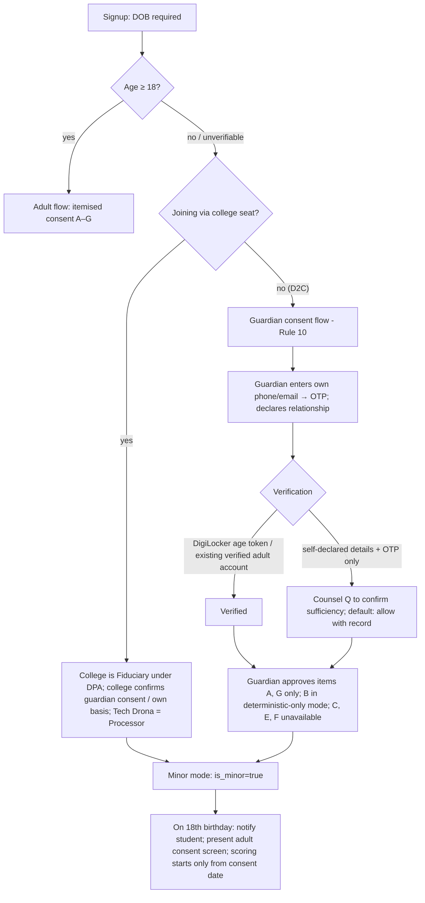

# Privacy & Data Retention — Tech Drona LMS

> **Single-company note (2026-11-06).** Tech Drona now runs as a single company ([ADR-0015](architecture-decisions/ADR-0015-single-company.md)); the college/B2B features described in this document (college portal and coordinators, institution contracts and seats, invitations and roster import, per-organization settings, trusted networks and lab devices, the "For colleges" page) are removed. Roles are Admin (`super_admin`), Trainer, Evaluator, Content manager and Student; finance, support, security and mentor duties belong to Admin. Batches are Tech Drona cohorts managed by Admin at `/admin/batches`; businesses use the corporate enquiry form at `/enquiries`. College data sharing, college DPAs and coordinator visibility are removed. Historic contract invoices are kept as legal records (exported to `backups/archived-contract-invoices/`). The optional learner profile field is labelled "Institution (optional)". Where this document conflicts, ADR-0015 and [`single-company/REMOVAL-PLAN.md`](single-company/REMOVAL-PLAN.md) §8 win.

| | |
|---|---|
| Owner | Security & Account Monitoring Specialist |
| Contract | `docs/blueprint-brief.md` v0.2 (Privacy: build to DPDP Act 2023 + Rules 2025 from day 1); `docs/contract-reconciliation.md` |
| Research basis | `research/reference-platform-analysis.md` §8 (**RPA**); `research_notes/.../india_privacy_dpdp.md` (**DPDP-n**) |
| Status | **Planned**, except the items marked implemented in §7.2 (erasure providers, `erasure_ledger`, `maint.*` retention purge, `purge_closed_cases`; audit fix wave 3, 2026-11-03) |

## Changelog

### v0.5 — 2026-11-03 (audit fix wave 3, documentation)

- New §7.2 records what is implemented: erasure (`admin.privacy.execute_erasure` with per-module erasure providers, `erasure_ledger`), the `maint.*` retention purge and partition jobs, and `purge_closed_cases`. New §7.3 lists the retention conflicts found during the fixes as open decisions for the DPO. §7 rows for `purge_closed_cases` and `account_erasure` point to §7.2. No retention value was changed.

### v0.4 — 2026-11-03 (Security Specialist, final cleanup)

- IPR-SEC-05: Sentry SaaS removed from the processor table; error tracking is **self-hosted GlitchTip in ap-south-1** (ADR-0014), so it is not a cross-border processor. New data item D19 (error events, 90 days, scrubbed) and retention job `purge_error_events` (§2, §7, §10). §9: D7/D8 access and export approval aligned with role matrix v0.4 (API I-26).

### v0.3 — 2026-11-03 (Security Specialist, review pass)

- **Security and operational log retention set to 13 months (395 days)** instead of exactly 365 days, so partition-granular purges never fall below the one-year legal minimum (§2 D5, §7; deployment I-12). Justification in §7.1.
- New data items: `session_network_observations` (D5), remember-device token hash and HMAC key versions (D6), high-confidence-rule evaluations and abuse/integrity signals (D7) (risk engine §1.2, §1.4, §1.5, §4.5, §5.6).
- Audit log retention split: 3 years for security-administration actions, 8 years for financial actions; Object-Lock anchors 8 years (D17; deployment I-05).
- Sentry added to the processor table with scrubbing rules (§10; deployment I-06). Backups capped at 35 days (§7; deployment I-07). HMAC key retirement job added (§7).
- Counsel question P-10 extended to automated L3 by high-confidence rules.

### v0.2 — 2026-11-03

Reconciliation follow-ups F-PRIV-1..4 applied.

> **⚠ Not legal advice.** This is an engineering blueprint built from public research as of 3 Nov 2026. Several points are genuinely unresolved in Indian law (see §10). Qualified Indian counsel must review this document, the privacy notice and the consent texts before launch. Statutory references were drawn largely from secondary reproductions of the Gazette text (DPDP-0 note) and must be checked against the Gazette.

**Regulatory timeline (as researched):**
- The DPDP substantive duties commence around **13 May 2027**; AZB gives 12 May ([Verified/Reported], RPA §8).
- Until s.44(2) commences, the **IT Act s.43A and SPDI Rules 2011 most likely still apply** ([Reported]).
- The CERT-In Directions (2022) apply now ([Verified via commentary]).
- The E-Commerce Amendment Rules (dark patterns) take effect on **1 Jan 2027** ([Reported]).

Tech Drona will launch to the DPDP standard so that it does not need to re-consent users later (RPA §8 [Rec]).

---

## 1. Roles and lawful bases

| Channel | Tech Drona role | Basis model |
|---|---|---|
| D2C (individual students) | **Data Fiduciary** | Consent through an itemised Rule 3 notice. s.7(a) "voluntarily provided for a specified purpose" for core account data, where it applies. Legal obligation for logs (Rule 6/8(3), CERT-In) and GST |
| B2B (college-sponsored seats) | **Data Processor** for the college, which is the Fiduciary, for roster and learning data processed on its instructions. Tech Drona is the Fiduciary for its own security and billing logs [Rec; counsel Q1] | College DPA. The college obtains the notice and consent, or uses its own basis. This is the strongest route to the "educational institution" exemption for minors (DPDP-3) |

**Key constraint.** DPDP has **no legitimate-interests or fraud-prevention basis** (s.7 [Verified]). Account-sharing detection for adults therefore relies on **itemised consent plus the contract (Terms)**. Access-security logging relies on the Rule 6 security obligation, which is the most defensible tier (DPDP-4 [Rec]).

---

## 2. Data inventory

Abbreviations:
- **Basis:** C = consent (itemised); C-core = consent required to provide the service (see Q3); LO = legal obligation (Rule 6/8(3), CERT-In, CGST); 7(a) = s.7(a) voluntarily provided.
- **Location:** all primary stores are in AWS ap-south-1 (Mumbai) unless stated.

| # | Category | Fields | Purpose | Basis | Source | Storage | Retention | Access roles | Minors |
|---|---|---|---|---|---|---|---|---|---|
| D1 | Account identity | name, email, phone, password hash (Argon2id), DOB, `is_minor`, `age_verified_at` | Create and secure the account; age gate | C-core / 7(a); age confirmation under 4th Sch. Part B | Student | RDS `users`, `user_profiles`, `user_credentials` | Life of account + 30 days grace, then erase (value confirmed in reconciliation F-PRIV-3; schema retention class R-ACCT aligned to 30 days); DOB reduced to the age-band flag at erase | Student; support_agent (masked); super_admin | Same fields; parental consent required first |
| D2 | Profile and education | college, branch, graduation year, target companies, résumé link (optional) | Personalised placement prep; coordinator rosters | C | Student / college roster | RDS `user_profiles`, `org_memberships` | Life of account; B2B per DPA | Student; coordinator (own org); placement_mentor (assigned) | Allowed for learning delivery; no marketing use |
| D3 | Guardian consent | guardian name, relationship, contact, verification method, DigiLocker/virtual-token reference or OTP evidence, consent text version, timestamp | Verifiable parental consent (s.9, Rule 10) | LO | Guardian | RDS `guardian_consents` (encrypted columns) | Life of the child account + 3 years (Q12) | super_admin; support (status only) | n/a |
| D4 | Consent records | notice version, items consented, timestamp, channel, withdrawal timestamp | Prove consent; honour withdrawal | LO | System | RDS `consents` (append-only) | Life of account + 3 years (Q12) | super_admin; DPO | Includes the guardian's consent |
| D5 | Authentication and access logs | login outcome, timestamps, IP, ASN, network type, state-level geo, parsed UA, `ua_hash`, device id, MFA method; per-session network changes (`session_network_observations`: network cluster, ASN, network type, state) | Access security; incident investigation; separating one-person from shared use (risk engine §4.2.1) | LO (Rule 6(c),(e); 8(3); CERT-In) | System | RDS `login_attempts`, `auth_sessions`, `session_network_observations`; CloudWatch → S3 | **13 months (395 days)** (hot 180 days in India, then archive); then delete (§7.1) | security_reviewer; support (masked); DevOps (operational logs) | Same (security-necessary) |
| D6 | Device identifiers | `device_key_hash` with `key_version`, client type, OS/UA family, labels, trust status, owner-verification time and method, remember-device token hash and expiry; optional `fp_hash` (adults, Phase 2) | Device caps, new-device OTP, remember-device, session security | C-core (caps); C (fingerprint, separate item) | System | RDS `devices`, `user_devices` | Active while used; 180 days after last use, then delete (unless referenced by an open case) | Student (own list); security_reviewer; support | Caps yes; **fingerprint never** |
| D7 | Account-sharing and abuse risk data | `security_signals` (sharing, takeover, high-confidence, abuse and integrity rules), `risk_evaluations` (IDs, prefixes, network types, separation classes, counts, scores, HC rule matches incl. shadow) | Enforce the single-user licence; protect accounts; explain decisions | **C** (itemised: "account-sharing detection") + Terms | Derived | RDS (security tables) | Signals and evaluations: **180 days**; when referenced by a case, kept with the case | security_reviewer only | **Not processed** for minors |
| D8 | Restrictions, cases, unblock requests, decisions, attachments | case data, student statements, attachments, reviewer notes | Fair process, appeal, s.8(3) accuracy, defence of claims | C-core + LO (grievance) | Student, reviewer | RDS; S3 (attachments) | 1 year after closure; 3 years if disputed or on legal hold; attachments 90 days after closure | security_reviewer; super_admin; student (own) | Minors' cases are deterministic or takeover only |
| D9 | Learning activity | enrolments, lesson progress, attempts, responses, scores, code submissions, certificates | Deliver courses, assessments and certificates | C-core / 7(a) | Student | RDS | Life of account; certificates kept for public verification until the student revokes them; attempts 3 years after course end, then aggregate (Q4) | Student; trainer (assigned); coordinator (own org) | Learning delivery only |
| D10 | Engagement analytics | `analytics_events`, `activity_heartbeats` (raw), engagement intervals | Time-on-task, progress, readiness analytics | A (`core_service`, basic progress); C (`analytics_personalisation`); H (`analytics_product`) | System | RDS partitioned monthly | Raw: `activity_heartbeats` **35 days**, `analytics_events` **90 days**; `engagement_intervals` 13 months; identifiable aggregates: 24 months; then pseudonymised or aggregated (§7) | trainer, coordinator (aggregates, own scope); analytics staff (pseudonymised) | Learning delivery only; no profiling or targeting; aggregates only for reports |
| D11 | Video playback | `playback_sessions` (asset, start, end, device) | Stream cap; leak attribution | C-core | System | RDS | 180 days | security_reviewer; support (counts) | Caps only |
| D12 | Commerce | orders, payments (gateway token, last 4, issuer), refunds, subscriptions, GSTIN (B2B), billing address | Payment, refunds, tax | C-core; LO (CGST s.36) | Student / gateway | RDS | Invoices and GST records: **72 months from the annual-return due date** (longer if proceedings are pending); payment logs ≥1 year even after account deletion (Rule 8 illustration) | finance_admin | Payments by the guardian for D2C minors |
| D13 | Communications | email/SMS logs (template id, status), support tickets | Service messages, support | C-core; LO | System / student | RDS; provider logs (SES ap-south-1; SMS provider) | Notification logs 1 year; support tickets 3 years (Q12) | support_agent | Same |
| D14 | Marketing preferences | opt-in flags, campaign events | Marketing email/WhatsApp | C (separate, optional) | Student | RDS | Until withdrawal + 1 year (proof) | marketing (future role) | **Never** for minors |
| D15 | Integrity / proctoring (assessment) | tab-switch, fullscreen exit, paste events, code snapshots, similarity results | Assessment integrity review | C (itemised, shown at test start) | System | RDS | Attempt life + 1 year; code snapshots 1 year | trainer (assigned); security_reviewer | Events allowed for the institution's educational activity only under B2B; D2C minors: basic events only (Q2) |
| D16 | Security incidents | incident record, timeline, affected data, notifications sent, CERT-In/DPB filings | Breach response | LO | System / staff | RDS `security_incidents`; S3 Object Lock | 3 years after closure (Q12) | security lead; DPO; super_admin | — |
| D17 | Audit log | actor, action, target, reason code, hashes | Accountability; Rule 6(c) access review | LO | System | RDS `audit_log` + S3 Object Lock anchors | Security-administration and access actions: 3 years. Financial actions (refunds, payouts, prices, invoices): 8 years (R-AUDIT, aligned to GST records). Object-Lock hash anchors (no personal data): 8 years, compliance mode | security lead; auditors (read-only) | — |
| D18 | Rights requests | request type, identity verification method, status, response | DPDP ss.11–14 | LO | Student / nominee | RDS `privacy_requests` | 3 years after closure | DPO; support (status) | Via the guardian |
| D19 | Error events (GlitchTip, ADR-0014) | stack traces, request metadata after scrubbing (`send_default_pii = false`; no cookies, auth/CSRF/`X-TD-*` headers, bodies, query strings or IPs); internal `user_id` only; no session replay | Fault diagnosis and service security | LO (Rule 6 reasonable security safeguards) | System | Self-hosted GlitchTip in AWS ap-south-1 (inside the VPC) | **90 days** | engineering on-call; security_reviewer (SSO, audited) | Same scrubbing; no extra data |

**Never collected:** GPS or precise location; government ID numbers (Aadhaar, PAN), unless a specific later feature needs them and counsel approves; contact lists; hardware IDs or advertising IDs; webcam or screen recordings (v1); card numbers; caste, religion, health or disability details (accessibility needs are recorded only as an accommodation flag, such as an extra-time override, never as a diagnosis).

---

## 3. Notice and consent design

### 3.1 Notice (Rule 3)

The notice is **standalone**, in plain English, Hindi and Telugu, and linked from signup, the footer and the app. It contains:
- an itemised table of each data element and its purpose, the D1–D18 rows rewritten in plain language;
- the goods and services each enables;
- how to withdraw, as easily as consenting;
- how to exercise rights;
- how to complain to the Data Protection Board;
- the DPO / grievance contact;
- the published device and session policy numbers (RPA §3 [Rec]).

Versions are tracked (`notice_version`). A material change triggers re-consent for the affected items only.

### 3.2 Itemised consent screen at signup

Purpose codes (`consents.purpose`) per brief v0.2 §1; `terms` and `privacy_notice` are recorded alongside item A.

| Item | Default | Can the service run without it? | Withdrawal effect |
|---|---|---|---|
| A. Account and learning service (D1, D2, D9, D11, D12, D13), incl. basic learning-progress analytics — `core_service` | Required | No (core) | Withdrawal = account closure flow, with legal retentions explained |
| B. **Account protection & single-user licence enforcement**: device and session limits, plus "detecting account sharing using device, session-overlap and network signals; may lead to verification or temporary restriction, always human-reviewed before suspension" (D6, D7) — `security_monitoring` | Required for adult paid plans (Q3) | Caps always apply. Sharing detection is part of the licence | Withdrawal → the account moves to "deterministic-only" mode (caps, no scoring) **pending counsel Q3**. The alternative is ending the paid licence with a pro-rata refund. The UI explains both |
| C. Learning analytics for personalised recommendations and readiness scores (D10 beyond basic progress) — `analytics_personalisation` | Opt-in toggle, on by default for adults only if counsel accepts; otherwise off. We propose **off by default** [Rec] | Yes (basic progress still shown) | Stop computing personalisation; delete derived profiles within 30 days |
| D. Sharing my progress with my college / coordinator (D2C students who later join a college) — `college_data_sharing` | Off | Yes | Coordinator access is removed immediately |
| E. Device fingerprint for account protection (Phase 2) — `device_fingerprint` | Off | Yes | `fp_hash` deleted within 24 h |
| F. Marketing (email/WhatsApp) — `marketing_email`, `marketing_sms` | Off | Yes | Stop within 24 h; suppression list |
| G. Assessment integrity events (D15), shown at test start, per test — `assessment_integrity` | Required for proctored tests | Practice tests run without it | Can't take that proctored test |
| H. Product analytics (route and feature usage, to improve the product; D10) — `analytics_product` | Off; adults only (never asked of minors) | Yes | Stop collecting product analytics within 24 h; existing rows age out with raw retention |

Rules:
- No pre-ticked optional boxes, no bundling of optional items with the core, no confirm-shaming. This follows the dark-pattern guidelines ([Reported]).
- Withdrawal sits in **Settings → Privacy & consent**, one click per item, effective within 24 h. Processors are instructed within 24 h.
- Every grant and withdrawal is written to `consents` and audited.

---

## 4. Minors and parental consent flow

**Minor mode, enforced in code** (risk-engine doc §4.4):
- no sharing scoring;
- no fingerprint;
- no marketing;
- no third-party pixels;
- no personalised upsell;
- analytics used only for learning delivery;
- leaderboards show first name and initial, or an alias.

**Unverified age** (missing DOB, or a college roster with no DOB) defaults to minor mode.

**Guardian rights:** the guardian can view the consent, withdraw it, and request data access or erasure on the child's behalf through the privacy centre, after OTP verification.

The **evidence** we store is the verification token reference, the method and the timestamp. ID documents are never stored (RPA §8 [Rec]).

---

## 5. Data principal rights handling

| Right | Channel | Identity verification | Target timeline [Rec] | Statutory ceiling | Notes |
|---|---|---|---|---|---|
| Access summary (s.11) | Privacy centre → "Download my data" | Logged-in + OTP step-up | Self-service export within 72 h (JSON + PDF summary); list of processors and recipients | Grievance ≤90 days (Rule 14 [Verified]) | Each module implements a `privacy_provider` interface with `export()` and `delete()`, the Moodle pattern (RPA §6) |
| Correction / completion (s.12) | Profile edit; request form for locked fields (DOB, name on certificate) | Logged-in + OTP | 7 days | 90 days | Certificate name changes are re-issued with an audit trail |
| Erasure (s.12) | Privacy centre → "Delete my account" | Logged-in + OTP + 7-day cooling-off | Erase within 30 days of cooling-off end | 90 days | Legal holds kept: D5 logs 13 months, D12 GST 72 months, D8 open cases, D16/D17. The user is told exactly what remains and why |
| Grievance (s.13) | Grievance form + email to DPO | As appropriate | Acknowledge in 48 h; resolve in ≤30 days | 90 days (Rule 14); 1 month E-Commerce Rules [Reported] | Unblock appeals are a specialised grievance channel |
| Nomination (s.14) | Privacy centre | Logged-in + OTP | Immediate | — | Nominee acts on death or incapacity; verified by documents reviewed by the DPO |
| Consent withdrawal | Privacy centre toggles | Logged-in | ≤24 h | "Reasonable time" | §3.2 |
| Complaint to the Board | Link in the notice | — | — | Must exhaust the grievance process first [Verified] | |

All requests are tracked in `privacy_requests` with an SLA timer, owner and outcome, and every step is audited.

---

## 6. Breach response (dual clock)

| Clock | Trigger | Deadline | Content | Owner |
|---|---|---|---|---|
| **CERT-In** | A reportable cyber incident (Annex I categories; verify the list, Q9) | **Within 6 hours** of noticing ([Verified via commentary]); partial information acceptable, supplemented later | Incident form via the CERT-In channel | Security lead (point of contact designated with CERT-In) |
| **DPB initial** (from DPDP commencement) | **Any** personal data breach; there is no materiality threshold [Verified] | Without delay | Nature, extent, timing, likely impact | DPO |
| **DPB detailed report** | Same | **Within 72 hours** (extendable on written request) [Verified] | Facts, causes, mitigation, findings on the person responsible, preventive measures, notices sent | DPO + security lead |
| **Data Principals** | Same | Without delay | Nature, extent and timing; consequences; mitigation; steps the person can take; contact (Rule 7) | DPO, via in-app + email/SMS |
| **Colleges (B2B)** | Breach affecting their students | Within 24 h (DPA term [Rec]) so they can meet their own Fiduciary duties | As per DPA | Account manager + DPO |
| **Processors → Tech Drona** | Processor breach | Within 6 h (contract term [Rec]) | | Vendor management |

**Runbook stages:**

| Stage | Time from detection (T0) |
|---|---|
| Detect | — |
| Triage (severity, personal data involved?) | ≤1 h |
| Contain | — |
| CERT-In report | ≤6 h |
| DPB initial notice | Without delay |
| Notify principals | — |
| Forensics (logs preserved; legal hold on related partitions) | — |
| DPB 72 h report | — |
| Post-incident review | ≤14 days |

The runbook is drilled every 6 months. All clocks are recorded in `security_incidents` (CCP-S2): `detected_at`, `certin_reported_at`, `dpb_initial_at`, `dpb_report_at`, `principals_notified_at`.

Clocks are NTP-synced and traceable to NIC/NPL, as CERT-In requires.

---

## 7. Retention schedule and deletion jobs

A `retention_policies` registry (CCP-S2) holds `data_category`, `table/partition`, `retention`, `basis`, `deletion_method`, `legal_hold_aware` and `job_name`. A Celery beat schedule runs the jobs, and each run writes a summary to `audit_log`: rows deleted, partitions dropped, failures.

| Job | Schedule (IST) | Action |
|---|---|---|
| `purge_raw_analytics` | Daily 03:00 | Drop `activity_heartbeats` partitions older than 35 days and `analytics_events` partitions older than 90 days (`engagement_intervals` older than 13 months), after the aggregates (`daily_learning_aggregates`, `engagement_intervals`) are verified complete |
| `pseudonymise_aggregates` | Monthly | Aggregates older than 24 months are re-keyed to `subject_key` and direct identifiers dropped; cohorts with <10 learners are suppressed |
| `purge_security_signals` | Daily 03:30 | Delete `security_signals` (all families) and `risk_evaluations` (incl. shadow-mode rows) older than 180 days, unless referenced by an open or held case |
| `purge_auth_logs` | Daily 04:00 | Drop `login_attempts` and `session_network_observations` partitions whose newest row is older than **395 days**; delete ended `auth_sessions` rows older than 395 days; operational log objects expire at 395 days (S3 lifecycle: Standard 180 days, then Glacier IR, then expire at 395 days; CloudWatch retention 400 days where used) |
| `expire_devices` | Daily | Mark `user_devices` expired after 90 days of inactivity; delete `devices` rows unused for 180 days with no references |
| `purge_closed_cases` | Weekly | Case data 1 year after closure (3 years if disputed); attachments 90 days after closure. **Implemented** (§7.2) |
| `account_erasure` | Daily | Execute erasures whose cooling-off period has ended. Call each module's `privacy_provider.delete()`; keep the legal-hold categories in a minimal form (e.g. invoices reference a tombstoned user id); verify and report. **Implemented as an operator action, not a daily job** (§7.2) |
| `inactive_account_review` | Monthly | Accounts inactive for 3 years: notify with 30 days' warning, then erase. This is voluntary: edtech is not in the Third Schedule [Verified]; we adopt it under s.8(7) purpose exhaustion [Rec] |
| `gst_records_expiry` | Yearly (Apr) | Delete invoices whose 72-month period from the annual-return due date has passed and that have no pending proceedings |
| `consent_proof_expiry` | Monthly | Marketing consent records 1 year after withdrawal |
| `fp_epoch_rotate` | Every 90 days | Rotate the fingerprint HMAC key; drop the previous epoch's hashes after 30 days |
| `purge_error_events` | Daily | GlitchTip event retention 90 days (D19; ADR-0014), set in the GlitchTip retention setting and verified by the job |
| `hmac_key_retire` | Monthly | Destroy `k_device` versions 400 days after retirement and `k_login` versions 395 days after retirement (risk engine §1.5); audit the destruction |

**Backups.** RDS snapshots and any other backup containing personal data are retained for **at most 35 days** (deployment I-07). Erased data ages out of backups within that window. A restore re-applies the deletion ledger (`erasure_ledger`) before the data is used. If finance later needs longer month-end or year-end snapshots, they must either exclude personal-data tables or extend `erasure_ledger` retention to the oldest snapshot, recorded in `retention_policies` before the first such snapshot is taken.

### 7.1 Why 13 months for security logs (deployment I-12)

Rules 6(e) and 8(3) require logs to be kept for **at least one year**, and CERT-In requires 180 days rolling. Logs are partitioned monthly and purged by dropping whole partitions (and S3 objects by lifecycle rules that run once a day). Purging at exactly 365 days would make every partition-level drop either too early for its newest rows or dependent on per-row deletes. 395 days = one year plus one monthly partition of margin: every row is kept at least 365 days, and no row is kept more than about 13 months, which still respects storage limitation (s.8(7)). The value is the same in the schema (R-SEC "purge at 13 months"), the risk engine and operations.

Legal holds are set by the DPO or security lead on a case or incident. All jobs skip held rows.

### 7.2 Implementation status (audit fix wave 3, 2026-11-03)

Verified against the code on 2026-11-03. Everything not listed here is still Planned.

**Erasure (§5, §7 `account_erasure`).**

- **Trigger.** An erasure request (`POST /me/privacy-requests`, `request_type=erasure`) starts in `cooling_off` for **14 days** (`admin/privacy.py` `COOLING_OFF`). §5 says 7 days; see §7.3. It is not run by a daily job. A staff member with `privacy.request.process` and P5 step-up executes it with `POST /admin/privacy-requests/{id}/complete` once the cooling-off has ended.
- **What `admin.privacy.execute_erasure` does:**
  - revokes every session (`account_deleted`) and deactivates the account;
  - runs every registered erasure provider (`register_erasure_provider(module, fn)`; each provider is idempotent and registered when its module is imported);
  - appends an `erasure_ledger` row.
- **Completion.** The request becomes `completed` only when every module in `REQUIRED_ERASURE_MODULES` has run: `identity`, `analytics`, `learning`, `assessments`, `coding`, `placement`, `support`, `notifications`, `mentoring`, `media`. Otherwise it stays `in_progress`, the summary names the pending modules, and completing it again re-runs the providers.
- **What each provider does:**
  - **identity:** tombstones the user. The contact details are cleared, the status becomes `deleted` and the row is kept so legal-hold records keep a valid foreign key. The name is replaced, the DOB and other optional profile fields are cleared, and credentials, MFA factors and verification and reset tokens are deleted. The avatar object is deleted from the uploads bucket through `app/modules/media/storage.py` before the profile is scrubbed. `consents` (D4) and `guardian_consents` (D3) are kept as legal holds and age out through retention.
  - **media:** deletes the user's objects in the private uploads bucket under `uploads/support_attachment/<user>/` and `uploads/assignment_submission/<user>/` (support-ticket attachments and assignment files). It does **not** delete security-case attachments (`uploads/unblock_request/`). Those are D8 legal-hold material and leave through `purge_closed_cases`.
  - **learning:** deletes lesson progress. It clears submission text, links, files and feedback. Certificates are revoked (`erasure`) with the name replaced, and enrolments are set to `withdrawn`.
  - **assessments:** clears the start IP, idempotency keys and raw answers. Attempts, marks and results are kept; append-only `attempt_events` age out with their retention.
  - **coding:** deletes drafts. It clears submission source, custom input, compiler output, normalised hash and per-case stdout. Verdicts are kept.
  - **placement:** deletes practice sessions, responses and recommendations, and clears question-report messages.
  - **support:** minimal form under the 3-year hold. The ticket subject, body, context and CSAT comment are replaced, user-authored messages are redacted and attachments dropped. Append-only staff notes are kept.
  - **mentoring:** deletes résumés and reviews, and clears feedback comments, mentor-note bodies and meeting URLs.
  - **notifications:** deletes the user's inbox rows.
  - **analytics:** `analytics.jobs.erase_user`.
- **`erasure_ledger` (migration `admin_0003`).** Append-only, platform-only RLS. It stores the request id, `subject_hash`, `scope` (modules run and sessions revoked) and `pending_modules`, never the user id. **Deviation:** `subject_hash` is an unkeyed `SHA-256("erasure:<user_id>")`, not the keyed HMAC(k_erasure, …) that CCP-P1 and database-schema §13.1 specify. Re-applying the ledger after a backup restore (§7 Backups) is not built.

**Retention purge (DB-02, DB-04; migration `core_base_0002`).**

- **How it runs.** Two daily jobs run on the Celery `maintenance` queue (`worker-maintenance`) as the `td_maintenance` role through `DATABASE_MAINTENANCE_URL`. Without that URL they skip with a warning.
  - `td.core.maint_partitions`: 21:30 UTC = 03:00 IST.
  - `td.core.maint_retention`: 22:30 UTC = 04:00 IST.
- **What they do.** They call SECURITY DEFINER functions (`maint.run_partition_maintenance`, `maint.run_retention` → `maint.drop_expired_partitions`, `maint.purge_expired_rows`). These drop expired monthly partitions and delete expired rows in batches, using the intervals in `retention_policies`. Missing rows were seeded:
  - `auth_sessions`: 395 days
  - `playback_sessions`: 180 days
  - `attempt_events`: 24 months
  - tokens: 7 days
  - `outbox_events`: 7 days
  - `idempotency_keys`: at expiry
  - `notifications`: 1 year
- **Held rows.** `security_signals` / `risk_evaluations` rows of a user with an open or legal-hold case are kept.
- **Audit.** Each run writes an `audit_outbox` summary.
- **S3 backstop.** Unblock-request attachments have a 455-day lifecycle expiry. This is only a backstop for the 90-day rule below.

**`purge_closed_cases` (D8; `app/modules/security/retention.py`, migration `support_0003`).**

- **Schedule.** Weekly job `td.security.purge_closed_cases`: Sundays 23:00 UTC (Monday 04:30 IST), on the `maintenance` queue as `td_maintenance`.
- **Attachments** (`unblock_requests.attachments`, `case_notes.attachments`) are handled 90 days after case closure.
  - The objects are deleted from the uploads bucket through `app.modules.media.storage` first.
  - Only then does `maint.clear_closed_case_attachments` empty the lists, so a failed delete is retried on the next run.
- **Case data** (case, notes, decisions, unblock requests, case-linked restrictions) is deleted by `maint.purge_closed_cases`:
  - 1 year after closure (the `retention_policies` interval);
  - **3 years if disputed.** The code reads "disputed" as "the student used the second-level appeal on the case" (`is_second_level_appeal` or `appeal_used`). **This interpretation is a DPO decision** (§7.3).
- **A case is never purged while:**
  - it is on `legal_hold`;
  - a linked restriction is still in force;
  - an unblock request on it is still open;
  - any of its attachments has not been purged yet;
  - a `policy_settings` user exception cites one of its decisions.
- **Support tickets** linked to a purged case or unblock request are unlinked (`related_case_id` / `related_unblock_request_id` set to NULL), not deleted. They keep their own 3-year retention.
- **Audit.** Every step writes an `audit_outbox` summary.

### 7.3 Open retention decisions (DPO)

Found during the audit fixes (`docs/audit/fixes/core.md` DB-02, `secadmin.md`). The code currently uses the value in bold.

| # | Topic | Conflict | Current behaviour | Decision needed |
|---|---|---|---|---|
| RD-1 | `attempt_events` (D15) | database-schema R-ASSESS-EVT says 24 months; D15 says the attempt's life + 1 year; D9 (learning activity) implies 3 years | **24 months** (`retention_policies`, partition drop) | Which period applies to integrity events |
| RD-2 | Notification logs (D13) | D13 says 1 year; the fix brief said 180 days | **1 year** (this document wins) | Confirm 1 year |
| RD-3 | D8 "disputed" | D8 says "3 years if disputed" without defining it | **Second-level appeal used** on the case | Confirm the definition, or define another trigger (for example a grievance or legal claim) |
| RD-4 | D8 scope of the 90-day rule | core request 6 asked for case data **and** attachments at closure + 90 days; secadmin request 9 asked for 1 year (3 years if disputed) for case data; D8 says attachments 90 days, case data 1 year / 3 years | **Attachments 90 days; case data 1 year / 3 years** (follows D8 and secadmin request 9) | Confirm that 90 days applies to attachments only |
| RD-5 | Unblock attachments in S3 | D8's 90 days after closure cannot be written as an S3 lifecycle rule (it depends on closure, not upload) | **`purge_closed_cases` deletes them; a 455-day lifecycle rule is the backstop** | Accept the backstop value |
| RD-6 | Device data (D6) | §7 `expire_devices` (90-day inactivity expiry, 180-day unused `devices` delete) | **Not implemented**; device rows have no purge | Priority and owner (sessions/identity) |
| RD-7 | Erasure cooling-off | §5 says 7 days | **14 days** (`admin/privacy.py`) | Pick one and align code or document |
| RD-8 | Erasure execution | §7 describes a daily `account_erasure` job | **Manual staff action** after cooling-off (§7.2) | Whether an automatic job is required within the 30-day target |
| RD-9 | `erasure_ledger` hash | CCP-P1 / schema say keyed HMAC(k_erasure, user id) | **Unkeyed SHA-256** of a fixed prefix + user id | Whether an unkeyed hash is acceptable (a user id can be confirmed against it by anyone holding the id) |
---

## 8. Pseudonymisation of analytics

- `subject_key = HMAC-SHA256(k_analytics_vN, user_id)`. The key lives in KMS and is rotated yearly. The re-identification mapping is available only to the analytics service account in identifiable contexts, never to BI users.
- BI and exports use `subject_key`, the org id, a cohort id and coarse attributes (graduation-year band, branch group).
- Free text, IPs and device IDs are removed from the analytics marts.
- k-anonymity floors (`analytics.k_min.*`, brief v0.2 §1): any cohort cell with <10 learners (`cohort` = 10) is suppressed for coordinator and external reports; item analytics need ≥ 10 responses (`item` = 10); cross-org benchmarks shown to coordinators or students need ≥ 50 learners per bucket (`cross_org_display` = 50); a percentile is computed only against a reference cohort of ≥ 20 (`percentile_reference`).
- Trainers and coordinators see identifiable progress only for their own scope, because this is learning delivery. Cross-org benchmarks are aggregates only.
- Security data (D5–D8) is **never** joined into analytics marts, and analytics data is never used for risk scoring beyond the engaged-bucket feature (risk-engine §2).

---

## 9. Access control and audit of monitoring data

| Data | Who | Conditions |
|---|---|---|
| D7 risk data, D8 cases, device graph | `security_reviewer` (platform scope); `super_admin` aggregates only (per-user evidence only in break-glass) | Reason code per per-user view; full-IP reveal audited; per-user exports approved by a second `security_reviewer` (`report.export.approve`, ≠ requester) + watermark |
| D5 auth logs | security_reviewer; support (last 10 logins, IP masked /24); DevOps (operational, no user search UI) | |
| Restriction status | support_agent; coordinator (status only, own org, per policy) | No signals |
| D15 integrity events | trainer (assigned tests), security_reviewer | Shown as "review recommended" with evidence (RPA §5) |
| Audit of the auditors | Security lead monthly review; quarterly external sample | Alerts: >30 timelines/day, a view without an assigned case, off-hours bulk views |

Access reviews are quarterly: role grants are re-certified by the managers and stale grants auto-expire after 90 days unused.

Rule 6(c) requires "logs, monitoring and review of access" ([Verified]). The `audit_log` plus the access reviews above implement it.

---

## 10. Cross-border considerations

- **Primary data and logs** are in AWS ap-south-1 (brief). CERT-In logs are kept in India, which avoids the FAQ ambiguity (DPDP-5 [Rec]).
- DPDP s.16 allows transfers except to countries the government restricts (a negative list; none notified as of research [Reported]). SDF localisation (Rule 13) does not apply unless Tech Drona is notified as an SDF.
- **Processors that may process outside India:**

| Processor | Data shared | Notes |
|---|---|---|
| Judge0 Cloud | Source code and test inputs only; no PII. Submissions are keyed by random IDs | Location to be confirmed |
| VdoCipher | User ID / name / masked phone for the watermark | Confirm the region of its CDN and licence servers |
| Email (SES, Mumbai) | — | In India |
| SMS provider | — | India |
| HIBP range API | First 5 hex characters of SHA-1 only; not personal data | |
| IP-intelligence | Offline DB preferred, so no transfer | |

- **Error tracking is not a cross-border processor.** It is self-hosted GlitchTip in ap-south-1 (ADR-0014); no Sentry SaaS and no `sentry.io` egress. Its events are D19 (90 days, scrubbed).
- Each processor contract needs Rule 6(f) security clauses, breach notice to us within 6 h, deletion on termination, sub-processor listing and the 1-year log duty.

---

## 11. Open legal questions for qualified Indian counsel

> **These are questions, not conclusions. Nothing in this document is legal advice.**

| # | Question | Design impact |
|---|---|---|
| P-1 | Is a private, online, for-profit placement-prep platform an "educational institution" under Fourth Schedule Part A? Does processing as a college's processor inherit that exemption? (RPA Q1) | Whether any learning analytics or integrity monitoring of minors is lawful, D2C vs B2B |
| P-2 | Is account-sharing detection (session overlap, device counting), or deterministic account-takeover protection, "tracking or behavioural monitoring" of children under s.9(3)? Can parental consent lift the ban? (RPA Q2) | Minor mode scope (CCP-S4) |
| P-3 | Can sharing detection for adults be required as a condition of a single-user licence, given that s.6(1) requires "unconditional" consent? What must happen on withdrawal (deterministic-only mode, or termination with refund)? (RPA Q3) | Consent item B |
| P-4 | How do s.8(7) erasure and Rules 6(e)/8(3) one-year retention interact? What counts as "logs" and "traffic data"? Can a case file under appeal be retained beyond a user's erasure request? (RPA Q4) | Erasure job scope |
| P-5 | Effective date (12 vs 13 May 2027). Has s.44(2) commenced (SPDI still applies?)? Any amendment after Oct 2026? (RPA Q5) | Which regime at launch; SPDI written-consent requirement for passwords |
| P-6 | Is the Rule 10 verification method (guardian OTP + declaration without DigiLocker) sufficient as "verifiable" consent? | Guardian flow branch J |
| P-7 | Is a college roster upload without DOB acceptable when the college asserts all students are adults? Who bears age-verification duty in B2B? | Default-to-minor rule for colleges |
| P-8 | CERT-In: must a copy of logs sit in India (the FAQs conflict)? Which Annex I categories apply to an LMS (e.g. account takeover of a single user)? (RPA Q9) | Reporting triggers |
| P-9 | Limitation periods for retaining consent, grievance, case and incident records: are the proposed 3 years appropriate (Limitation Act; CPA s.69, 2 years)? (RPA Q12) | Retention values for D3, D4, D8, D13, D16–D18 |
| P-10 | Is a temporary restriction of paid access (L3) a decision requiring specific s.8(3) accuracy safeguards beyond ours, in particular when it is applied automatically by a high-confidence rule without prior human review (risk engine §5.6)? Is a subscription-extension credit appropriate as a remedy, or is a refund required for false positives? | Unblock remedy; HC rule activation |
| P-11 | Does publishing device and session limits in the Terms plus automated L3 restrictions raise consumer-law issues (unfair contract term, deficiency of service)? | Terms drafting |
| P-12 | Is Tech Drona an "inventory e-commerce entity" (grievance officer duty, the 2026 dark-pattern self-audit)? (RPA Q6) | Grievance SLAs; consent UI review |
| P-13 | Is processing Judge0 Cloud submissions (source code; possibly the student's name inside comments) outside India acceptable, and does it need notice? | Processor list |
| P-14 | Do watermarking (name + masked phone overlaid on video) and leak tracing need a separate itemised consent? | Consent item A wording |
| P-15 | Does a nominee's or guardian's access to a security case (with device data) need additional verification standards? | Rights handling |

**Count: 15 open legal questions.**

---

## 12. Contract change proposals

See `account-security-and-risk-engine.md` §13. This document depends on CCP-S2 (`privacy_requests`, `security_incidents`, `retention_policies`) and CCP-S6 (`users.is_minor`, `age_verified_at`). It additionally proposes an **`erasure_ledger`** table (user id hash, erased_at, scope) so that backup restores re-apply deletions (CCP-P1).

Reconciliation outcomes (`contract-reconciliation.md` §2.3): CCP-S2 → Accepted in brief v0.2 (`privacy_requests`, `retention_policies` owned by `admin` privacy sub-package; `security_incidents` by `security`); CCP-S6 → Accepted (unverified age ⇒ minor); CCP-P1 → Accepted in brief v0.2 (`erasure_ledger`, owner `admin`, stores `subject_hash` rather than the user id).
