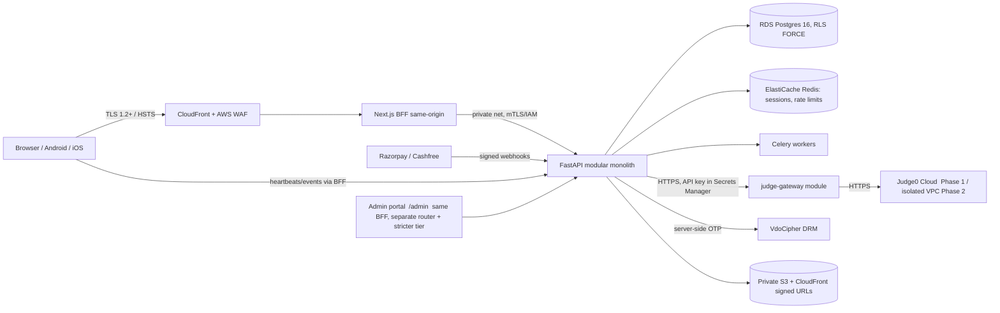

# Security Threat Model — Tech Drona LMS

| | |
|---|---|
| Owner | Security & Account Monitoring Specialist |
| Contract | `docs/blueprint-brief.md` v0.2; `docs/contract-reconciliation.md` |
| Method | STRIDE per component, mapped to the OWASP API Security Top 10 (2023), plus abuse cases. Target **OWASP ASVS 5.0 Level 2** platform-wide, with Level 3 items for the finance, security_reviewer and super_admin consoles (RPA §8 [Rec]) |
| Status | Every item in this document is **Planned** |

Every concrete value below comes from `research/reference-platform-analysis.md` §8 "Security baseline values" or the OWASP/NIST notes, with **[Verified]** standard values separated from **[Rec]** choices made within those standards' bounds.

## Changelog

### v0.4 — 2026-11-03 (Security Specialist, final cleanup)

- IPR-SEC-04: webhook path is `POST /api/v1/webhooks/{provider}` (§4.1).

### v0.3 — 2026-11-03 (Security Specialist, review pass)

- **Webhook replay** no longer relies on a 5-minute timestamp rejection: signature verification + event-id dedupe + server-side re-fetch of the entity from the provider for authoritative state; legitimate late retries are processed (§2.4, §4.2, A8; AMB-10, API I-14).
- **Cookie replay** (TO-04, new TO-08/TO-10): revoke the replayed session immediately and run a takeover evaluation; revoke all sessions only on a confirming rule (HC-T3) (§2.1, A2; AMB-02).
- Idle-timeout, remember-device and key-versioning values added to §4.2 (AMB-05/06; deployment I-04). Audit anchors kept 8 years (deployment I-05).
- CAPTCHA replaced by a non-puzzle, accessible challenge (§4.1, A12; AMB-19). Ingest limits now reference the analytics document as the single source (AMB-11).
- Abuse cases reference the AB-*/IN-* registry (risk engine §4.5; AMB-04). Risk-engine tests cover HC rules, the kill switch and the bulk lift (§6). Residual risks R1/R4 updated.

### v0.2 — 2026-11-03

Reconciliation follow-up F-THR-1 applied.

---

## 1. System context and trust boundaries

| Trust boundary | Crossed by |
|---|---|
| TB1 | Internet → CloudFront/WAF |
| TB2 | BFF → API. The browser never holds bearer tokens (brief §1) |
| TB3 | API → Judge. Untrusted code, and hidden tests must never leak |
| TB4 | Payment provider → webhook endpoint |
| TB5 | API → DRM provider |
| TB6 | Staff → admin functions |
| TB7 | Tenant ↔ tenant inside Postgres |
| TB8 | Client telemetry → analytics ingest |

---

## 2. STRIDE per component

Legend: S = Spoofing, T = Tampering, R = Repudiation, I = Information disclosure, D = Denial of service, E = Elevation of privilege.

### 2.1 Next.js BFF

| | Threat | Control (values) |
|---|---|---|
| S | Session cookie theft or fixation | The `__Host-td_session` token is opaque, 256-bit CSPRNG (≥128 bits required, ASVS 7.2.3 [Verified]). Attributes `Secure; HttpOnly; SameSite=Lax; Path=/`, no Domain. Rotated on login, privilege change and reauthentication (ASVS 7.2.4). Bound to `__Host-td_device`, so a mismatch revokes **that session** immediately (TO-04) and a takeover evaluation runs; a browser-family or OS-family change within one session does the same (TO-08). All sessions are revoked only on a confirming takeover rule (HC-T3, risk engine §5.6). Strict mode rejects IDs unknown to both Redis and Postgres (AB-07) |
| S | Login CSRF | Pre-session CSRF token on the login form; new session after login (OWASP CSRF CS) |
| T | CSRF on state changes | Three layers. (1) Reject `Sec-Fetch-Site: cross-site` on POST, PUT, PATCH and DELETE, falling back to Origin, and reject `Origin: null`. (2) HMAC-SHA-256 signed double-submit token (`__Host-td_csrf` + `X-CSRF-Token` header) bound to the session, compared in constant time. (3) SameSite=Lax. JSON only: `text/plain`, form-urlencoded and multipart are rejected except on upload routes |
| T | XSS leading to session riding | CSP: `default-src 'self'; script-src 'self' 'nonce-{r}' 'strict-dynamic'; frame-src https://player.vdocipher.com; object-src 'none'; base-uri 'none'; frame-ancestors 'none'`. Trusted Types in report-only mode first. React escaping. Markdown is sanitised with DOMPurify server-side |
| R | Missing user actions | The BFF forwards `request_id`. The API owns the audit log |
| I | Token leakage to the browser | The BFF holds no bearer tokens for the browser. `Cache-Control: no-store` on authenticated pages. `Referrer-Policy: strict-origin-when-cross-origin` (`no-referrer` on reset pages) |
| I | Hidden tests or answer keys in RSC payloads | Server components select explicit DTOs. A lint rule bans passing ORM or raw API objects to client components. The CI payload scan fails if fields such as `is_hidden`, `expected_output` or `correct_option` appear in any client bundle or RSC flight data |
| D | SSR amplification | WAF rate rules (§4). Edge caching of public pages. Request timeout 10 s |
| E | Path-based admin access | `/admin/*` is gated in the BFF *and* the API. The API is authoritative (API5) |

### 2.2 FastAPI API (modular monolith)

| | Threat | Control |
|---|---|---|
| S | Credential stuffing or spraying | Argon2id m=19456 KiB, t=2, p=1 minimum, tuned to 250–500 ms ([Verified] OWASP). Run in a threadpool after rate limits. Per-account back-off: 1 s doubling to a 900 s cap. Hard disable at 50 consecutive failures (≤100 NIST [Verified]), unlocked by reset or MFA. Per-IP and per-ASN windows. Pre-auth blocks don't count toward lockout. Breached-password check through the HIBP k-anonymity range API |
| S | Weak passwords | NIST 800-63B-4: minimum 15 characters without MFA, 8 with MFA, maximum 128 accepted, no composition rules, blocklist (top 100k + breached + context words "techdrona", "drona", course names) [Verified] |
| S | MFA bypass | Passkeys (WebAuthn with server-side UV check), then TOTP (30 s, `valid_window=1`, last timestep stored for single use), then SMS (NIST "restricted"; never for privileged tiers). Recovery codes: 10 × 64-bit, hashed. Reset does not bypass MFA (ASVS 6.4.3) |
| T | Mass assignment | Pydantic v2 `extra="forbid"` on every input model. Separate input and output models. `role`, `organization_id`, `is_admin`, `score` and `price` are never accepted from the client (API3) |
| T | Score or timer tampering | Server-authoritative `started_at`/`deadline_at`. Scoring runs only server-side from stored responses. Answer saves keyed by (attempt, question, version) and idempotent. Saves after `deadline_at + grace` are rejected |
| R | Disputed admin or grade actions | Append-only, hash-chained `audit_log`. The app role has INSERT only, and a trigger blocks UPDATE and DELETE. Hourly hash anchoring to S3 Object Lock (compliance mode, **8 years**, matching R-AUDIT; anchors hold hashes only, no personal data) |
| I | IDOR across tenants (API1) | Central `scoped_query()` repository layer plus Postgres RLS `FORCE` with policy `organization_id = current_setting('app.tenant_id')::uuid` and a matching `WITH CHECK`. `SET LOCAL app.tenant_id` per transaction (never session-level SET). The app connects as a non-owner, non-BYPASSRLS role. Composite FKs `(organization_id, id)`. UUIDv7 IDs, though IDs are not relied on for secrecy |
| I | Existence probing via unique/FK checks (RLS bypass, [Verified] PG docs) | Uniqueness errors are mapped to generic 409/422 without echoing the value. Cross-tenant unique constraints are avoided where possible |
| I | Verbose errors | RFC 9457 problem+json without stack traces. `/docs` and `/openapi.json` disabled in production (API9) |
| D | Resource exhaustion (API4) | Page `limit` ≤100. Body ≤1 MB (JSON), uploads ≤25 MB through presigned S3 only. Request timeout 15 s. Argon2 concurrency semaphore set to vCPU × 2. Per-route rate limits (§4) |
| E | Function-level authz (API5) | Every endpoint declares `permission + scope`. Routes deny by default. Admin routers sit under a separate prefix with their own dependency. CI asserts every route has a permission declaration and `require_active_principal` |

### 2.3 Code judge (`judge-gateway` + Judge0)

| | Threat | Control |
|---|---|---|
| S | Direct calls to Judge0 with a stolen API key | The key lives only in Secrets Manager and is used only by the gateway. It is rotated every 90 days. Phase 2: Judge0 in a separate VPC/account, reachable only from the gateway SG, with mTLS |
| T | Tampering with verdicts or callbacks | No public callbacks: the gateway polls, or the callback URL carries an HMAC-signed token plus a submission nonce. Verdicts are recomputed by comparing outputs server-side; the judge's "accepted" flag is not trusted blindly. Expected outputs never leave the gateway when comparison is done locally |
| R | Disputed results | `code_submissions` and `submission_results` are immutable. Source code is hashed (SHA-256) and stored |
| I | **Hidden-test exfiltration** | Hidden inputs and outputs are stored encrypted (KMS envelope) or in private S3, and decrypted only inside the gateway worker. They never appear in an API response. Per-case results to students show verdict, time and memory only, never stdin, expected output or stderr beyond the first 1 KB of the student's own output on *sample* cases. Output-channel side channels (timing or `exit(code)` encoding): limit verdict granularity on hidden cases, rate-limit submissions, flag repeated probe patterns (≥20 submits/problem/hour) |
| D | Fork bombs, infinite loops, `sleep` | CPU 5 s, wall 10 s, memory 512 MB, processes ≤64, output ≤64 KB, file size ≤1 MB (Judge0 defaults [Verified]; wall-time required, isolate [Verified]). Per-user queue: max 2 in flight, 30 submissions per 10 min. Drive-mode capacity planning (RPA §8: possibly >10k/day) |
| E | **Sandbox escape** | Never run student code on app servers (brief). Phase 2 hardening against the CVSS 10.0 Judge0 escapes (Tanto Security [Verified]): no `--privileged`; no `--share-net` (network disabled); non-root; read-only root FS; symlink-safe file handling; no shell interpolation of user values; no default DB passwords; dedicated VMs (cgroup v1/v2 conflict, RPA §8); no route to RDS or Redis; egress denied; patch SLA 72 h for critical CVEs; Phase 3 gVisor or Firecracker |

### 2.4 Payment webhooks (Razorpay / Cashfree)

| | Threat | Control |
|---|---|---|
| S | Forged webhook | HMAC-SHA256 over the **raw body** with the provider secret, constant-time compare. Unsigned or unknown-scheme requests are rejected. Optional source IP allowlist (defence in depth only) |
| T | **Replay** | No age-based rejection (Razorpay signs no timestamp, and providers legitimately retry for hours). Instead: (1) verify the HMAC over the raw body; (2) dedupe on `payment_webhook_events(gateway, event_id)` unique, inserted in the same transaction as the side effect, and a duplicate gets 2xx with no effect; (3) **never act on the payload's state**: for every event that can change money or entitlement state, re-fetch the order, payment, refund or subscription from the provider API and apply the fetched state through the monotonic state machine (paid → refunded allowed; captured → created rejected). A replayed old payload therefore can only re-trigger an idempotent re-fetch. Events older than 5 min are flagged `is_stale` for monitoring only. For providers that sign a timestamp (Cashfree), a skew > 5 min means the *payload* is not trusted, but the event is still processed through the re-fetch. Never use `created` for ordering |
| R | "We never received payment" | Raw payload stored (with PII minimised) plus the verification result and processing result. Daily reconciliation against the provider settlement API |
| I | Card data exposure | No card data is stored (RBI [Verified]). Only the gateway token, last 4 digits and network or issuer |
| D | Webhook floods | Return 2xx in under 1 s after enqueueing. Per-provider rate 100 rps. Async Celery processing with a dead-letter queue |
| E | Entitlement granted on an unverified client redirect | Entitlements are granted **only** from a verified webhook, or from a server-to-server fetch of the payment status. Client "success" redirects only display a pending state. Amount and currency are re-checked against `orders` |

### 2.5 Media (VdoCipher, S3/CloudFront)

| | Threat | Control |
|---|---|---|
| S | Using someone else's playback token | The OTP is issued server-side per request with TTL 300 s, bound to the user ID watermark and an annotation code. The 1-stream cap applies at issuance |
| T | Altering the watermark | The watermark is server-specified (name + masked phone + session code), not client-supplied. An iframe embed cannot show the user ID (RPA §3 [Verified]), so the backend API integration is required |
| R | Leak attribution | The watermark session code maps to `playback_sessions.id` |
| I | Direct S3 object access | Private buckets with Block Public Access. CloudFront OAC. Signed URLs TTL 5 min for resources and 1 min for downloads of paid PDFs (watermarked server-side) |
| D | Token minting abuse (API6) | 30 playback tokens per user per hour; 300 per IP per hour (relaxed for registered campus ranges) |
| E | Accessing unentitled content | `entitlements.check` runs before every OTP or signed URL |

### 2.6 Admin portal (staff, security_reviewer, finance, super_admin)

| | Threat | Control |
|---|---|---|
| S | **Admin account takeover** | Mandatory MFA. Privileged tiers (finance_admin, security_reviewer, super_admin): passkey preferred, TOTP allowed; SMS and email never (brief v0.2 §1; passkey-only for privileged is pending PO-05). Timeouts: 15 min / 8 h (brief). Staff: 30 min / 12 h. No remember-device. New-device login for privileged roles alerts the security lead. Optional IP allowlist for super_admin (office or VPN) |
| T | Policy or role tampering | Role grants and `policy_settings` changes need step-up (`auth_time` within 5 min) plus a second approver for super_admin grants and 🔒 policy keys |
| R | Insider denies an action | Every privileged action is audited with a reason code. Audit logs cannot be edited by any app role, super_admin included (DB-level). Break-glass account use pages on-call |
| I | **Insider misuse of monitoring data** | Purpose-bound access (a reason code before opening any per-user security timeline). IP masking by default. Export needs second approval and is watermarked. Monthly access review. Anomaly alert when one staff member views >30 user timelines a day or views users outside their assigned cases. Coordinators get aggregates only. Monitoring data is never used for marketing (privacy doc) |
| D | Bulk operations locking the DB | Bulk jobs run asynchronously with batch limits and confirm dialogs |
| E | Privilege escalation via scoped grants | Grants are validated against the grantor's own scope (no granting beyond your own scope). `super_admin` grants need two super_admins. Support **cannot** set passwords (ASVS 6.4.6 [Verified]) |

### 2.7 Analytics ingest (heartbeats, learning events)

| | Threat | Control |
|---|---|---|
| S | Events forged for another user | Ingest goes through the authenticated BFF only. The server sets `user_id`, `session_id` and `device_id` from the principal, and client-supplied identity fields are ignored |
| T | Inflated time-on-task or faked overlap (to frame a user or game metrics) | Heartbeat schema validation. Server timestamp is authoritative (client clock kept as metadata only). Cadence, page-instance and request limits as defined in `analytics-event-schema.md` §5.2 (single source; AMB-11). Events after session revocation are dropped. Overlap evidence is server-derived from the authenticated session and device, so another user cannot be framed by forged payload identities. Forgery bursts are IN-02 |
| R | — | Raw events are partitioned and retained for a short period (see the privacy doc) |
| I | Re-identification from analytics | Pseudonymised `subject_key = HMAC(k_analytics, user_id)` in aggregates and exports. Minors' events are restricted to learning-delivery purposes |
| D | Event flooding | Limits per `analytics-event-schema.md` §5.2. WAF rules |
| E | — | Ingest is write-only, with no read path to other users' data |

---

## 3. OWASP API Security Top 10 (2023) mapping

| Risk | Where it bites Tech Drona | Primary controls |
|---|---|---|
| API1 BOLA | Attempts, submissions, certificates, invoices, cases, org rosters | Central scoped repositories; RLS FORCE; ownership/enrolment checks; automated authz-matrix tests (§6) |
| API2 Broken Authentication | Login, OTP, reset, sessions | §2.2, §4 values; opaque sessions; reset tokens 256-bit, single-use, hashed, TTL 30 min, no auto-login; identical responses and timing (ASVS 6.3.8) |
| API3 BOPLA | Mass assignment of role, price or score; over-exposed DTOs (hidden tests, emails in leaderboards) | `extra="forbid"`; explicit response models; leaderboard shows display name only; field-level authz for PII |
| API4 Unrestricted Resource Consumption | SMS OTP cost, Argon2 CPU, judge minutes, exports | Per-number, IP and device OTP quotas; rate limit before hashing; judge queues; export quotas |
| API5 BFLA | Admin, finance and security endpoints | Permission declarations; separate routers; deny by default; CI check |
| API6 Sensitive Business Flows | Coupon brute-force, trial farming, OTP pumping, playback token minting, question-bank scraping | §4 limits; coupon codes ≥10 chars from Crockford Base32; per-user redemption cap; question pagination caps (≤50 per request, 2,000 per day per user) with scrape alerting |
| API7 SSRF | Webhook target registration (future), LTI/SCORM import, avatar URL fetch | No user-supplied URL fetching in v1. Later: allowlist plus egress proxy that denies RFC1918 and metadata IPs (169.254.169.254) |
| API8 Security Misconfiguration | CORS, headers, S3, debug | CORS allowlist of exact origins (no wildcards); HSTS `max-age=63072000; includeSubDomains; preload`; `X-Content-Type-Options: nosniff`; S3 Block Public Access; IaC scanning |
| API9 Improper Inventory | Old API versions, staging exposed | `/api/v1` only; staging behind SSO plus IP allowlist; API inventory generated from the router registry |
| API10 Unsafe Consumption of APIs | Judge0, Razorpay, VdoCipher, IP-intel, HIBP responses | Schema-validate third-party responses; timeouts of 5 s; circuit breakers; never trust a judge "Accepted" flag without our own comparison; fail closed for payments and fail open (with a log) for HIBP |

---

## 4. Concrete controls: rate limits, lockout, timeouts

### 4.1 Per-endpoint rate limits (Redis sliding window) [Rec]

| Endpoint | Per account / identifier | Per IP | Per ASN | Notes |
|---|---|---|---|---|
| `POST /auth/login` | Back-off 1 s doubling → 900 s cap; disable at 50 consecutive failures | 30 failures / 10 min (×10 for registered campus and known-CGNAT ranges) | 500 failures / 10 min → accessible challenge for that ASN (AB-04/AB-05) | Pre-auth blocks not counted to the account |
| `POST /auth/otp/send` (login, new device, step-up) | 3/hour, 10/day per phone; 5/hour per email | 20/hour | — | Plus 5/hour per device. Global SMS spend alarm at 2× the 7-day baseline per hour (AB-02) |
| `POST /auth/otp/verify` | 5 attempts per OTP; 10 failures / hour → OTP disabled for 1 h | 60/hour | — | |
| `POST /auth/password-reset/request` | 3/hour, 5/day | 20/hour | — | Same response whether the account exists or not |
| `POST /auth/password-reset/confirm` | Token single-use; 5 attempts per token | 30/hour | — | |
| `POST /auth/register` | — | 10/hour (×10 campus) | — | Phone OTP required |
| `POST /media/playback-tokens` | 30/hour | 300/hour | — | Stream cap 1 |
| `POST /coding/submissions` | 2 in flight; 30 / 10 min; drive mode per test rules | 300 / 10 min | — | Run (samples) 60 / 10 min |
| `PUT /attempts/{id}/responses` | 120/min per attempt | — | — | Debounced client saves every 5–10 s |
| `POST /commerce/coupons/validate` | 10/hour; 20 failures/day → coupon validation disabled 24 h | 60/hour | — | |
| `POST /security/unblock-requests` | 1 open per case; 3/30 days; 5 form loads/min | 10/day | — | No CAPTCHA (WCAG 2.2 SC 3.3.8) |
| `GET` list endpoints | 600/min | 1,200/min | — | `limit` ≤100 |
| `POST /analytics/events` | Per `analytics-event-schema.md` §5.2 (authoritative; AMB-11) | — | — | |
| `POST /api/v1/webhooks/{provider}` | — | 100 rps per provider | — | HMAC first; invalid → 400 `webhook_signature_invalid` + AB-12 |
| Admin exports | 5/day per staff member; second approval for per-user rows | — | — | |

### 4.2 Session, cookie and token values

| Control | Value | Source |
|---|---|---|
| Session token | 256-bit CSPRNG, SHA-256 at rest | ASVS 7.2.3 (≥128) [Verified]; brief |
| Cookie | `__Host-td_session; Secure; HttpOnly; SameSite=Lax; Path=/` | Brief; NIST/OWASP [Verified] |
| Device cookie | `__Host-td_device`, 128-bit random, same flags, 400-day Max-Age | Risk-engine doc |
| Timeouts | Student 60 min / 24 h (remember-device ≤30 days, trusted only); staff 30 min / 12 h; finance, security_reviewer, super_admin 15 min / 8 h | Brief; NIST AAL2/AAL3 [Verified] |
| Step-up window | `auth_sessions.last_step_up_at` ≤5 min for privileged actions (refund, role grant, policy change, case decision, bulk export); ≤10 min for other staff sensitive actions (incl. support session kills); ≤15 min for student email, phone or MFA change (with full reauthentication) (brief v0.2 §1) | ASVS 7.5.1/7.5.3 |
| OTP | 6 digits, TTL 300 s, single use, hashed | NIST ≤10 min [Verified] |
| Reset link | 256-bit, single use, hashed, TTL 30 min, `Referrer-Policy: no-referrer`, URL never built from the Host header | OWASP Forgot Password CS |
| Email verification | TTL 24 h | NIST [Verified] |
| Mobile JWT (if used) | ES256 pinned, access TTL 10 min, opaque rotating refresh with family revocation on reuse, `jti`+`iss` denylist | OWASP JWT CS |
| Webhook freshness | No age-based rejection; HMAC + event-ID dedupe + provider re-fetch; `is_stale` flag at > 5 min (metric only) | §2.4; ADR-0006 |
| Idle extension | Only `extends` routes and server-confirmed engagement (`engaged_only`); keepalives, polling and prefetch never extend idle; an in-progress timed attempt holds the session until `deadline_at + grace + 5 min`; absolute timeout never extended | Brief §1; risk engine §1.4 |
| Remember-device | Students, trusted devices only; separate `__Host-td_remember` token rotated on each use; silent re-issue only on a top-level user navigation; fixed 30-day ceiling from the last full authentication (never slides); new session AAL1 | Brief §1; risk engine §1.4 |
| Session cookie lifetime | `Max-Age` = seconds to `absolute_expires_at` (survives a crash); lab devices: browser-session cookie | Risk engine §1.4 |
| Keyed hashes | `k_device`, `k_login` versioned (`key_version`); planned rotation 24 months; old device keys usable for lookup 400 days with re-hash on hit | Risk engine §1.5 |
| Secrets | AWS Secrets Manager; KMS CMKs; rotation 90 days (API keys) | [Rec] |
| TLS | TLS 1.2+ (1.3 preferred); HSTS preload | [Rec] |
| Time sync | NTP traceable to NIC/NPL (AWS Time Sync plus documented traceability) | CERT-In [Verified via commentary] |

---

## 5. Abuse cases

| # | Abuse case | Actor and goal | Attack path | Controls | Detection | Residual |
|---|---|---|---|---|---|---|
| A1 | **Credential stuffing** | External; takes over accounts to resell access | Leaked combo lists against `/auth/login` from residential proxies | §4.1 limits; breached-password check at login and signup; MFA offer; TO-01, TO-03, TO-05; generic errors | Spike in failure rate by ASN; dashboard H10; T-protect counts | Residential proxies spread load; MFA adoption by students may be low |
| A2 | **Session hijack or replay** | External or malware; reuses a stolen cookie | Infostealer exports cookies; replays from another browser | HttpOnly; device-cookie binding (TO-04); client-drift check within a session (TO-08: browser or OS family change, which catches a full cookie jar replayed in another browser); remember-token rotation with reuse detection (TO-10); short idle timeout that background requests cannot extend; sessions listed and revocable by the user; absolute timeout | The replayed session is revoked at the first mismatched request and a takeover evaluation runs (T-step-up for the account); a second replay within 24 h or the owner's "This wasn't me" triggers HC-T3 (revoke all, forced reset) | Theft of both cookies replayed in the **same** browser family and OS is undetectable until idle or absolute expiry |
| A3 | **IDOR across tenants** | A student or coordinator of college A reads college B's roster, results or certificates | Swaps IDs in `/orgs/{id}/batches`, `/attempts/{id}` | App scoping plus RLS FORCE; composite FKs; authz-matrix tests; 404 (not 403) for cross-tenant objects | RLS violations logged (policy denials via app error mapping); alerts on ≥20 404s per minute per user on ID routes | RLS misconfiguration on a new table. Mitigated by a CI check that every tenant table has FORCE plus a policy |
| A4 | **Score tampering** | A student raises a mock score | Edits the client payload (score, correct flag), replays saves after the deadline, modifies leaderboard values | Server-side scoring only; immutable attempt steps; `deadline_at` enforced; idempotent saves; leaderboards provisional until the similarity pass (RPA §5) | Validation failures logged (OWASP "always log") | Collusion (answers shared live). Addressed by randomisation and similarity analysis, not by security controls |
| A5 | **Timer manipulation** | Gets extra time | Changes the client clock, pauses JS, kills the network to "freeze" time, opens a second device | Server-authoritative deadline; autosave; a disconnect doesn't stop the clock; extra time only by trainer override (audited); single-device binding | Rebind and disconnect events in `attempt_events` | Legitimate outages need a human override decision |
| A6 | **Hidden-testcase exfiltration** | Leaks hidden tests to a Telegram group | Prints stdin to stdout or stderr; encodes it via exit codes or timing; reads files in the sandbox; insider leak from the admin UI | Hidden outputs never returned; stdin not echoed for hidden cases; verdict-only feedback; probe-rate limits; encrypted storage; admin view of hidden tests requires the `coding.testcases.read_hidden` permission and is audited | ≥20 submits per problem per hour; many WA/RE variations | Slow side-channel probing over weeks. Rotate problem test sets per drive |
| A7 | **Sandbox escape** | Pivots into infrastructure | Exploits a Judge0 or isolate CVE, privileged containers or a symlink | §2.3 hardening; separate account and VPC; no credentials on judge hosts; IMDSv2 hop limit 1 and IMDS blocked from sandboxes | Falco/auditd on judge VMs; egress-deny alerts | 0-days in kernel or isolate. Accepted risk with blast radius limited by isolation |
| A8 | **Webhook replay** | Gets a free subscription by replaying an old "payment.captured" | Captures and replays a signed payload, possibly with a new event id | HMAC verification; event-ID dedupe; **re-fetch of the payment/order from the provider API before any state change** (a replayed payload can only cause a re-fetch of a state that already exists); amount, currency and order match; monotonic state | Duplicate-event counter; `is_stale` rate; AB-12 for bad signatures | Provider secret leak. Rotate secrets; 24 h overlap |
| A9 | **Coupon abuse** | Mass discount farming or brute-forcing codes | Enumerates codes; makes many accounts for "first purchase" coupons; leaks influencer codes | Codes ≥10 chars (≈50 bits); validation limits (§4.1); per-user and per-phone redemption caps; `max_redemptions`; expiry; coupons bound to plans; finance alerts at >3× expected redemptions per hour | `coupon_redemptions` velocity | Multi-account farming with real SIMs. Phone uniqueness only raises the cost |
| A10 | **Admin account takeover** | Steals a super_admin or finance login | Phishing, session theft, SIM swap | Passkey preferred, TOTP allowed for privileged tiers; SMS/email never (passkey-only pending PO-05); 15 min idle; new-device alert; dual control for role grants and payouts; break-glass accounts sealed with alerting | Privileged-login alerts; anomalous admin actions | Device compromise of an admin laptop. MDM requirement for privileged staff [Rec] |
| A11 | **Insider misuse of monitoring data** | A reviewer or support agent stalks a student, sells data, or targets someone | Browses security timelines or device graphs without a case; exports | Purpose-bound access; reason codes; IP masking; export approval; least privilege (support sees no signals); immutable audit; monthly review; minors not profiled at all | Views/day anomaly; views without an assigned case; export volume | A colluding pair of reviewers. Mitigated by external audit sampling |
| A12 | **OTP / SMS pumping** | Generates SMS revenue through premium numbers | Automated OTP sends to number ranges | §4.1 quotas; country restriction (+91 only in v1); spend alarm; after 2 sends from one source, a non-puzzle accessible challenge (invisible/managed challenge with a passkey or email fallback, never a cognitive puzzle, WCAG 2.2 SC 3.3.8) | AB-02; spend anomaly | Provider-side fraud. Contractual caps with the provider |
| A13 | **Account sharing / reselling** | A student sells or shares a subscription | §2 of the risk-engine doc; the owner relays OTPs so the sharer's device becomes verified | Caps, risk engine (separation classes: separated fixed-line use is never discounted by verification; SH-13 for verification at a distance; HC-01/HC-02), watermark | Risk engine | Sharers who use only mobile data (CGNAT) stay under-detected; accepted (R1); the buddy seat is the commercial answer |
| A14 | **Abuse of the risk engine to restrict a victim** | An attacker who knows a victim's password logs in from elsewhere to trigger L3 on the victim | Logs in on a distant fixed-line network while the victim studies | New-device OTP to the victim's phone blocks the attacker's device before it can create engaged overlap; SH-07/SH-13 surface the attempt; L2 precedes L3; the victim's appeal and the takeover flow | TO-*, SH-07 | An attacker with the victim's SIM or inbox. Mitigated by "This wasn't me" (HC-T3) and human review |

---

## 6. Security testing requirements

| Area | Requirement | When |
|---|---|---|
| SAST | Semgrep (Python, TypeScript rulesets plus custom rules: missing `require_active_principal`, `==` on secrets, raw SQL without tenant scope, `extra="allow"`) | Every PR, blocking on high severity |
| Dependency / SCA | `pip-audit`, `npm audit`/OSV-Scanner, Dependabot; SBOM (CycloneDX) per release | Every PR + daily |
| Secrets scanning | gitleaks pre-commit + CI | Every commit |
| IaC | Checkov/tfsec on Terraform | Every PR |
| Authz matrix tests | Auto-generated from the route registry × 9 roles × scopes; asserts allow or deny, including cross-tenant IDs (API1/API5) | Every PR |
| RLS tests | For each tenant table: FORCE enabled; a policy exists; cross-tenant select, insert and update fail as the app role | Every migration |
| Session tests | Fixation, rotation on login, idle and absolute timeouts per tier, idle classes (`extends`/`engaged_only`/`neutral`), attempt idle hold, remember-device re-issue only on navigation, revoke-all, device mismatch revokes one session only, TO-08 drift, Redis-miss DB fallback, cookie flags | Every PR (integration) |
| CSRF tests | Cross-site POST rejected; missing token rejected; `Origin: null` rejected | Every PR |
| Rate-limit tests | Each §4.1 limit; lockout not triggered by pre-auth blocks | Nightly |
| Risk-engine tests | All rows of risk-engine doc §11 (owner scenarios 1–20 and R-1..R-9) as deterministic fixtures, incl. separation classes, worked examples A–C, HC rules in shadow and enforce, the circuit breaker, the kill switch and the bulk lift; minors produce no SH, HC or evaluation rows (DB CHECK + test) | Every PR touching `security` |
| Webhook tests | Bad signature (400 `webhook_signature_invalid` + AB-12), duplicate event (2xx, no effect), replay of an old valid payload hours later (2xx, re-fetch, no second effect), out-of-order events (re-fetched state wins), amount mismatch, provider API down during re-fetch (retry, no state change) | Every PR touching `commerce` |
| Judge tests | Escape test corpus (fork bomb, network access, symlink, `/proc` reads, large output, sleep); hidden-test leak tests | Weekly + every judge image change |
| DAST | OWASP ZAP baseline on staging, plus an authenticated scan per role | Weekly |
| Pen test | External CREST/CERT-In-empanelled tester: web, API, judge, admin; retest of fixes | Before public launch, then annually and after major changes |
| ASVS L2 verification | Checklist tracked per requirement with evidence | Pre-launch gate |
| Incident drills | Tabletop for CERT-In 6 h and DPB 72 h (privacy doc §6) | Pre-launch, then every 6 months |
| Bug bounty / VDP | `security.txt` plus a disclosure policy; private bounty after launch | Launch + 3 months |

---

## 7. Residual risks (accepted or tracked)

| # | Risk | Rating | Rationale and treatment |
|---|---|---|---|
| R1 | Sharing via OTP hand-off (owner cooperates with the sharer) | Medium → Low–Medium | Verification no longer discounts separated fixed-line use, and SH-13/HC-01 detect relayed verifications (risk engine §4.2.1, §5.6). Residual: a sharer who uses only mobile data (CGNAT) stays at L0/L1 (risk engine §11 row 5c). Accepted; caps, watermark and buddy seat reduce the incentive |
| R2 | False positives in the sharing engine under CGNAT, lab or family use | Medium | Gates, caps on network points, human review, FP-rate alerting (H8), shadow mode for rule changes |
| R3 | Judge 0-day escape | Medium (Phase 1 lower: Judge0 Cloud is a third party) | Isolation, egress deny, patch SLA. Phase 3 microVMs |
| R4 | Browser cookie theft (both cookies) by infostealer | Medium | Replay in a different browser or OS family is caught by TO-08; replay in the same browser family is not. Timeouts (background traffic cannot extend idle), user session list, MFA for sensitive actions |
| R5 | SMS as a factor (SIM swap) | Medium | SMS is restricted; passkeys and TOTP promoted; privileged roles never use SMS |
| R6 | Legal uncertainty on monitoring minors or consent withdrawal | High (legal) | Conservative defaults (no scoring for minors); open questions to counsel (privacy doc §10) |
| R7 | DRM licence cannot be recalled mid-stream | Low | Short OTP TTL plus heartbeat refusal bounds the overrun to ≤90 s |
| R8 | Third-party processors (Judge0 Cloud outside India?) | Medium | Data minimisation (code only, no PII sent to the judge); DPA; Phase 2 self-hosting in ap-south-1 |
| R9 | Insider collusion | Low–Medium | Dual control and audit; external sampling |
| R10 | Unverified vendor claims (VdoCipher watermark efficacy, IP-intel accuracy for India) | Low | Measure on our own data; do not depend on these for enforcement |

---

## 8. Contract change proposals

None beyond those recorded in `account-security-and-risk-engine.md` §13. Note for the Architect: the brief's `audit_log` table is used here (the research text says `audit_events`; the brief name wins). → Accepted (no change) in `contract-reconciliation.md` §2.3.

Review pass v0.3: the webhook, idle, remember-device and audit-anchor decisions above require edits in other documents; they are listed in `consistency-pass-requests.md` (CPR-PRD-01, CPR-API-06, CPR-DEP-02, CPR-TST-08).
