# Tech Drona LMS — System Architecture

> **Single-company note (2026-11-06).** Tech Drona now runs as a single company ([ADR-0015](architecture-decisions/ADR-0015-single-company.md)); the college/B2B features described in this document (college portal and coordinators, institution contracts and seats, invitations and roster import, per-organization settings, trusted networks and lab devices, the "For colleges" page) are removed. Roles are Admin (`super_admin`), Trainer, Evaluator, Content manager and Student; finance, support, security and mentor duties belong to Admin. Batches are Tech Drona cohorts managed by Admin at `/admin/batches`; businesses use the corporate enquiry form at `/enquiries`. The `orgs` module keeps only the internal company org; per-org settings are platform settings. Where this document conflicts, ADR-0015 and [`single-company/REMOVAL-PLAN.md`](single-company/REMOVAL-PLAN.md) §8 win.

| Field | Value |
|---|---|
| Owner | System Architect |
| Contract basis | `docs/blueprint-brief.md` (Shared Contracts **v0.3**) |
| Revision | v0.5 (2026-11-03): Stage 10 integration sync — event name `attempt.scored` (was `attempt.graded`), new §24 implemented hook/extension-point architecture. v0.4 (2026-11-03): security review pass applied by the Integration Lead (CPR-ARC-01..06, `contract-reconciliation.md` §9) — `x-td-route-tag` + `x-td-idle`, `touch_engaged`, idle hold, same-device replace/re-attach, versioned device HMAC, webhook re-fetch for every state-changing event. v0.3 (2026-11-03): wave-2 consistency pass by Integration Lead (`contract-reconciliation.md` §7) — permission-key format, playback paths/`playback_conflict`, attempt binding, `account_status` route tags, step-up codes, 5-day grace, autosave ≤ 10 s, coding limits, webhook path, CSRF in BFF, GlitchTip (ADR-0014), `audit-sealer` service, `td_maintenance`, maintenance mode; F-ARCH-1..5 applied |
| Research basis | `research/reference-platform-analysis.md` (labels [Verified]/[Reported]/[Rec] preserved) |
| Status | Blueprint sections remain **Planned** unless stated otherwise. ◇ v0.5 (2026-11-03, Stage 10): the implemented kernel and extension-point architecture is documented in §24; per-module status is in `docs/implementation-status.md`. |
| Companion docs | `docs/database-schema.md`, `docs/database-erd.md`, `docs/architecture-decisions/ADR-0001` … `ADR-0014` (modular monolith, sessions, RLS, analytics storage, code execution, payments, video, jobs, migrations, BFF, outbox+audit chain, ids/time/money, assessment timer, error tracking in India) |
| Detail owned elsewhere | Risk-rule content and unblock SOP (Security Specialist), event schema and time-on-task model (Analytics Engineer), ops runbooks (DevOps), endpoint catalogue (Backend Lead) |

Every component, flow and number in this document is **Planned**. Where a value is a tunable default it lives in `policy_settings` and is marked *(policy)*.

---

## 1. Architecture drivers

| Driver | Target / constraint | Source |
|---|---|---|
| Scale (launch + 12 months) | 50,000 registered users, 5,000 concurrent, 2,000 concurrent test-takers at drive peak | Brief task statement |
| Exam integrity | Server-authoritative timer, autosave ≤ 10 s, crash/reconnect resume, keys never on client before review policy allows | Research §2, §6 (Moodle 60 s autosave is the baseline to beat) [Verified] |
| Untrusted code | Never on app servers; isolated judge; hidden tests server-only | Brief §1; research §8 (Judge0 CVSS 10.0 escapes) [Verified] |
| Account security | ASVS 5.0 L2 platform-wide, L3 items for finance/super-admin; NIST 800-63B-4 sessions and passwords | Research §8 [Rec] |
| Anti-sharing | Deterministic, published caps (3 devices / 2 sessions / 1 stream / 1 session during assessment) enforced server-side; explainable rule-based risk v1; no behavioural scoring of minors | Brief §1; research §3 [Rec], DPDP s.9(3) [Verified] |
| Tenancy | Colleges (organizations) must never see each other's data; app scoping + Postgres RLS with FORCE | Brief §1; research §8 (RLS owner bypass) [Verified] |
| Data residency & logs | AWS ap-south-1; security logs ≥ 1 year (180 days hot); CERT-In 6 h reporting; GST records 72 months | Brief §1; research §8 [Verified] |
| Money | Razorpay primary + Cashfree fallback adapter; HMAC-verified idempotent webhooks; recurring debit ≤ ₹15,000 | Brief §1; research §4 [Reported, news] |
| Team size | Small team; one deployable backend; boring, well-documented tech | [Rec] → ADR-0001 |

---

## 2. System context (Planned)

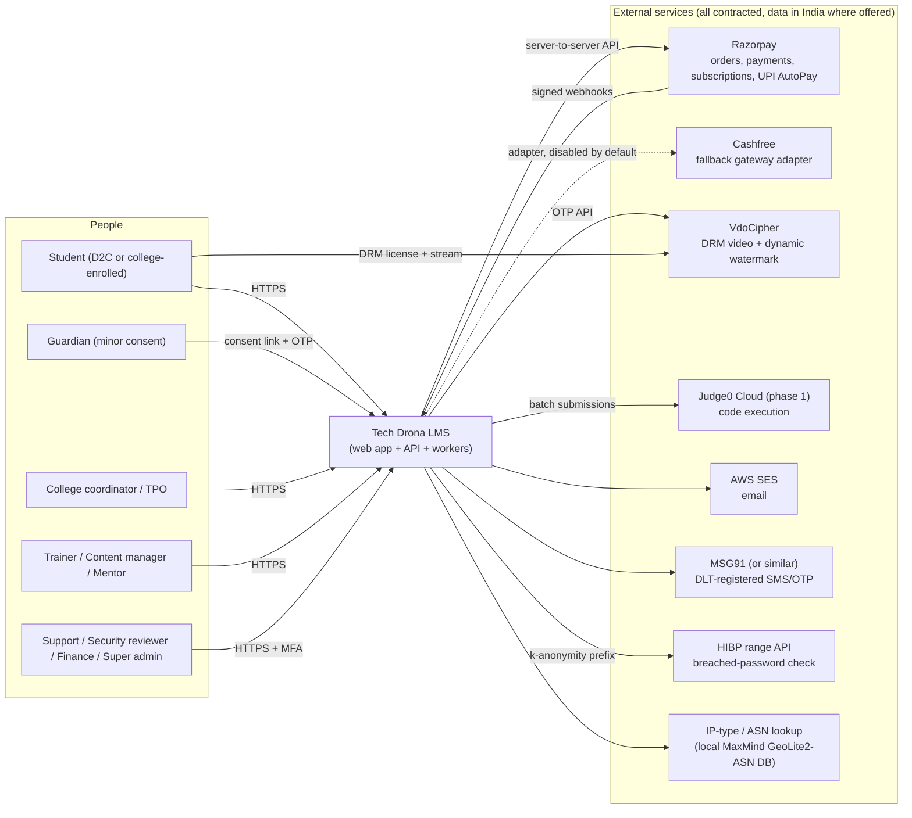

Students stream video directly from VdoCipher's CDN using a short-lived OTP minted by our API; video bytes never pass through Tech Drona infrastructure (Brief §1, "No videos/binaries in Postgres").

---

## 3. Container view (Planned)

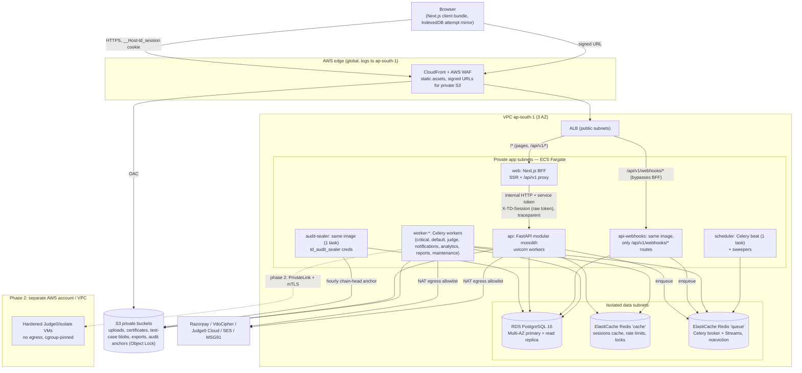

| Container | Tech | Scales on | Notes |
|---|---|---|---|
| `web` | Next.js (App Router, TS), Node 22 | ALB req/target, CPU | Same-origin BFF. Holds no bearer tokens in the browser. Proxies `/api/v1/*` to `api` with a service token; renders SSR pages by calling `api` server-side. |
| `api` | FastAPI, SQLAlchemy 2 (async, asyncpg), Pydantic v2 | CPU, p95 latency | All 18 modules in one process. Not internet-reachable except via `web` and the webhook target group. |
| `api-webhooks` | Same image, `TD_ROUTER_SET=webhooks` | req count | Isolated so a payment-webhook storm cannot starve user traffic and vice versa. |
| `worker-<queue>` | Celery 5, same image | queue depth / age | One ECS service per queue family (ADR-0008). `worker-judge` is the only service with egress to Judge0. |
| `scheduler` | Celery beat (single replica, leader lock in Redis) | n/a | Periodic jobs, sweepers. |
| `audit-sealer` | Same image, `TD_ROLE=audit_sealer`, exactly 1 task (leader-locked as a second guard) | n/a | Drains `audit_outbox` → `audit_log` (ADR-0011). Only service holding `td_audit_sealer` DB credentials and the only `s3:PutObject` on `td-audit-anchor` (Object Lock compliance, 8 years = R-AUDIT). |
| Error tracking | Self-hosted GlitchTip (Sentry-SDK compatible) on ECS Fargate, ap-south-1 (ADR-0014) | n/a | No Sentry SaaS; SDK scrubbing (`send_default_pii=False`, cookies/headers/bodies/IPs removed in `before_send`); 90-day event retention. |
| Postgres | RDS PG 16, gp3 | vertical; read replica for reports | Extensions: `pgcrypto`, `citext`, `pg_partman`, `pg_stat_statements`, `btree_gist`. |
| Redis `cache` | ElastiCache (cluster mode off, Multi-AZ), `allkeys-lru` | memory | Disposable: Postgres is source of truth for everything cached. |
| Redis `queue` | ElastiCache, `noeviction` | memory | Celery broker, analytics ingest Streams, attempt deadline ZSET. |

---

## 4. Modular-monolith boundaries

### 4.1 Package layout inside `apps/api/app/`

```
app/
  core/            # kernel: config, db session + RLS context, ids (uuid7), money, errors (RFC 9457),
                   # outbox, event bus, idempotency, rate-limit, crypto (KMS envelope), clock, telemetry
  modules/
    <module>/
      public.py           # the ONLY importable surface for other modules (service facades, DTOs, event types)
      api/                # FastAPI routers (thin)
      service/            # use-cases, transactions
      repo/               # SQLAlchemy queries over this module's own tables only
      models.py           # ORM models (tables owned by this module)
      schemas.py          # Pydantic request/response models (extra="forbid")
      events.py           # domain events published via outbox
      tasks.py            # Celery tasks
      privacy_provider.py # declare / export / erase personal data (research §6, Moodle tool_dataprivacy pattern)
      permissions.py      # permission keys declared by this module
```

### 4.2 Module ownership and allowed dependencies

"Depends on" = may import `modules.<x>.public` synchronously. Everything else must use domain events (outbox → in-process dispatcher / Celery). Cross-module **foreign keys** to `users.id`, `organizations.id`, `batches.id`, `courses.id` and similar identity anchors are allowed; cross-module **SQL joins in repositories are not** (reporting goes through `analytics` read models or the read replica).

| Module | Owns tables (see schema) | Depends on (sync, via `public.py`) | Publishes events (examples) |
|---|---|---|---|
| `audit` | `audit_log`, `audit_outbox` | core only | — |
| `admin` | `policy_settings`, `feature_flags`, `approval_requests`; privacy sub-package: `privacy_requests`, `retention_policies`, `erasure_ledger` | `audit`, `rbac` | `policy.changed` |
| `identity` | `users`, `user_profiles`, `user_credentials`, `mfa_factors`, `verification_tokens`, `password_reset_tokens`, `consents`, `guardian_consents` | `audit`, `admin` (policy read), `notifications` | `user.registered`, `user.password_changed`, `consent.changed`, `age_tier.changed` |
| `rbac` | `roles`, `permissions`, `role_permissions`, `role_grants` | `audit` | `grant.changed` |
| `orgs` | `organizations`, `org_memberships`, `org_invitations`, `bulk_import_jobs`, `batches`, `batch_members` | `identity`, `rbac`, `audit` | `batch.member_added`, `batch.member_removed`, `org.membership_changed` |
| `sessions` | `auth_sessions`, `devices`, `user_devices`, `login_attempts`, `playback_sessions` | `identity`, `admin`, `audit` | `session.created`, `session.revoked`, `session.ended`, `device.registered`, `device.removed` |
| `security` | `security_signals`, `risk_rules`, `risk_rule_versions`, `risk_evaluations`, `account_restrictions`, `security_cases`, `unblock_requests`, `case_notes`, `case_decisions`, `org_trusted_networks`, `security_incidents` | `identity`, `sessions`, `admin`, `audit`, `notifications`, `analytics` (feeds `get_engaged_buckets` / `get_activity_summary` only) | `restriction.imposed`, `account.restricted`, `restriction.lifted`, `case.decided` |
| `catalog` | `courses`, `course_versions`, `course_modules`, `lessons`, `lesson_assets`, `lesson_topics`, `resources` | `rbac`, `audit` | `course.published` |
| `entitlements` | `entitlements`, `entitlement_events` | `catalog`, `orgs`, `audit` | `entitlement.granted`, `entitlement.revoked`, `entitlement.extended` |
| `commerce` | `products`, `product_items`*, `plans`, `prices`, `coupons`, `coupon_redemptions`, `orders`, `order_items`, `payments`, `payment_webhook_events`, `subscriptions`, `refunds`, `invoices`, `invoice_sequences`*, `institution_contracts` | `entitlements`, `catalog`, `orgs`, `identity`, `audit`, `notifications` | `order.paid`, `refund.processed`, `subscription.state_changed` |
| `media` | (uses `lesson_assets` via catalog; `playback_sessions` owned by `sessions`) | `catalog`, `entitlements`, `sessions`, `security` | `playback.started`, `playback.denied` |
| `placement` | `topics`, `companies`, `company_paths`, `company_path_steps`*, `questions`, `question_versions`, `question_options`, `question_tags`, `practice_sessions`*, `practice_responses`*, `recommendations`*, `mentor_slots`, `mentor_bookings`, `interview_feedback`, `resumes`, `resume_reviews` | `catalog`, `coding`, `entitlements`, `analytics` (`topic_mastery` read), `audit` | `question.published`, `practice.answered`, `recommendations.refreshed` |
| `coding` | `coding_problems`, `coding_test_cases`, `code_submissions`, `submission_results`, `judge_languages`* | `entitlements`, `audit` | `submission.judged` |
| `assessments` | `tests`, `test_sections`, `test_section_rules`, `test_assignments`*, `attempt_overrides`*, `test_attempts`, `attempt_sections`*, `attempt_responses`, `attempt_events`, `attempt_results` | `placement` (question bank read), `coding`, `entitlements`, `orgs`, `sessions`, `audit` | `attempt.started`, `attempt.submitted`, `attempt.scored`, `attempt.integrity_flagged` |
| `learning` | `enrolments`, `lesson_progress`, `assignments`, `assignment_submissions`, `certificates` | `catalog`, `entitlements`, `orgs`, `assessments` (result read), `audit` | `lesson.completed`, `course.completed`, `certificate.issued` |
| `analytics` | `analytics_events`, `activity_heartbeats`, `engagement_intervals`, `daily_learning_aggregates`, `weekly_learning_aggregates`, `cohort_learning_aggregates`, `route_daily_aggregates`, `video_watch_coverage`, `topic_mastery`, `question_item_stats`, `security_activity_feed_daily`, `analytics_dirty_days`, `analytics_ingest_rejections`, `export_jobs` | core only (consumes everyone's events) | — |
| `notifications` | `notifications` | `identity` (contact lookup), `admin` | — |
| `support` | `support_tickets`, `support_ticket_messages` | `identity`, `rbac`, `audit`, `notifications` | `ticket.updated` |

\* = table proposed in §23 Contract change proposals (now in brief v0.2 §4). Tables without a marker added in the v0.2 reconciliation come from other authors' proposals (`contract-reconciliation.md` §4).

Cross-cutting kernel services (in `core`, usable by all): `outbox.publish()`, `audit.record()` facade (writes `audit_outbox` in the caller's transaction), `idempotency`, `rate_limit`, `policy.get(key, org_id)` (cached read of `policy_settings`), `clock` (NTP-synced; CERT-In).

### 4.3 Dependency graph (allowed, acyclic)

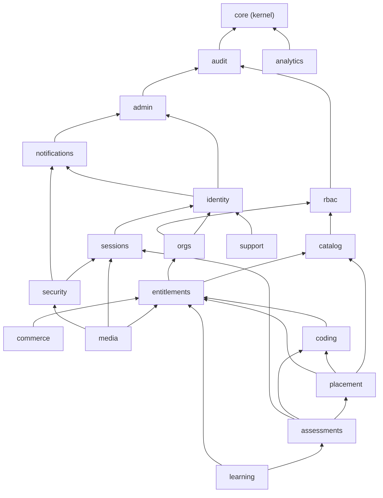

**Enforcement (Planned):** `import-linter` contracts in CI — (1) "independence/layers" contract mirroring the table; (2) "forbidden" contract: no module imports another module's `models`, `repo`, or `service` packages, only `public`; (3) a pytest check that every SQLAlchemy model's `__tablename__` is listed in exactly one module's ownership manifest (also consumed by ADR-0009 migration review).

`require_active_principal` and permission checks live in `core.authz`, which calls `sessions.public`, `security.public` and `rbac.public` through registered interfaces (dependency inversion) so the kernel does not import modules at import time.

---

## 5. Request lifecycle

### 5.1 Browser → Next.js BFF → FastAPI → Postgres/Redis

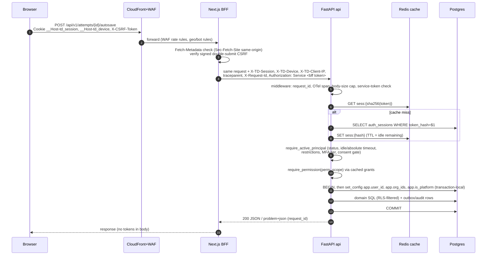

Middleware / dependency order in `api` (Planned):

1. `RequestContextMiddleware` — assigns/propagates `X-Request-Id`, binds OTel trace, structured-log context.
2. `ServiceAuthMiddleware` — only `web` (service token, rotated via Secrets Manager) or the webhook target group may call; trusted client IP taken from `X-TD-Client-IP` only when the service token is valid.
3. `BodyLimitMiddleware` — 256 KiB default; 64 KiB code-submission source; uploads go direct-to-S3 via presigned POST.
4. Router-level dependency `require_active_principal` on **every** authenticated router (mounted by `core.routing.authenticated_router()` — routers cannot be created without it; CI test enumerates `app.routes` and fails if any non-public route lacks it).
5. Endpoint dependency `require_permission(key, scope_resolver)`.
6. `db_transaction` dependency — opens the transaction and sets RLS GUCs with `set_config(..., true)` (transaction-local, safe for pooled connections).
7. Handlers return Pydantic models; exceptions mapped to RFC 9457 `application/problem+json` with `type`, `title`, `status`, `detail`, `code`, `request_id` (Brief §5).

Public (unauthenticated) routers: `auth` (login, register, OTP, reset), `catalog-public` (SEO pages, company hubs), `certificates/verify/{public_code}`, `/api/v1/webhooks/{provider}` (HMAC instead; served only by `api-webhooks`), `health`.

Maintenance mode (Planned): feature flag `platform.maintenance_mode` (restore cutover, RB-04). While on, GETs are served, every write returns `503` problem+json `code=maintenance` with `Retry-After`; webhooks also get `503` so providers retry later; health endpoints are unaffected.

### 5.2 Idempotency

`Idempotency-Key` header is mandatory on POSTs that create money/attempt/submission records (Brief §5). `core.idempotency` stores `(principal_id, route_key, key) → request_hash, status, response` in the `idempotency_keys` table* (24 h TTL; money routes 7 days). Replay with same hash returns the stored response; different hash returns `409 idempotency_key_reuse`. Redis lock `idem:{...}` prevents concurrent duplicates.

---

## 6. Authentication and authorization architecture

### 6.1 Session model (ADR-0002)

| Aspect | Design |
|---|---|
| Token | 32 random bytes (256-bit, `secrets.token_bytes`), base64url in cookie `__Host-td_session` (Secure, HttpOnly, SameSite=Lax, Path=/, no Domain). Only `sha256(token)` stored (`auth_sessions.token_hash`), and Redis key `sess:{hex(hash)}`. Raw token never logged. |
| Source of truth | Postgres `auth_sessions`; Redis `cache` is a read-through cache (TTL ≤ idle remaining). Revocation = DB update + `DEL sess:*` for that user (index `user_sess:{user_id}` set). |
| Timeouts (Brief §1) | `session_tier`: `student` 60 min idle / 24 h absolute (remember-device, v0.4: no session outlives its absolute timeout — a new AAL1 session (`created_via = remember_device`) is re-issued only on a top-level user navigation within a fixed 30-day ceiling from the last full authentication, only when `user_devices.trust_status='trusted'`; payment/profile changes still require re-auth within 15 min); `staff` 30 min / 12 h; `privileged` (finance_admin, security_reviewer, super_admin) 15 min / 8 h + MFA. Tier = most privileged active role grant at login; a grant change forces re-login (session rotation). Registered college lab devices: 30 min idle, no remember-device. |
| Sliding idle | Only engaged activity extends the idle timer: every authenticated route declares `x-td-idle` = `extends` (state-changing user actions; GETs the BFF marks `X-TD-Activity: navigation`), `engaged_only` (analytics ingest with credited active seconds, playback heartbeat with `state = playing`, autosave with a changed response — these call `sessions.touch_engaged(session_id)`) or `neutral` (keepalives, notification polling/SSE, security-status polling, prefetch); keepalives never extend it (analytics CP-6, brief v0.4 §1). While `auth_sessions.idle_hold_until` (= `deadline_at + grace + 5 min` of a bound in-progress attempt) is in the future, idle expiry is not enforced; absolute expiry always is (v0.4, CPR-ARC-02). Each qualifying request updates `last_seen_at` in Redis; DB `last_seen_at`/`idle_expires_at` written at most once per 60 s per session (write-behind via throttled UPDATE). |
| Rotation | New token on login, MFA completion, privilege change, password change (all other sessions revoked — ASVS 7.4.2). |
| Device cookie | `__Host-td_device` — 128-bit random first-party device key identifying a browser profile; stored only as keyed `HMAC-SHA256(k_device_v{n}, raw id)` in `devices.device_key_hash` with `devices.key_version` = n (brief v0.4 §1; API I-19). A lookup that matches under an older key version re-hashes the row in place to the current version; `login_attempts.identifier_hash` uses `k_login_v{n}` + `key_version` and is never re-hashed (lookups search live versions) (v0.4, CPR-ARC-05). Primary device counter (research §3, "First-party device token" [Rec]). |
| CSRF | Signed double-submit: `td_csrf` cookie (non-HttpOnly) = HMAC(`TD_CSRF_KEY`, session_id_hash ‖ nonce); header `X-CSRF-Token` must match and verify (beacon route: signed token in the body + `Sec-Fetch-Site: same-origin`). Plus Fetch Metadata: reject state-changing requests where `Sec-Fetch-Site` ∉ {same-origin, none}. No state changes on GET. **The BFF (`web`) both issues and validates `td_csrf`** (it mints a new token whenever `api` rotates `__Host-td_session`); `TD_CSRF_KEY` is provisioned to `web` only, and `api` never issues or sees it (ADR-0010; brief v0.3). |
| MFA | `mfa_factors`: WebAuthn passkey > TOTP (replay-guarded by `last_used_step`) > SMS OTP (restricted). Mandatory for staff and privileged tiers. Step-up (`auth_sessions.last_step_up_at`; windows `auth.step_up_window.*`): **5 min** for privileged actions (refund, role grant, policy change, case decision, bulk export), **10 min** for other staff sensitive actions (grade overrides, support session kills), **15 min** for student email/phone/MFA changes (brief v0.2 §1). |
| Mobile (later) | Opaque rotating refresh token + 5–15 min ES256 access token (research §8 "JWT (mobile or API only)"); not in v1 web. |

### 6.2 Concurrency and device caps (deterministic, minor-safe)

| Cap (default, *policy*) | Enforcement point | Mechanism |
|---|---|---|
| ≤ 3 trusted devices | Login from unknown device token | `user_devices` count where `trust_status='trusted'`; 4th device ⇒ must remove one (self-service, ≤ 2 replacements / 30 days counted from `user_devices.removed_at` with `removal_reason='self_service_replacement'`) or contact support. New device ⇒ email/SMS OTP (`verification_tokens.purpose='new_device_otp'`). |
| ≤ 2 concurrent active sessions | Session creation | `pg_advisory_xact_lock(hashtext('sess:'||user_id))`, count `auth_sessions` active; at cap ⇒ the new session is created with `status='pending_session_choice'` (held ≤ 5 min) and the UI prompts "sign out other device?"; before the cap check, active sessions on the same `device_id` (same browser profile) are ended as `replaced_same_device`; the chooser pre-selects the oldest session without an active attempt (Moodle `limitconcurrentlogins` semantics, research §1 [Verified]); an attempt-holding session is never evicted — if every other session holds an active attempt the login is refused with `409 session_cap_reached` (v0.4, CPR-ARC-03; RE §6.3). |
| ≤ 1 video stream | Playback OTP issuance | `playback_sessions` (§12). |
| 1 session during an assessment | Attempt start/resume/autosave | The attempt is bound to one session: `test_attempts.bound_session_id` (+ `bound_device_id`, `rebind_count`) is the authority (Redis may cache it, never decide). Another session gets `409 attempt_bound_elsewhere` and a read-only view; it may rebind after explicit confirmation (OTP only when restriction level ≥ L2, max 2 rebinds per attempt, proctored drives need a trainer override; brief §1, PO-08). Logged as `attempt_events` `rebind_requested` / `rebind` / `rebind_refused` (advisory, not a penalty). Re-login on the **same** `bound_device_id` re-attaches the attempt to the new session without consuming a rebind or needing OTP (`reattach_same_device`). There is no Redis "take over" lock and no `session_takeover` event; `bound_session_id`/`bound_device_id` in Postgres decide (v0.4, CPR-ARC-04; API I-06). |

### 6.3 `require_active_principal` (single enforcement point)

```python
# core/authz/principal.py  (Planned — illustrative)
async def require_active_principal(request: Request) -> Principal:
    token = request.state.session_token                     # from X-TD-Session
    if not token: raise Problem(401, "unauthenticated")
    sess = await sessions_port.load(sha256(token))          # Redis → Postgres
    now = clock.now()
    if sess is None or sess.status != "active" \
       or (sess.idle_expires_at <= now and not (sess.idle_hold_until and now < sess.idle_hold_until)) \
       or sess.absolute_expires_at <= now:                 # idle_hold_until: attempt idle hold (v0.4)
        raise Problem(401, "session_expired")
    user = await identity_port.get_status(sess.user_id)     # cached, versioned
    if user.status in ("deactivated", "deleted"): raise Problem(401, "session_expired")
    restr = await security_port.active_restrictions(user.id)  # Redis 'restr:{uid}:v{n}', DB fallback
    route_tags = route_tag_registry.tags_for(request.scope["route"])  # openapi_extra x-td-route-tag, e.g. {"account_status"}
    decision = restriction_policy.evaluate(restr, route_tags)  # scope derived per request; auth_sessions.scope is a record only
    if decision.blocked:                                      # may call only 'account_status' (+ 'l3_readonly' for L3)
        raise Problem(403, "account_restricted", case_ref=decision.case_ref, until=decision.until)
    if sess.tier != "student" and not sess.has_mfa_factor and "mfa_enrolment" not in route_tags:
        raise Problem(403, "mfa_enrolment_required")
    # step-up freshness (auth_sessions.last_step_up_at) is checked per sensitive permission:
    # stale → 401 step_up_required (windows 5/10/15 min, auth.step_up_window.*)
    if user.pending_required_consents and not route_tags & {"consent", "account_status"}:
        raise Problem(403, "consent_required")
    if route_idle_effect(request) == "extends":             # x-td-idle; engaged_only routes call
        await sessions_port.touch(sess)                      # sessions.touch_engaged(session_id) when engagement
                                                             # is credited; neutral never slides (throttled DB write)
    return Principal(user_id=user.id, session_id=sess.id, tier=sess.tier, is_minor=user.is_minor,
                     org_ids=await rbac_port.org_ids(user.id), restrictions=decision.feature_locks)
```

* Feature-level restrictions (e.g. `video_locked`, `assessments_locked`) are returned in `Principal.restrictions` and enforced by `require_feature("video")` on the relevant routers.
* Route tags (brief v0.4 §5; declared as `openapi_extra={"x-td-route-tag": ...}`): the canonical set is `public`, `login_continuation`, `account_status` (me, devices/sessions, cases and unblock requests, privacy requests incl. data export, billing view/cancel, support, logout), `l3_readonly` (L3 read-only dashboard/progress, certificate list), `mfa_enrolment`, `consent`, `default` (`api-specification.md` §1.4). Tags may be declared on routes in **any** module (billing lives in `commerce`, privacy in `admin`, devices in `sessions`). CI fails if any authenticated route lacks `require_active_principal`, an `x-td-route-tag` or an `x-td-idle` effect (`extends`, `engaged_only`, `neutral`). The former `restriction_class` (`appeal`, `self_service_minimal`) is retired (v0.4, CPR-ARC-01).
* During an L3 deferral the attempt-bound session keeps `full` scope for that attempt's `ATT-*` routes only; all other sessions are revoked immediately (RE §7.4).
* Restriction cache key carries a version number bumped by the `restriction.imposed/lifted` handlers in the same transaction (via outbox) so revocation propagates in < 1 s.

### 6.4 Permission + scope checks

* Roles (Brief §3) are bundles of `permissions`. Keys are the ones in `role-permission-matrix.md` §2 (canonical): 2–3 lowercase dot-separated segments (`resource.action` or `resource.sub.action`, e.g. `test.results.release`, `refund.decide`), CHECK `^[a-z][a-z0-9_]*(\.[a-z][a-z0-9_]*){1,2}$`; the owning module is a separate `permissions.module` column, not the first segment. Grants are `role_grants(user_id, role_id, scope_type ∈ {platform, organization, batch, course}, scope_id)`. Allow-only, deny by default (research §5 [Rec]).
* `require_permission("test.results.read", scope=ScopeFrom.path("attempt_id"))` resolves the resource's **scope chain** (attempt → batch → organization → platform; course → organization|platform) through the owning module's `public.scope_of(resource_id)` and passes if the user holds the permission at any scope in the chain.
* Grants cached per user: `grants:{user_id}:v{n}` (hash of scope → permission set), invalidated by `grant.changed`.
* Object-level ownership (a student reading *their own* attempt) is a separate predicate (`owner_or(permission)`), never inferred from RLS.
* `sensitive=true` permissions additionally require step-up freshness (`401 step_up_required` when stale).

### 6.5 RLS tenant context (ADR-0003)

* Application DB role `td_app` is **not** the table owner; tables owned by `td_owner` (Alembic in `apps/api/migrations` only, ADR-0009). Partition premake/drop runs as `td_maintenance` through `SECURITY DEFINER` functions only (schema §1.2). `ALTER TABLE … ENABLE ROW LEVEL SECURITY; ALTER TABLE … FORCE ROW LEVEL SECURITY;` on every tenant-scoped table.
* Per transaction: `set_config('app.user_id', $uid, true)`, `set_config('app.org_ids', $csv, true)`, `set_config('app.is_platform', 'on'|'off', true)`, `set_config('app.actor', 'user:<id>'|'system:<job>', true)`. Transaction-local, so connection pooling cannot leak context.
* `app.is_platform='on'` only for principals holding a platform-scoped grant **and** for named system jobs (webhook processor, schedulers) — each system job declares its actor and is audited.
* Policy families (`T`, `TN`, `U`, `O`) are defined in `database-schema.md §2.3`. RLS is a tenant **boundary**, not object authorization; unique/PK/FK checks bypass RLS (research §8 [Verified]), so uniqueness that must not leak across tenants is always scoped by `organization_id`.

### 6.6 Login and risk-evaluation flow

The rule content, weights and L1–L4 thresholds are owned by the Security Specialist (`docs/account-security-and-risk-engine.md`); this is the runtime architecture.

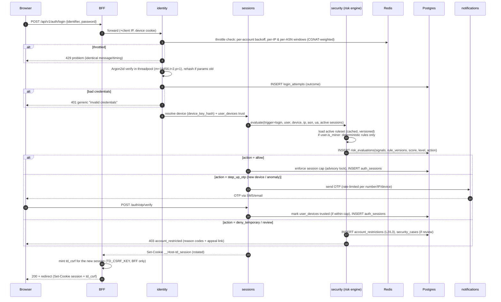

### 6.7 Block / unblock flow (architecture view)

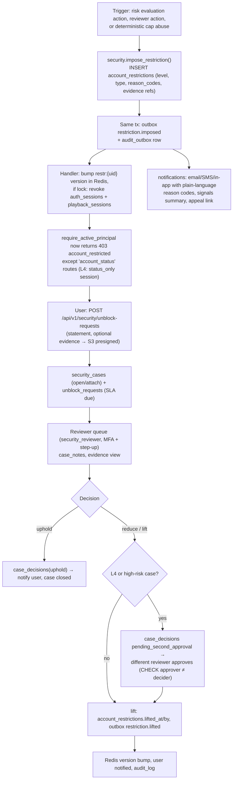

Never a permanent ban on IP/fingerprint alone (Brief §1); restrictions always carry reason codes linked to `risk_evaluations` / `security_signals` so the user notice can cite them (research §3, DPDP s.8(3) [Verified]).

---

## 7. Placement-preparation engine (Planned)

### 7.1 Taxonomy

* `topics` is a tree with `kind ∈ {subject, topic, subtopic}` and a materialised `path` (e.g. `quant/percentages/successive-percentages`). Seed subjects mirror the market IA (research §1–2 [Verified]): Quantitative Aptitude, Logical Reasoning, Verbal Ability, Programming Languages, DSA, CS Core (OS, CN, DBMS, OOP), Company Hubs (via `companies`), Technical & HR Interview.
* `companies` + versioned `company_paths` (company × role, e.g. "TCS NQT — Ninja") with ordered `company_path_steps`* (step types: `lesson`, `practice_set`, `test`, `coding_set`) and a `pattern` JSONB (section → topic weights, durations) used for readiness scoring and for generating company-pattern mocks.
* Content framing: "pattern-aligned practice", never "actual questions" (research §6 [Rec]).

### 7.2 Question selection (tests and practice)

1. Authors define `test_section_rules`: either a pinned question (`question_id` + optional pinned `question_version_id`) or a **random draw**: `{topic_id (subtree), difficulty_min..max, tag filters, company_id, count, marks}`.
2. On test publish, `assessments` validates each random rule has a pool of ≥ 3 × `count` *(policy)* `published` versions and freezes `tests.version`.
3. A per-test-version **candidate pool** (question_version_ids per rule) is computed once and cached in Redis (`pool:{test_id}:v{n}`, 24 h) so 2,000 simultaneous starts do not run 2,000 pool queries.
4. At attempt start: seed = CSPRNG 16 bytes stored on `test_attempts.selection_seed`; deterministic draw (seeded shuffle) excluding versions the user saw in their last N attempts of the same test family *(policy)*; option order shuffled per seed if `shuffle_options`. The result is frozen into `attempt_sections`* + `test_attempts.layout` (JSONB: section → ordered `[question_version_id, option_order]`). Regrading/dispute replays use the frozen layout (Moodle immutable-attempt pattern, research §2 [Rec]).

### 7.3 Adaptive practice v1 (no ML)

* `practice_sessions`* run against a topic (subtree) or company path step; `practice_responses`* record each answer.
* Per user × topic `topic_mastery` (owned by `analytics`, read by `placement` through its service interface; analytics CP-11): attempts, correct, EWMA accuracy (α = 0.3), Elo-style `rating` (start 1000, K = 32 *(policy)*), `last_practiced_at`. Question difficulty 1–5 maps to item ratings 800/900/1000/1100/1200 (re-calibrated quarterly from observed p-values — later improvement).
* Next-item selection: target an expected success probability of about 0.7 (choose item rating nearest `user_rating − 147`), excluding items answered correctly in the last 30 days, with 20 % exploration from adjacent difficulty. Pure function, unit-testable, explainable.
* Minors: adaptive practice is learning delivery (permitted per research §8 [Rec], "no personalisation beyond learning delivery"); mastery data is **never** used for marketing or risk scoring.

### 7.4 Recommendations v1 (rule-based, explainable)

Generated by `placement.tasks.refresh_recommendations(user_id)` on `attempt.scored` / `practice.answered` (debounced 10 min) and nightly. Each `recommendations`* row stores `rule_key`, `reason` (human text with the numbers that triggered it), `target_type/target_id`, `priority`, `expires_at`.

| Rule key | Condition (defaults, *policy*) | Recommendation |
|---|---|---|
| `weak_topic` | ≥ 10 answers in topic, EWMA accuracy < 0.5 | Lesson(s) tagged to topic + 15-question practice set at difficulty ≤ current |
| `stale_topic` | Mastery ≥ 0.7 but not practised for 21 days | Short refresh practice |
| `path_next_step` | Active company path with incomplete next step | That step |
| `assigned_due` | Test/assignment assigned to user's batch due within 72 h | That test |
| `readiness_gap` | Company readiness < 60 % and a target date set | Lowest-mastery, highest-weight topic of that company's pattern |

Readiness per company path = Σ(pattern weight × topic mastery) / Σ weights, displayed with its formula (research §7 "placement-readiness engine" [Rec]). Cohort percentiles come from `analytics` aggregates (Analytics owns).

---

## 8. Question bank and assessment architecture (Planned)

### 8.1 Versioned questions

* `questions` is the stable identity (owner org or platform, status, current published version). `question_versions` is **immutable once published** (content hash); edits create a new version. Attempts reference `question_version_id`, never the mutable question.
* Types v1: `mcq_single`, `mcq_multi`, `numeric`, `fill_blank`, `coding` (references `coding_problems`), `descriptive` (manual grading). Keys: `question_options.is_correct`, `question_versions.answer_key` (numeric tolerance / accepted strings).
* Review workflow: `draft → in_review → published → retired`, second-person reviewer for platform banks (research §5 [Rec]).

### 8.2 Tests, sections, rules, assignments

* `tests` (kind: `practice_set`, `mock`, `company_mock`, `diagnostic`, `course_quiz`, `drive`) with `duration_seconds`, `navigation_mode` (`free`, `sequential`, `section_locked`), `grading_method`, `attempts_allowed`, `grace_seconds` (default 30), `review_policy` JSONB, `settings_locked_at` (set when the first attempt starts — HackerRank "lock once candidates start", research §5 [Verified]).
* `test_sections` may carry their own `duration_seconds` (sectional timers, research §2 "Build").
* `test_assignments`* bind a test to an organization/batch/course with an availability window; `attempt_overrides`* grant extra time / extra attempts / window extension per user or per batch (Moodle overrides, research §5 [Verified]).

### 8.3 Attempt state machine

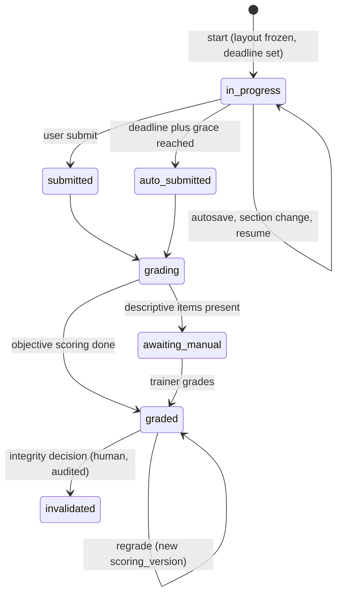

### 8.4 Server-authoritative timer

* On start: `started_at = now()`; `deadline_at = min(started_at + duration + override_extra, window_end + override_window_ext)`. Section deadlines in `attempt_sections.deadline_at`.
* Every response (autosave, navigation, resume) returns `server_now` and the deadlines; the client renders `deadline − (server_now + local_monotonic_elapsed)`; client clocks are never trusted.
* Writes after `deadline_at + grace_seconds` are rejected with `409 attempt_closed`. Section-locked tests reject writes to sections whose deadline has passed.
* **Auto-submit:** on start, `ZADD attempt_deadlines <deadline_epoch> <attempt_id>` (Redis `queue`). The `critical` sweeper runs every 5 s: `ZRANGEBYSCORE … now − grace`, then for each attempt `UPDATE test_attempts SET status='auto_submitted' WHERE id=$1 AND status='in_progress'` (idempotent) and enqueues scoring. A DB safety sweeper (every 60 s) catches any attempt with `status='in_progress' AND deadline_at < now() − grace` in case Redis lost the entry.

### 8.5 Autosave (≤ 10 s), crash and reconnect resume

* Client: every answer change is written to IndexedDB immediately with a monotonically increasing `client_seq`; the sync loop flushes after a 5 s debounce and **at most 10 s** after the first unsynced change *(policy; `max_interval_ms: 10000`, PRD FR-ASM-005)*, plus on `visibilitychange`/`pagehide` (`navigator.sendBeacon` fallback). Research recommends 5–10 s debounce + IndexedDB (research §2, §6 [Rec]).
* API: `POST /api/v1/attempts/{id}/autosave` with `[{question_version_id, response, client_seq, time_spent_ms, flagged}]` (≤ 50 items). Server upserts `attempt_responses` with `ON CONFLICT (attempt_id, question_version_id) DO UPDATE … WHERE attempt_responses.client_seq < EXCLUDED.client_seq` (out-of-order and replay safe), appends `attempt_events(event_type='answer_saved')`, returns `{acked_seq, server_now, deadline_at}`.
* Resume (`GET /api/v1/attempts/{id}/state`): frozen layout with question payloads **stripped of keys**, saved responses with `client_seq`, deadlines, `server_now`. The client merges IndexedDB entries whose `client_seq` is newer and re-sends them. Disconnects/reconnects are logged as `attempt_events` (`disconnect`, `reconnect`) — events, not penalties (research §4 [Rec]).
* Integrity events (`focus_lost`, `focus_gained`, `fullscreen_exit`, `paste`, `disconnect`, `reconnect`; rebinds are logged separately as `rebind_requested`/`rebind`/`rebind_refused`/`reattach_same_device` — the `attempt_events.event_type` CHECK in the schema is the canonical list; no `session_takeover`) ride along with autosave; advisory only, collected only with `assessment_integrity` consent, surfaced to trainers as "review recommended" (research §5 [Rec]). Whether these may be collected for minors is an open question for Security/Privacy (§22).

### 8.6 Scoring and review policy

* Scoring runs only server-side (`assessments.tasks.score_attempt`, `critical` queue, idempotent by `(attempt_id, scoring_version)`): MCQ exact-set match, negative marking per rule, numeric tolerance, coding = weighted hidden-case score of the latest `submit`-mode `code_submissions` linked to the attempt. Writes `attempt_results` (section and topic breakdown, time per question).
* Percentile/rank are **provisional** until the window closes and the cohort similarity pass completes (research §5 Codeforces practice [Rec]) — `attempt_results.rank_provisional`.
* `tests.review_policy` (Moodle 4-phase review matrix, research §2 [Verified]):

```json
{"during":       {"score": false, "correctness": false, "answer_key": false, "explanation": false},
 "after_submit": {"score": true,  "correctness": false, "answer_key": false, "explanation": false},
 "after_close":  {"score": true,  "correctness": true,  "answer_key": true,  "explanation": true},
 "release_at":   null}
```

* **Answer keys never leave the server** before the policy allows: delivery DTOs (`QuestionDelivery`) are distinct Pydantic models with no key fields; cached question payloads in Redis (`qv:{id}:delivery`) are built from those DTOs; review endpoints compute the current phase server-side and include key fields only when the phase allows. A contract test asserts that no delivery schema contains `is_correct`, `answer_key`, `explanation` or hidden test data.

### 8.7 Test execution flow

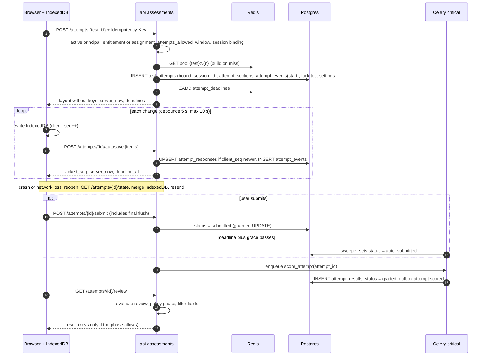

---

## 9. Coding execution architecture (Planned, ADR-0005)

### 9.1 Components

* **`coding` module (monolith):** problems, test cases, submissions, verdict aggregation, APIs (`/run`, `/submit`).
* **`judge-gateway`** (sub-package `apps/api/app/modules/coding/judge_gateway/`, executed only by the `worker-judge` ECS service): provider interface `JudgeProvider.submit_batch() / poll() / languages()`; implementations `Judge0CloudProvider` (phase 1) and `SelfHostedJudge0Provider` (phase 2). Only `worker-judge` holds judge credentials (Secrets Manager) and has the NAT egress allowlist to the judge endpoint. The browser never talks to the judge.
* **Phase 1 executor:** Judge0 Cloud paid tier (€27–107/mo for 2k–10k submissions/day + €0.001 overage, research §8 [Verified]). Accepted risk: hidden test inputs transit to the vendor under contract (§22).
* **Phase 2 executor:** self-hosted hardened Judge0/isolate on dedicated EC2 VMs in a **separate AWS account and VPC** (`services/judge-runner/` image + `infra/judge/`), no internet egress, no route to RDS/Redis, reachable only through a PrivateLink endpoint service with mTLS from `worker-judge`; never `--privileged`, per-run network disabled, no host-path symlink following, no default credentials, patched beyond the 2024 CVEs (research §8 Tanto [Verified]). Judge0's cgroup-v1 vs isolate's cgroup-v2 requirement ⇒ VMs, not Fargate/K8s pods (research §8 [Verified]). Later: gVisor/Firecracker.

### 9.2 Resource limits (defaults; per-language overrides in `judge_languages`*)

| Limit | Default | Note |
|---|---|---|
| CPU time | `coding_problems.time_limit_ms` default 2,000 ms, cap 5,000 | Judge0 default 5 s CPU [Verified] |
| Wall time | 2 × CPU + 1 s, cap 10 s | prevents `sleep` hogging workers (research §6 isolate [Verified]) |
| Memory | `memory_limit_kb` default 262,144, cap 524,288 | Judge0 default 512 MB |
| Processes/threads | 64 (Java 128) | |
| Output captured | 64 KiB stdout, 16 KiB stderr | |
| Source size | 64 KiB | body limit |
| Network | disabled | |
| Languages v1 | C, C++17, Java 17, Python 3; then JavaScript, Go, C#, Kotlin | research §4 [Rec] |

### 9.3 Hidden-test protection

* Sample cases (`is_sample=true`) may be shown. Hidden cases' input/expected output are **envelope-encrypted** (AES-256-GCM data key wrapped by KMS key `td-judge-testcases`), ciphertext in S3 `td-judge-private/…`; Postgres holds `input_s3_key`, `expected_s3_key`, `sha256`, `size_bytes`, `wrapped_data_key`. Only the `worker-judge` task role has `kms:Decrypt` on that key.
* Results for hidden cases expose only `verdict`, `time_ms`, `memory_kb` — never stdin, stdout, expected output or diff. Sample cases may return stdout excerpts.
* Authors view hidden cases via an audited, permissioned endpoint (`coding_test_case.hidden.read`) — HackerRank evaluator-only view (research §5 [Verified]).

### 9.4 Queueing and fairness

* Celery queues: `judge_assessment` (submissions inside an active attempt — highest priority), `judge_submit` (practice submit), `judge_run` (custom-input runs). Consumed by `worker-judge` with concurrency matched to provider quota.
* Per-user, per-problem limits *(policy; PRD FR-COD-005)*: `run` ≤ 10/min (`coding.run_per_minute`), `submit` ≤ 5/min (`coding.submit_per_minute`), 1 in-flight `submit` (`coding.max_inflight_submits`). A global Redis token bucket is sized to the provider's rate limit; under saturation `run` is shed first (429 + `retry_after`); assessment submissions are never shed (queue position shown).
* Idempotent on `(user_id, Idempotency-Key)`. Phase 1 polls the provider with exponential backoff (30 s budget, then `status='judge_timeout'` + automatic retry once). Phase 2 uses Judge0 callbacks to an internal HMAC-protected endpoint.

### 9.5 Sequence

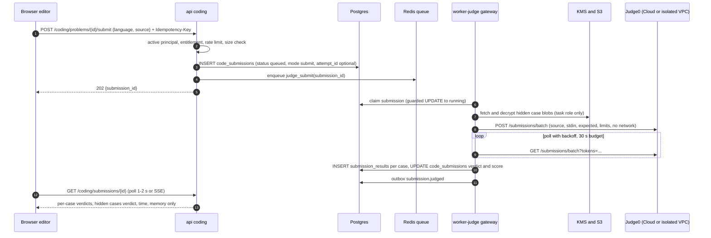

---

## 10. Course, batch and enrolment architecture (Planned)

* **Catalog:** `courses` → immutable published `course_versions` → `course_modules` → `lessons` (type `video`, `article`, `quiz` → `tests`, `coding` → `coding_problems`, `assignment`, `live_link`) → `lesson_assets` (VdoCipher video id, S3 files) and `resources`. `lessons.lesson_key` is stable across versions, so progress survives republishing (single `lessons` table with per-type references — Moodle polymorphic `course_module` shape, research §6 [Rec]).
* **Orgs/batches:** `organizations` (college, company, internal) → `batches` (academic/graduation year) → `batch_members` (student, trainer, mentor). Coordinators import rosters via CSV (`reports` queue job: validate, dedupe on email/phone, create/invite users, add `org_memberships` + `batch_members`, report per-row errors).
* **Enrolment sources:** `entitlement` (paid/subscription), `batch_sync` (Moodle cohort-sync analogue, research §5 [Reported]), `manual` (staff), `free`. One `enrolments` row per (user, course); `source`, `batch_id`, `entitlement_id` record provenance.
* **Batch sync:** on `batch.member_added` → for each product item covered by the organization's active `institution_contracts`, ensure an entitlement (`source_type='institution_contract'`) and enrolment; on `batch.member_removed` or contract end → entitlement `revoked`/`expired`, enrolment `suspended`. History is retained so a graduating student converting to an individual plan keeps progress (research §4 [Rec]).
* **Progress:** `lesson_progress` updated from player heartbeats (every 30 s) and lesson completion events; `enrolments.progress_pct` recomputed incrementally; `course.completed` → certificate eligibility (required lessons + final assessment pass) → `certificates` with a public `/verify/{public_code}` page live instantly (research §6 [Rec]).
* **Seat pools:** `institution_contracts.seat_count`; a seat = an active entitlement with that contract as source; seat assignment locks the contract row (`SELECT … FOR UPDATE`) and counts active seats before inserting.

---

## 11. Payments, subscriptions and entitlements (Planned, ADR-0006)

### 11.1 Model

* `products` (what is sold) → `product_items`* (what it unlocks: course, test, company path, feature key such as `mentor_sessions`) → `plans` (one-time with `access_duration_days`, or recurring with interval) → `prices` (INR integer paise, GST-inclusive flag, validity window). Real list prices, no inflated anchors (research §7 [Rec]).
* `orders`/`order_items` snapshot the priced lines (CGST+SGST or IGST by place of supply). `payments` store only gateway ids, method, last4/network/issuer, masked VPA — **never card data** (RBI, research §4 [Verified]).
* `subscriptions` mirror Razorpay subscription state; recurring debits ≤ ₹15,000 (`CHECK` ≤ 1,500,000 paise on recurring prices and on `subscriptions.mandate_max_amount_paise`).
* `entitlements` are the **single source of access truth**, with `source_type` ∈ `free_enrolment`, `purchase`, `subscription`, `placement_package`, `coupon_grant`, `institution_contract`, `admin_grant`, `trial` (explicit nullable FK per source + CHECK; status adds `grace`; see schema §11, reconciliation §3.21). Product kinds (`products.product_kind`) follow the PRD vocabulary: `free_resource`, `free_course`, `course`, `bundle`, `subscription_plan`, `placement_package`, `mock_pack`, `institution_seat` (+ reserved `extra_learner_seat`). Order statuses: `created`, `pending_payment`, `paid`, `failed`, `expired`, `cancelled`, `refunded`, `partially_refunded`.
* Gateway abstraction `commerce.gateways.PaymentGateway` (`create_order`, `verify_checkout_signature`, `verify_webhook`, `parse_event`, `refund`, `create_subscription`, `cancel_subscription`, `fetch_order`) with `RazorpayGateway` (primary) and `CashfreeGateway` (fallback adapter, feature-flagged off).

### 11.2 Webhook verification and idempotent processing

1. CloudFront/ALB route `/api/v1/webhooks/razorpay` (path rule `/api/v1/webhooks/*`) directly to `api-webhooks`, never through the BFF. The handler reads the **raw body** before JSON parsing.
2. Verify `X-Razorpay-Signature` = HMAC-SHA256(webhook secret, raw body), constant-time compare; failure → 400, metric, `security_signals` (`rule_key = AB-12`). Two secrets accepted during rotation.
3. Dedupe on `(gateway, event_id)` where `event_id` = `X-Razorpay-Event-Id`: `INSERT INTO payment_webhook_events … ON CONFLICT (gateway, event_id) DO NOTHING RETURNING id`. No row returned ⇒ duplicate ⇒ 200.
4. Staleness (ADR-0006 v0.4; TM §2.4): **no event is rejected for age**, for any provider. **Every** event that can change order, payment, refund, subscription or entitlement state is applied from a server-side re-fetch of the entity from the provider API (`fetch_order` / payment / refund / subscription), never from the payload (`payment_webhook_events.refetched_at`, `refetch_status`). Events older than `commerce.webhook.tolerance_seconds` (5 min) are flagged `is_stale` for monitoring only. If the re-fetch fails the worker retries with backoff without any state change (`refetch_status = failed`) (v0.4, CPR-ARC-06; supersedes the v0.3 Cashfree "not trusted" rule).
5. Respond `200` immediately; enqueue `commerce.process_webhook_event(event_row_id)` on `critical`.
6. Worker: `SELECT … FOR UPDATE` the event row (skip if `processed`), then the order/subscription row; apply a **state machine** that ignores stale transitions (e.g. `payment.failed` after `captured`); upsert `payments` by `(gateway, gateway_payment_id)`; call `fulfil_order(order_id)`; mark the event `processed`. Failures retry with backoff (max 8) then `failed` + alert.
7. `fulfil_order` is idempotent: `UPDATE orders SET status='paid' WHERE id=$1 AND status IN ('created','pending_payment')`; entitlements carry `UNIQUE (order_item_id)`; coupon redemption `reserved → consumed`; invoice number from `invoice_sequences`* (`UPDATE … SET next_value = next_value + 1 RETURNING`) in the same transaction; outbox `order.paid`, `entitlement.granted`.
8. The browser checkout callback (HMAC of `order_id|payment_id`) calls the same `fulfil_order` — first arrival wins, the other is a no-op.
9. Reconciliation (`maintenance`, every 10 min): orders `pending_payment` > 15 min → `fetch_order` → fulfil or expire; daily settlement reconciliation report.

### 11.3 Entitlement grant/revoke flow

| Gateway / domain event | Effect |
|---|---|
| `payment.captured` / `order.paid` | Fulfil order → grant (`starts_at = now`, `ends_at = now + access_duration_days`) |
| `subscription.activated` / `subscription.charged` | Grant or extend: `ends_at = current_end + grace` (grace **5 days**, policy key `commerce.subscription_grace_days`, default 5, bounds 3–7; PRD BR-ENT-09; because UPI AutoPay debit webhooks can arrive 24–36 h late, research §4 [Verified]) |
| `subscription.pending` | Keep access until `ends_at`; notify user |
| `subscription.halted` / `cancelled` / `completed` | No extension; nightly job sets `expired` after `ends_at` |
| `refund.processed` (full) | Entitlement `revoked` (`revoke_reason='refund'`), credit-note invoice |
| `refund.processed` (partial) | Entitlement unchanged by default; credit note |
| `payment.dispute.created` | Entitlement `suspended` pending finance review (audited) |
| Institution contract end / seat unassigned | `expired` / `revoked` |

Every change writes `audit_outbox` and emits `entitlement.*` → handlers: cache invalidation (`ent:{user_id}` version bump), enrolment create/suspend, notification, analytics.

### 11.4 Access-check algorithm

```python
# entitlements.public.check_access  (Planned — illustrative)
def check_access(principal, resource: ResourceRef, now) -> AccessDecision:
    # 0. require_active_principal already rejected account-level locks
    if resource.feature in principal.restrictions:
        return deny("feature_restricted")
    # 1. free / preview content
    if catalog.is_free_or_preview(resource):
        return allow("free")
    # 2. staff authoring/review at the resource's scope bypass commerce
    if rbac.has_permission(principal, f"{resource.module}.content.preview", resource.scope_chain):
        return allow("staff_preview")
    # 3. resource -> product ids that include it (cached map prod_items:{type}:{id})
    product_ids = product_index.products_covering(resource)
    # 4. user's active entitlements (Redis ent:{uid}:v{n}, DB fallback)
    for e in entitlements.active_for(principal.user_id):
        if e.status != "active" or e.starts_at > now or (e.ends_at and now >= e.ends_at):
            continue
        if e.product_id in product_ids or e.covers_directly(resource):
            if e.source_type == "institution_contract" and not orgs.is_active_member(
                    principal.user_id, e.organization_id):
                continue
            return allow("entitlement", entitlement_id=e.id, expires=e.ends_at)
    # 5. org-assigned tests: active assignment to the user's batch
    if resource.kind == "test" and assessments.assigned_to(principal.user_id, resource.id, now):
        return allow("assignment")
    return deny("entitlement_required", purchase_options=product_ids)
```

Decisions are cached per `(user, resource)` for 60 s keyed by the entitlement-set version, so grants and revocations take effect immediately.

### 11.5 Payment → entitlement sequence

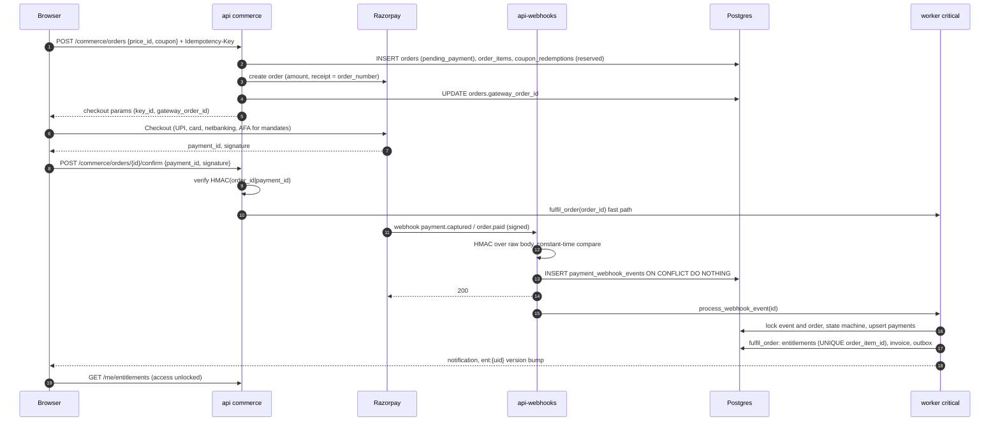

---

## 12. Media delivery (Planned, ADR-0007)

* **Video:** VdoCipher (Widevine/FairPlay DRM). `lesson_assets.provider='vdocipher'`, `provider_asset_id` = VdoCipher video id. Content managers upload directly to VdoCipher using its upload-credentials API; we store metadata only.
* **Playback OTP flow:** `POST /api/v1/media/playback-tokens {lesson_asset_id}`:
  1. `require_active_principal` + `require_feature("video")`;
  2. `entitlements.check_access(lesson)`;
  3. **stream cap:** `pg_advisory_xact_lock(hashtext('play:'||user_id))`; count `playback_sessions` with `status='active' AND last_heartbeat_at > now() − 90 s`; at cap (default 1 *(policy)*) → `409 playback_conflict` (brief §5) with the other device label and a "play here instead" option that marks the other session `revoked`;
  4. insert `playback_sessions` (`status='active'`, auth session, device);
  5. call VdoCipher `POST /api/videos/{id}/otp` with `ttl=300` and an `annotate` watermark (masked name + masked phone/email + short user id + timestamp, moving, low opacity — research §3 [Reported, vendor]);
  6. return `{otp, playbackInfo, playback_session_id}`. The player uses VdoCipher's JS API rather than a bare iframe because an iframe embed cannot show the user ID (research §3 [Verified]).
* **Heartbeat:** the player posts `POST /api/v1/media/playback-sessions/{id}/heartbeat` every 30 s (position, buffering) → updates `last_heartbeat_at` and `lesson_progress`. If the session was revoked (takeover, restriction), the response is `{"state":"revoked"}` and the player stops. A DRM stream that is already licensed cannot be killed server-side; enforcement is OTP issuance + cooperative stop + short TTL (§22).
* **Other files:** private S3 buckets (SSE-KMS, Block Public Access) served through CloudFront with Origin Access Control; per-request **CloudFront signed URLs** (TTL 5 min) after entitlement checks; uploads via S3 presigned POST with content-type and size conditions, malware scan (GuardDuty Malware Protection for S3) before an asset becomes `available`.
* Android app (later): FLAG_SECURE, VdoCipher SDK (research §6 [Rec]).

---

## 13. Analytics pipeline overview (Planned, ADR-0004)

The Analytics Engineer owns event names, payload schemas and the time-on-task model (`docs/analytics-event-schema.md`). This section fixes only the transport and storage architecture.

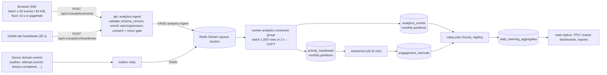

* Events are xAPI-shaped (actor, verb, object, context, result) for portability (research §6, Open edX [Verified]).
* **Consent and minors gate at ingest:** events whose purpose needs an opt-in consent (`analytics_personalisation`, `analytics_product`; brief v0.2 §1) are dropped when consent is absent/withdrawn; for `is_minor` users only events needed for learning delivery are stored and they are flagged `is_minor=true` so no downstream job uses them for risk or marketing (Brief §1).
* Dedupe: client-generated `event_id` (UUIDv7); the consumer uses `INSERT … ON CONFLICT DO NOTHING` on `(event_id, event_ts)`; raw tables are partitioned by `event_ts`, derived from the UUIDv7 `event_id` (analytics CP-1).
* Raw retention short (`analytics_events` 90 days, `activity_heartbeats` 35 days, `engagement_intervals` 13 months; brief v0.2 §1, PO-13) by dropping partitions via `pg_partman`; aggregates kept 24 months identifiable, then anonymised (research §8 retention table [Rec]).
* Dashboards query aggregates on the **read replica** only. ClickHouse/BigQuery evaluation triggers are in ADR-0004.

---

## 14. Background jobs (Planned, ADR-0008)

Celery 5 with the Redis `queue` cluster as broker (`acks_late=True`, `task_reject_on_worker_lost=True`, visibility timeout > longest task), results not stored in Redis (state lives in Postgres). All tasks are idempotent and take ids, never ORM objects.

| Queue | ECS service | Examples | SLO |
|---|---|---|---|
| `critical` | `worker-critical` | `process_webhook_event`, `fulfil_order`, `score_attempt`, attempt deadline sweeper, restriction propagation | p95 start < 2 s |
| `default` | `worker-default` | outbox relay fan-out, enrolment sync, recommendations refresh, certificate PDF render | < 30 s |
| `judge_assessment`, `judge_submit`, `judge_run` | `worker-judge` | judge-gateway | p95 verdict < 10 s (assessment) |
| `notifications` | `worker-notifications` | email/SMS/in-app delivery, pre-debit notices | OTP p95 < 5 s |
| `analytics` | `worker-analytics` | stream consumers, sessionization, rollups | lag < 5 min |
| `reports` | `worker-reports` | roster CSV import, exports (S3 + signed URL), invoices PDF | < 10 min |
| `maintenance` | `worker-default` | partition creation/drop (as DB role `td_maintenance`, `SECURITY DEFINER` `maint.*` functions only), retention purges, payment reconciliation, session cleanup (audit chain anchoring runs in `audit-sealer`) | n/a |

**Transactional outbox** (`outbox_events`*): modules write events in their own transaction; a relay (LISTEN/NOTIFY wake-up + 1 s poll, `FOR UPDATE SKIP LOCKED`) dispatches to in-process handlers or Celery tasks and marks `dispatched_at`. Guarantees at-least-once; handlers are idempotent by `event_id`.

**Scheduler (Celery beat, single replica with Redis leader lock):**

| Job | Schedule |
|---|---|
| Attempt deadline sweeper (Redis ZSET) / DB safety sweeper | 5 s / 60 s |
| Outbox relay safety poll | 1 s |
| Audit chain sealer (`audit_outbox` → `audit_log`; `audit-sealer` service) | 2 s |
| Audit chain head anchor to S3 Object Lock | hourly |
| Payment reconciliation | 10 min |
| Entitlement expiry + subscription grace checks; pre-debit reminder (≥ 24 h before debit, research §4 [Reported]) | hourly |
| Playback/auth session reaper (expired → `expired`) | 5 min |
| Sessionization / hourly rollup / nightly rollups + percentiles | 5 min / hourly / 02:00 IST |
| Recommendations nightly refresh | 03:00 IST |
| Partition maintenance (pg_partman premake, via `maint.run_partition_maintenance()` as `td_maintenance`) | daily 01:00 IST |
| Retention purges and expired-partition drops (`maint.drop_expired_partitions()`, `td_maintenance`) | per `privacy-and-data-retention.md` §7 (03:00 / 03:30 / 04:00 IST; privacy doc authoritative) |

The audit chain sealer runs in its own `audit-sealer` ECS service (§3), not in `scheduler` or a shared worker.

---

## 15. Caching (Planned)

Redis `cache` cluster; Postgres is always the source of truth. Versioned keys (`…:v{n}`) are invalidated by bumping a version counter inside the outbox handler of the change.

| Key | Content | TTL | Invalidation |
|---|---|---|---|
| `sess:{token_hash}` | session row subset | idle remaining | revoke → DEL; `user_sess:{uid}` set tracks keys |
| `restr:{uid}:v{n}` / `restr_ver:{uid}` | active restrictions | 10 min | `restriction.*` bumps version |
| `grants:{uid}:v{n}` | scope → permission set | 10 min | `grant.changed` |
| `ent:{uid}:v{n}` | active entitlements | 10 min | `entitlement.*` |
| `user:{uid}:status` | status, is_minor, consents pending | 5 min | identity events |
| `policy:{key}:{org}` | effective `policy_settings` | 5 min | `policy.changed` |
| `qv:{id}:delivery` | key-stripped question payload (immutable) | 7 days | never (immutable versions) |
| `pool:{test}:v{n}` | candidate pools per rule | 24 h | test republish creates a new version |
| `catalog:course:{id}:v{n}` | published course outline | 1 h | `course.published` |
| `rl:*` | rate-limit sliding windows (login, OTP, judge, API) | window | n/a |
| `idem:*`, `lock:*` | short locks | ≤ 60 s | n/a |

HTTP caching: public catalog/company-hub pages are SSR with `s-maxage` at CloudFront + on-demand revalidation on publish; authenticated responses are `Cache-Control: no-store`.

---

## 16. Notifications (Planned)

* `notifications` module exposes `notify(user_id, template_key, data, channels, priority)`; producers usually trigger it via domain events. Each notification is a row in `notifications` (in-app feed + delivery status per channel).
* Channels: SES email (ap-south-1, DKIM/SPF/DMARC, bounce/complaint SNS → suppression), SMS via MSG91 (or similar) with **DLT-registered templates** (Indian TRAI requirement for commercial SMS), in-app (feed polled/SSE). Push later for mobile.
* Templates versioned in code (`notifications/templates/<key>/<locale>.<channel>.jinja`); security and transactional notices (OTP, restriction notice, payment receipt, pre-debit notice) bypass marketing preferences; marketing requires `consents` (`marketing_email`/`marketing_sms`) and is never sent to minors.
* OTP abuse controls: per-number, per-IP, per-device quotas and daily spend cap; SMS-pumping detection (research §8, OWASP API4/API6 [Verified]).

---

## 17. Observability (Planned)

* **Tracing:** OpenTelemetry SDKs in Next.js (server), FastAPI (ASGI + SQLAlchemy + Redis + httpx instrumentation) and Celery (context propagated in task headers). W3C `traceparent` from BFF → API → worker → outbound calls. OTel Collector runs as an ECS sidecar exporting to AWS X-Ray and CloudWatch (ap-south-1). Sampling: 10 % head-based + 100 % of errors and of slow spans (tail sampling in collector).
* **Metrics:** RED per route (rate, errors, duration), plus domain SLIs: autosave p95 latency and failure rate, attempt start p95, auto-submit lag, judge queue age and verdict latency, webhook processing lag and failure count, outbox lag, analytics stream lag, login success/failure and OTP send rates, DB pool saturation, Redis memory. CloudWatch dashboards + alarms → SNS → on-call.
* **Logs:** structured JSON (`request_id`, `trace_id`, `user_id` pseudonymous, `org_id`, `module`, `event`), CloudWatch Logs in ap-south-1. Security/auth logs retained **≥ 1 year** (180 days hot in CloudWatch, then S3 Glacier in ap-south-1) — Brief §1, CERT-In 180 days, DPDP Rule 6 [Verified]. Redaction filter blocks session tokens, OTPs, passwords, Authorization headers, answer keys, hidden test data, full phone/email (masked).
* **Time:** all hosts use Amazon Time Sync; CERT-In NTP-alignment requirement noted for DevOps (research §8 [Verified via commentary]).
* **Audit:** `audit_log` is separate from operational logs (§21).

---

## 18. Deployment architecture overview (Planned — DevOps owns detail)

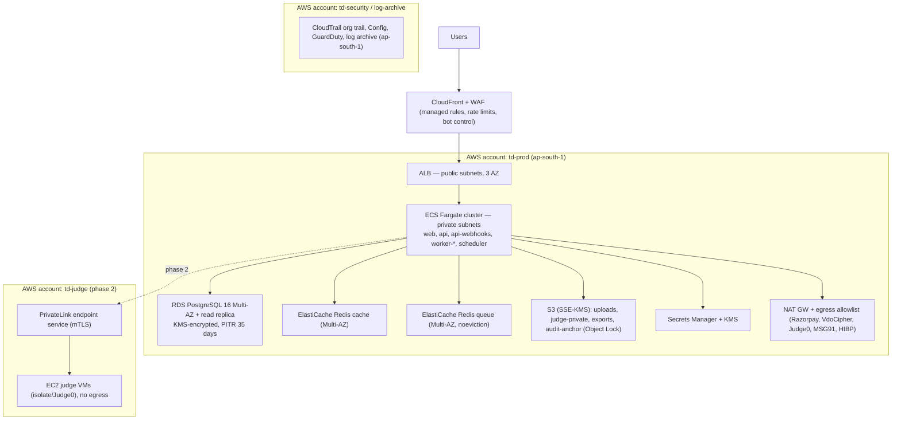

* Environments: `dev`, `staging` (production-like, anonymised data only), `prod` — separate AWS accounts under AWS Organizations.
* IaC: Terraform in `infra/terraform` (modules per component); CI/CD GitHub Actions → build one backend image (api/worker/scheduler entrypoints) and one web image → ECR (scan) → deploy with ECS rolling/blue-green (CodeDeploy) after `alembic upgrade` runs as a one-off ECS task (ADR-0009).
* Data in ap-south-1 only; backups (RDS snapshots, S3) stay in-region (cross-region DR to ap-south-2 Hyderabad is a later decision for DevOps).

---

## 19. Scalability plan (Planned)

### 19.1 Load model

| Quantity | Assumption | Derived |
|---|---|---|
| Concurrent users | 5,000 | — |
| Steady API rate | ~0.2 req/s/user (navigation, heartbeats 1/30 s, analytics batch 1/10–30 s) | ~1,000 req/s peak through BFF |
| Concurrent test-takers | 2,000 | autosave ≤ 1 per 10 s per user while dirty ⇒ ≤ 200 writes/s (upper bound with 5 s debounce ≈ 400/s) |
| Test start burst | 2,000 starts in ~2 min | ~17 starts/s; pools pre-cached; question payloads cached |
| Submit burst | 2,000 auto-submits within ~10 s of a shared deadline | ≈ 200 scoring tasks/s enqueued; ~50 ms each ⇒ ~2,000 task-seconds drained by 16 concurrent workers in ~10 s |
| Coding (drive day) | 2,000 × 3 problems × ~10 submissions (research §8 [Rec]) | ~60k submissions/day, ~8/s at peak hour; exceeds Judge0 Cloud 10k/day tier ⇒ overage or phase-2 self-host |
| Analytics | ~500 events/s peak | ~3–10 M rows/day; ~45–150 GB/month raw before compression |
| Video | ≤ 5,000 concurrent streams (served by VdoCipher CDN) | our load: OTP issuance + 1 heartbeat/30 s ⇒ ~170 req/s |

### 19.2 Initial sizing (to be load-tested)

| Component | Start | Scale rule |
|---|---|---|
| `web` | 3 × (1 vCPU, 2 GB) | target 60 % CPU / ALB 300 req/target; max 12 |
| `api` | 4 × (2 vCPU, 4 GB), 4 uvicorn workers | target 55 % CPU and p95 < 300 ms; max 16; scheduled pre-scale before announced drives |
| `api-webhooks` | 2 × (0.5 vCPU) | max 4 |
| `worker-critical` | 2 × concurrency 8 | queue age > 2 s |
| `worker-judge` | 2 × concurrency 16 (I/O-bound) | queue age; capped by provider quota |
| other workers | 1–2 each | queue depth |
| RDS | db.r7g.xlarge (4 vCPU, 32 GB) Multi-AZ + 1 replica, gp3 500 GB / 12k IOPS | vertical to 2xlarge; replica for reads |
| Redis cache / queue | cache.r7g.large each, Multi-AZ | memory |

Connection budget: 16 api tasks × 4 workers × pool 5 + workers ≈ 450 connections < RDS limit; SQLAlchemy pools sized conservatively. RDS Proxy/PgBouncer (transaction mode) is introduced only if needed — RLS context uses transaction-local `set_config(..., true)` so it is pooler-compatible, but RDS Proxy pinning behaviour must be verified first (§22).

### 19.3 Hot-path tactics

* Assessment: cached pools and payloads; single-row upserts; `attempt_events` batched multi-row INSERT per request; partitioned `attempt_events`; no synchronous scoring on submit.
* Drive mode: trainers schedule drives in `test_assignments`; the scheduler pre-warms caches and pre-scales ECS 30 min before `available_from`.
* Writes that do not need synchronous durability (analytics, heartbeats) go through Redis Streams and COPY.
* Read-heavy dashboards on the read replica and aggregate tables only.
* Partitioned high-volume tables (see schema §1.4) with `pg_partman`; BRIN indexes on time columns.

---

## 20. Monorepo layout (Planned)

```
techdrona-lms/
├── apps/
│   ├── web/                      # Next.js App Router (TS, Tailwind), BFF route handlers, server actions
│   │   ├── app/(public)/ (student)/ (org)/ (staff)/ (admin)/
│   │   ├── app/api/v1/[...path]/route.ts   # thin authenticated proxy to api
│   │   └── lib/attempt-sync/      # IndexedDB mirror + autosave loop
│   └── api/                      # FastAPI modular monolith + Celery workers (one image)
│       ├── app/core/  app/modules/<18 modules>/
│       ├── migrations/           # Alembic — single migration owner (ADR-0009)
│       ├── tests/  (unit, integration w/ Testcontainers Postgres+Redis, contract)
│       └── pyproject.toml        # uv-managed; import-linter config
├── services/
│   └── judge-runner/             # Phase 2 only: hardened Judge0/isolate image + config (no app code)
├── packages/
│   ├── ui/                       # own component library (Tailwind, Radix primitives)
│   ├── api-client/               # TS client generated from FastAPI OpenAPI (CI-checked)
│   ├── event-schemas/            # JSON Schemas for analytics + domain events (owned by Analytics/Arch)
│   ├── config-eslint/  config-tsconfig/
├── infra/
│   ├── terraform/{modules,envs/dev,envs/staging,envs/prod,envs/judge}
│   └── docker/                   # local docker-compose: postgres16, redis x2, minio, mailpit
├── docs/                         # blueprint docs, ADRs, runbooks
├── tools/                        # scripts: seed data, partition checks, ownership-manifest checker
└── .github/workflows/
```

`judge-gateway` is a sub-package of the `coding` module, deployed as the `worker-judge` service; `services/judge-runner` contains only the phase-2 executor image (ADR-0005).

---

## 21. Cross-cutting concerns

* **Audit (append-only, hash-chained):** `core.audit.record(action, target, before, after, reason)` writes `audit_outbox` in the business transaction. A single sealer (leader-locked) moves rows in order into `audit_log`, assigning `seq` and `row_hash = sha256(prev_hash ‖ canonical_json(row))`. `td_app` has only INSERT on `audit_outbox` and SELECT on `audit_log`; UPDATE/DELETE revoked from all roles; expired partitions are dropped only by `td_maintenance` through the `SECURITY DEFINER` function `maint.drop_expired_partitions(parent)` (owned by `td_owner`, drops only partitions whose upper bound is older than the `retention_policies` value; schema §1.2); hourly chain-head anchoring to S3 Object Lock (compliance mode) makes tampering detectable. Always audited: role grants, restriction impose/lift, device resets, session kills, grade overrides, refunds, coupon creation, bulk exports, hidden-test views, policy changes (research §5 OWASP + DPDP Rule 6(c) [Verified]).
* **Privacy providers:** each module's `privacy_provider.py` implements `describe()`, `export(user_id)`, `erase(user_id, mode)`; the Security Specialist's privacy doc defines the request workflow and retention registry (research §6 Moodle `tool_dataprivacy` [Rec]).
* **Errors:** RFC 9457 problem+json, stable `code` values (e.g. `account_restricted`, `playback_conflict`, `attempt_bound_elsewhere`, `attempt_closed`, `step_up_required`, `mfa_enrolment_required`, `entitlement_required`, `idempotency_key_reuse`, `maintenance`). Server errors go to self-hosted GlitchTip in ap-south-1 (ADR-0014).
* **Security baseline:** ASVS 5.0 L2; `/docs` and `/openapi.json` disabled in prod (research §8 [Verified]); Pydantic `extra="forbid"`; secrets only in Secrets Manager; KMS envelope encryption for TOTP secrets and hidden tests.
* **Time & IDs:** UTC `timestamptz` everywhere; UUIDv7 generated in the application (ADR-0012); money as integer paise.

---

## 22. Open risks

| # | Risk | Mitigation / owner |
|---|---|---|
| 1 | Judge0 Cloud quota/rate limits unknown for drive peaks (~60k/day) and hidden tests leave our boundary | Contract + load test; token bucket; accelerate phase-2 self-host before first large drive (Architect/DevOps) |
| 2 | DRM stream already licensed cannot be killed server-side; stream cap is enforced at OTP issuance + cooperative stop | Short OTP TTL; verify VdoCipher license-duration/concurrency options (Architect, vendor) |
| 3 | Whether assessment integrity events / device caps count as "behavioural monitoring" of minors (DPDP s.9(3)) | Security/Privacy + counsel (research §8 open legal Q2) |
| 4 | RDS Proxy session pinning with `set_config` RLS context | Avoid proxy in v1; verify before adopting |
| 5 | Audit sealer is a single serialised writer | Volume is modest (privileged actions); measured; can shard chain by month partition if needed |
| 6 | Analytics raw volume could exceed Postgres comfort (≥ 150 GB/month) | ADR-0004 triggers for ClickHouse evaluation; short raw retention |
| 7 | Razorpay UPI webhook delays (24–36 h) vs access continuity | 5-day grace (`commerce.subscription_grace_days`) + reconciliation polling |
| 8 | SMS OTP cost abuse and DLT template approval lead time | Quotas, spend caps; start DLT registration early (DevOps/Product) |
| 9 | Auto-submit burst at shared deadlines | Critical queue headroom, pre-scaling, idempotent scoring |
| 10 | Schema columns for security/analytics tables are assumptions until Security/Analytics confirm | `database-schema.md` §15 "Columns pending confirmation" |

---

## 23. Contract change proposals

Reconciled by the Integration Lead in `contract-reconciliation.md` §2.2; outcomes are in the last column and are reflected in brief v0.2 and `database-schema.md`.

| # | Proposal | Reason | Reconciliation outcome |
|---|---|---|---|
| CCP-1 | Add tables `outbox_events`, `idempotency_keys` (core) | Transactional outbox for reliable events; durable Idempotency-Key storage required by Brief §5 for money/attempt/submission POSTs | → Accepted in brief v0.2 (single outbox, also serves analytics CP-8) |
| CCP-2 | Add `audit_outbox` (audit) | Hash chain needs a single ordered sealer; business transactions write the outbox, sealer appends to `audit_log` | → Accepted in brief v0.2 |
| CCP-3 | Add `test_assignments`, `attempt_overrides`, `attempt_sections` (assessments) | Batch/drive scheduling windows, per-user/batch extra time (research §5 [Verified]), sectional timers (research §2) | → Accepted in brief v0.2 (merged with PRD CCP-09) |
| CCP-4 | Add `practice_sessions`, `practice_responses`, `user_topic_mastery`, `recommendations`, `company_path_steps` (placement) | Adaptive practice, rule-based recommendations, ordered company paths | → Accepted-modified: all except `user_topic_mastery`, which becomes analytics-owned `topic_mastery` (analytics CP-11) |
| CCP-5 | Add `product_items`, `invoice_sequences` (commerce) | Map products to unlocked resources for the access check; gap-free GST invoice numbering per financial year | → Accepted in brief v0.2 |
| CCP-6 | Add `judge_languages` (coding) | Per-language limits and provider language ids | → Accepted in brief v0.2 |
| CCP-7 | Assign `policy_settings` and `feature_flags` to the `admin` module (Brief §4 lists `policy_settings` under Security entities while §2 lists "policy settings" under `admin`) | One owner per table; `security` is the main consumer via `core.policy` | → Accepted in brief v0.2 |
| CCP-8 | `playback_sessions` owned by `sessions` module (listed under Sessions/devices in §4); `media` only orchestrates OTP issuance | Keeps all concurrency caps in one module | → Accepted in brief v0.2 |
| CCP-9 | Second Redis cluster (`queue`, `noeviction`) separate from cache | Broker/streams must never be evicted, cache must be | → Accepted in brief v0.2 |
| CCP-10 | `api-webhooks` as a separate ECS service from the same image | Isolation of payment webhooks from user traffic; still one deployable codebase (no microservice) | → Accepted in brief v0.2 |
| CCP-11 | `lessons.lesson_key` stable identifier across `course_versions`; progress keyed by it | Course republishing must not reset student progress | → Accepted in brief v0.2 |
| CCP-12 | Brief §1 calls for "only SHA-256 hash stored" — also applied to device tokens (`devices.device_token_hash`), verification/reset tokens, and identifiers in `login_attempts` (HMAC) | Consistency with the session-token rule | → Accepted-modified: keyed HMAC-SHA-256 for the device cookie (`devices.device_key_hash`) and login identifiers; SHA-256 for session, verification, reset and invite tokens |
| CCP-13 | Add `privacy_requests` (owned by Security/Privacy if they adopt it) — not defined here | DPDP export/erasure workflow; left to Security Specialist | → Accepted (merged with PRD CCP-07 / SEC CCP-S2; owner `admin` privacy sub-package) |


---

## 24. Implemented kernel and extension-point architecture (v0.5, Stage 10)

Status: **Implemented** (code in `apps/api/app/core/` and `apps/api/app/modules/*`), **Tested** where a test pointer is given. Wiring that is still open is marked **Open** with its `docs/stage10-integration-backlog.md` item. This section describes the code as built; where it differs from §4–§14 above, this section wins.

### 24.1 Application assembly

- `app/main.py` auto-discovers routers: every `app.modules.<name>.router` exposing `router: APIRouter` is mounted under `/api/v1`; a module may also expose `webhook_router`. `TD_ROUTER_SET` selects `user` (the `api` service), `webhooks` (the `api-webhooks` service) or `all` (local dev/tests). Modules never edit `main.py`.
- Health: `GET /healthz` (container/ALB liveness, outside `/api/v1`) plus the `/api/v1` health router (`app/core/health.py`).
- ASGI middleware: `RequestContextMiddleware` (request id, trace context), `ServiceAuthMiddleware` (BFF → api service token `TD_SERVICE_TOKEN`, with `TD_SERVICE_TOKEN_PREVIOUS` for rotation), `BodyLimitMiddleware` (`TD_MAX_BODY_BYTES`).
- Errors: `app/core/errors.py` installs the RFC 9457 handlers; modules raise API errors only through `ProblemError(code, **extra)` (codes in `api-specification.md` §1 and §28).
- Startup gate: `app/core/startup_checks.run_startup_checks` refuses to boot in production with any fake adapter, local KMS key, weak keyring, DEBUG logging, enabled API docs, insecure cookies or placeholder service token. Modules add checks with `register_fake_adapter(name, predicate)` (used by coding, the commerce gateway, media providers and notifications adapters).

### 24.2 Core extension points (`app.core`)

| Hook | Defined in | Registered by | Purpose |
|---|---|---|---|
| `register_session_resolver` | `core/auth.py` | `sessions/router.py` (`SessionsResolver`) | `require_active_principal` (single enforcement point, ADR-0002) delegates session validation. Unregistered ⇒ every authenticated route answers `401 unauthenticated` (fail closed). A defensive scope gate (`routing.scope_allows`) runs again after the resolver. |
| `register_permission_checker` | `core/auth.py` | `rbac/router.py` | Permission + scope checks for `require_permission`. A public `check_permission` getter is still **Open** (backlog A11). |
| `register_access_checker` | `core/access.py` | `entitlements/router.py` | `check_access` / `require_access(resource_type, id, is_free=)` for `course`, `lesson`, `resource`, `test`, `question_set`, `coding_problem`, `company_path`, `product`. Unregistered ⇒ only free content is allowed (fail closed); a denial raises `403 entitlement_required`. Tests: `apps/api/tests/entitlements/test_access_and_seats.py`. |
| `outbox.emit_event` / `register_handler` | `core/outbox.py` | No module subscribes yet (**Open**, backlog A3) | Transactional outbox (`outbox_events`). Event types match `^[a-z][a-z0-9_]*(\.[a-z][a-z0-9_]*)+$`. The relay (`relay_pending`, `FOR UPDATE SKIP LOCKED`, batch `TD_OUTBOX_RELAY_BATCH`, max attempts `TD_OUTBOX_MAX_ATTEMPTS`) runs handlers inside its own transaction under `system_context`. Handler DB writes commit atomically with `dispatched_at`; a failing handler rolls the batch item back and the event is retried. Events with no handler are marked dispatched. Tests: `apps/api/tests/core/test_outbox_relay_and_worker.py`. |
| `jobs.register_periodic` | `core/jobs.py` | `worker.register_core_jobs`: `core.outbox_relay` every `TD_OUTBOX_RELAY_INTERVAL_SECONDS` on `critical`; `core.audit_seal` when `TD_AUDIT_SEALER_BEAT_ENABLED` | Celery beat registry. `app.worker.create_celery` imports all models, discovers `app.modules.*.tasks` (calling an optional `register_celery_tasks(capp)`, used by coding), then builds `beat_schedule`. Module jobs (security decay/SLA jobs, the assessments deadline sweeper, analytics rollups) exist as functions but are **not yet registered** with beat (backlog A3, A4). |
| `register_fake_adapter` | `core/startup_checks.py` | coding, commerce, media, notifications | See 24.1. |
| Keyrings | `core/security.py` (`HmacKeyring`, `get_keyring`); `core/crypto.py` (`AeadKeyring`, `get_aead_keyring`) | env | HMAC keyrings (`TD_K_DEVICE_*`, `TD_K_LOGIN_*`) and AES-256-GCM AEAD keyrings (`TD_K_TOTP_*`, `TD_K_TESTCASE_*`). Keys are `TD_K_<NAME>_KEY_V{n}` (64 hex chars) plus `TD_K_<NAME>_ACTIVE_VERSION`; ciphertext format `v{n}:{nonce}:{ct‖tag}`. Rotation = add `V{n+1}`, flip the active version, re-encrypt, retire the old key. KMS wrapping (`TD_APP_ENVELOPE_KMS_KEY_ID`) is **Planned**; the `v{n}` prefix leaves room for a `kms{n}:` scheme. Hidden coding test cases are stored encrypted in the `coding_test_case_blobs` table until S3/KMS is wired. |
| `db.tenant_context` / `system_context` | `core/db.py` | all modules | Sets the RLS settings per transaction (ADR-0003); `system_context(session, reason)` is the platform bypass used by relays, the sealer and resolvers. |
| `audit()` | `core/audit.py` | all modules | Writes `audit_outbox`; `modules/audit/sealer.py` seals it into the hash-chained `audit_log`. |

### 24.3 Module-to-module hooks

| Hook | Owner | Wired by | State |
|---|---|---|---|
| `entitlements.register_resource_parent_resolver` | entitlements | — | **Open** (A1): catalog lessons and coding problems must register their parents. |
| `entitlements.register_usage_provider` | entitlements | — | **Open** (A2): learning consumption % for refund and seat-release rules. |
| `learning.register_video_coverage_lookup` | learning | — | **Open** (A3): analytics `watched_seconds_for_lesson`. |
| `learning.register_final_test_lookup` | learning | — | **Open**. |
| `catalog.register_publish_hook` | catalog | `learning/router.py` | Implemented. |
| `rbac.register_course_org_lookup` | rbac | `catalog/router.py` | Implemented. |
| `identity.register_policy_resolver` | identity | `admin/router.py` (`policy_settings`) | Implemented. |
| `sessions.register_security_events` / `register_restriction_lookup` | sessions | `security/router.py` | Implemented. |
| `sessions.register_consent_requirement` | sessions | — | **Open**. |
| `sessions.register_active_attempt_lookup` | sessions | `assessments/router.py` | Implemented (attempt idle hold and binding). |
| `analytics.register_org_resolver` / `register_lesson_meta_lookup` / `register_engagement_toucher` | analytics | — | **Open** (A3, A4: `touch_engaged`). |
| `security.register_engaged_bucket_feed` | security | — | **Open**: the analytics feed is not attached yet. |
| `coding.register_attempt_validator` | coding | — | **Open** (A4): coding questions inside timed tests. |
| `admin.approvals.register(ApprovalHandler)` | admin | `admin/router.py`, `security/controls.register_handlers` | Implemented: dual-control executor registry keyed by `action_type`. Approver ≠ requester (`sod_violation`); the payload hash is re-verified. Security registers `risk.kill_switch.ratify`, `risk.ruleset.activate`, `risk.ruleset.rollback`, `security.restriction.bulk_lift` and export approval. The `approval_requests` table is created by the rbac migration. |

### 24.4 Domain events as built

| Event | Emitted by | Consumed by |
|---|---|---|
| `attempt.scored` (replaces the blueprint name `attempt.graded`) | `assessments/attempts.py` | `analytics/consumer.py`, which stores it as `assessment.attempt_scored` and also handles `assessment.attempt_submitted` and `assessment.auto_submitted`. The consumer polls until it moves onto `outbox.register_handler` (A3). Placement recommendations (§7.4) will subscribe once implemented. |

The other events in §4.2 are emitted through `emit_event` where the module is implemented; `docs/analytics-event-schema.md` has the analytics catalogue.

### 24.5 Fakes and adapters

Every external provider sits behind an adapter with a local fake: payments `fake` (Razorpay adapter written but unverified; Cashfree verifies webhooks only), VdoCipher `stub`, Judge0 `fake`, email in-memory or SMTP to Mailpit, SMS `console`, a fake malware scanner, and S3 through SeaweedFS locally. The startup gate (24.1) blocks all of them in production. The full list with their switches is in `docs/implementation-status.md`.

### 24.6 Changelog

- v0.5 — 2026-11-03 (Stage 10 documentation sync): event name `attempt.scored` applied in §4.2, §7.4, §8.7 and §13; header status updated; §24 added.
